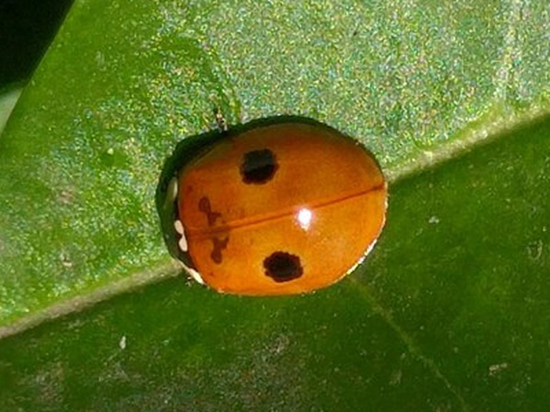
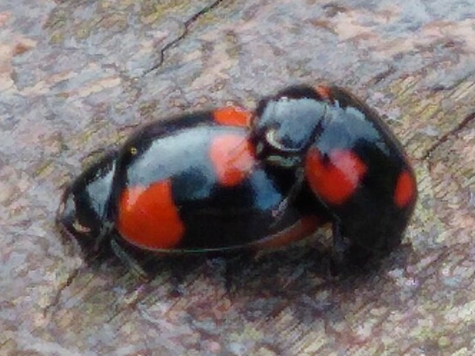
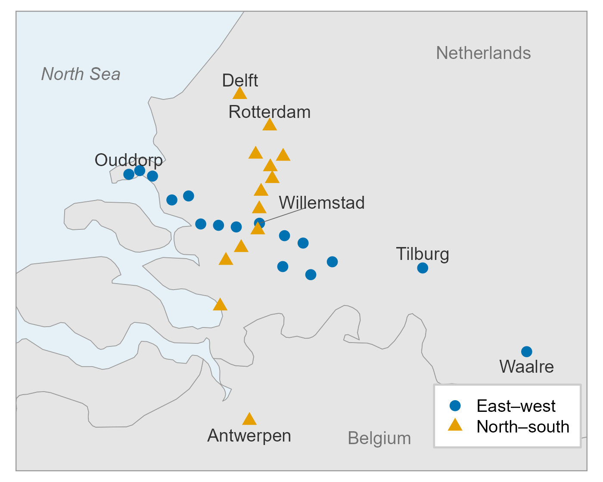
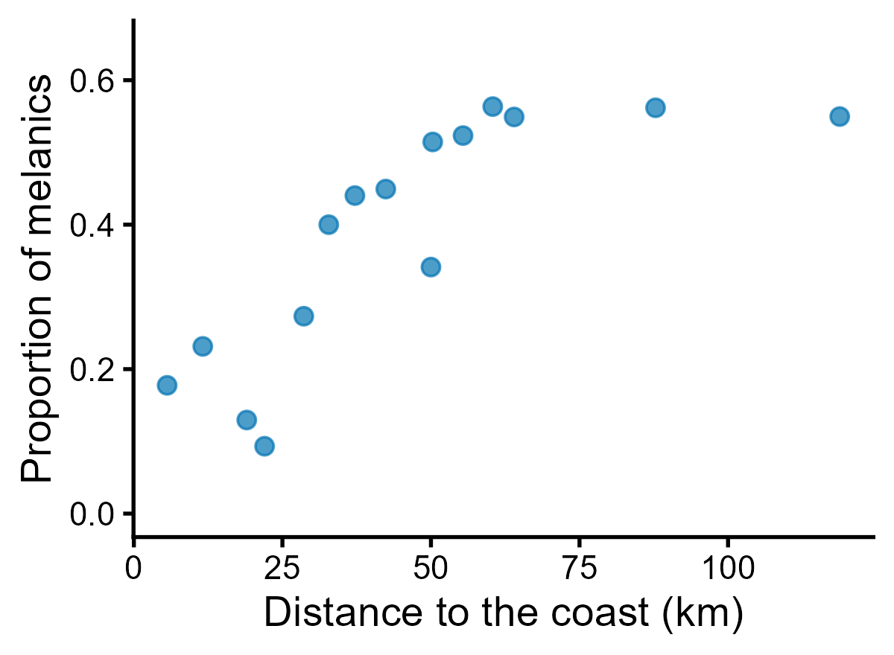

## The two-spot ladybird: one species, two colour classes {data-timing="120"}

:::: {.columns}
::: {.column width="33%"}
{fig-alt="A red two-spot ladybird with one black spot on each wing case, sitting on a green leaf."}

::: {.caption}
Non-melanic (*typica*): red with black spots.
:::
:::
::: {.column width="33%"}
{fig-alt="Two black two-spot ladybirds with large red spots, mating on a weathered wooden surface."}

::: {.caption}
Melanic: black with red spots.
:::
:::
::: {.column width="33%"}
{fig-alt="A black two-spot ladybird with four red spots mating with a red one on a green nettle leaf."}

::: {.caption}
Both classes mate with each other.
:::
:::
::::

::: {.incremental}
- **Polymorphism:** inherited colour morphs within one population.
- **Melanism:** the melanic alleles are dominant over the red one.
- **Thermal melanism:** black beetles warm up faster in spring sunshine.
- **Frequency of melanics:** differs from place to place.
:::

::: {.caption}
Photos: Rudolphous (CC BY-SA 4.0), jpuf (CC0), gailhampshire (CC BY 2.0), Wikimedia
Commons.
:::

## Two transects from the coast inland {.figure-slide data-timing="120"}

:::: {.columns}
::: {.column width="62%"}
{fig-alt="Map of the south-west Netherlands and northern Belgium. Blue circles mark 16 localities of the east–west transect, from Ouddorp on the North Sea coast inland past Willemstad and Tilburg to Waalre near Eindhoven. Orange triangles mark 14 localities of the north–south transect, from Delft past Rotterdam and Willemstad to Antwerpen in Belgium. The two transects cross at Willemstad."}
:::
::: {.column width="38%"}
::: {.incremental}
- **East–west:** 16 localities, 6 to 119 km from the coast.
- **North–south:** 14 localities, distance from Delft.
- **Surveys:** 1980 (1978–81), 1991, 1995, 1998, 2004.
- **Spring climate:** sunnier and windier at the coast.
:::
:::
::::

::: {.caption}
Blue circles: east–west transect. Orange triangles: north–south transect. Map: Natural
Earth; locations: © OpenStreetMap contributors.
:::

## The data: black and red beetles in each sample {data-timing="150"}

:::: {.columns}
::: {.column width="56%"}
```{.text code-line-numbers="false"}
transect place      year distance_km black   red
EW       Ouddorp    1980         5.6    19    88
EW       Oude Tonge 1980        28.6  4158 11059
EW       Etten L.   1980        60.4  2251  1744
EW       Ouddorp    2004         5.6    18    65
NS       Delft      1980         0.0   104  3389
```

::: {.incremental}
- **One row:** a locality in one survey.
- **Counts:** 35 to 15,217 beetles per sample.
- **Surveys:** repeated, not always complete.
:::
:::
::: {.column width="44%"}
{fig-alt="Proportion of melanic beetles in each of the 15 samples of the 1980 survey of the east–west transect against the distance to the coast. Near the coast the proportion is about 0.1 to 0.25; it rises steeply between about 25 and 50 km and stays at about 0.55 from 55 to 119 km. One sample at 50 km lies at about 0.34, below its neighbours."}

::: {.caption}
Blue: proportion of melanics per sample, 1980 survey, east–west.
:::
:::
::::

::: {.takeaway .fragment}
How does the frequency of melanism vary in space and change over time?
:::
