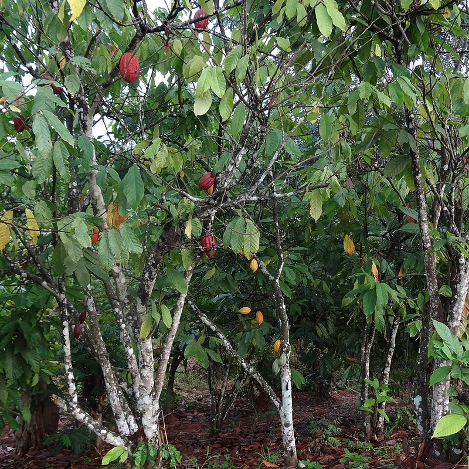
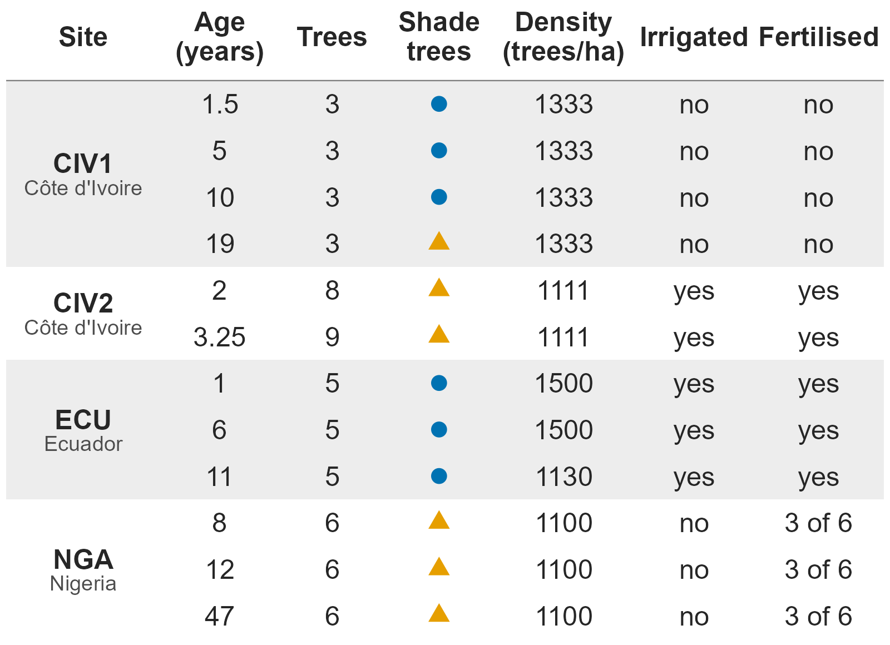
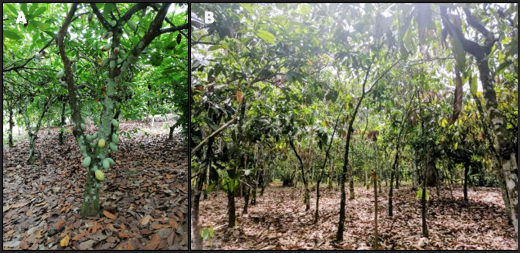
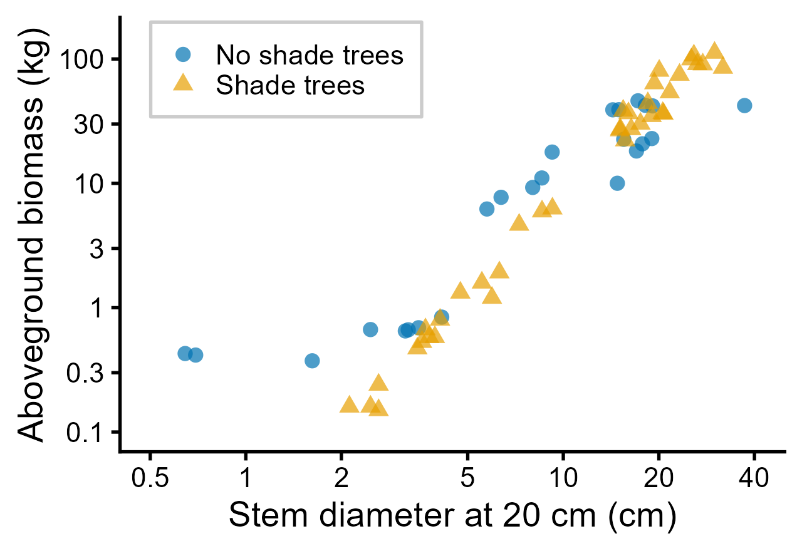

## Cocoa trees and allometry {data-timing="120"}

:::: {.columns}
::: {.column width="58%"}
::: {.incremental}
- **Allometric relation:** predicts a quantity that is hard to measure from a size that
  is easy to measure.
- **Cocoa trees:** aboveground biomass (kg) from the stem diameter at 20 cm above the
  soil.
- **Power law:** usually $y = a\,x^b$.
- **Use:** biomass and carbon stocks of plantations from diameters measured in the field.
- **Management:** shade trees and planting density may change the relation.
:::
:::
::: {.column width="42%"}
{fig-alt="Cocoa trees in a plantation in Côte d'Ivoire: several thin grey stems with white lichen patches branch low above a ground covered in brown leaf litter. Red and yellow pods hang from the stems and branches among large green leaves."}

::: {.caption}
Cocoa trees with pods, Côte d'Ivoire. Photo: Hanay (CC BY-SA 4.0), Wikimedia Commons.
:::
:::
::::

## Four sites, twelve fields {.figure-slide data-timing="120"}

:::: {.columns}
::: {.column width="60%"}
{fig-alt="Chart of the twelve fields, one row each, grouped by site. CIV1, Côte d'Ivoire: fields of 1.5, 5, 10 and 19 years, 3 trees each, 1333 trees/ha, not irrigated, not fertilised; only the 19-year field has shade trees. CIV2, Côte d'Ivoire: fields of 2 and 3.25 years with 8 and 9 trees, shade, 1111 trees/ha, irrigated and fertilised. ECU, Ecuador: fields of 1, 6 and 11 years, 5 trees each, no shade, 1500 trees/ha (1130 at 11 years), irrigated and fertilised. NGA, Nigeria: fields of 8, 12 and 47 years, 6 trees each, shade, 1100 trees/ha, not irrigated, 3 of the 6 trees fertilised."}

::: {.caption}
Orange triangles: fields with shade trees (plantain at CIV2). Blue circles: no shade
trees.
:::
:::
::: {.column width="40%"}
{fig-alt="Two photographs side by side. A: a single cocoa tree in full sun with green pods along its stem, on bare ground covered in dry leaves. B: a dense stand of thin, tall cocoa stems under a closed canopy of shade trees."}

::: {.caption}
A: full sun, Côte d'Ivoire. B: heavy shade, Ghana. Photos: Goudsmit et al. (unpublished
manuscript).
:::

::: {.incremental}
- **Harvest:** each tree cut, dried and weighed.
- **Field:** a plantation of one age at one site.
- **Management:** differs mostly between sites.
:::
:::
::::

## The data: one harvested tree per row {.figure-slide data-timing="150"}

:::: {.columns}
::: {.column width="46%"}
```{.text code-line-numbers="false"}
tree site age_years dia20_cm agb_kg shade
D4   ECU          1    0.695  0.416 no
T4   CIV2         2     3.94   0.58 yes
F5   CIV1         5    14.32  39.01 no
O8   NGA         12     17.5  30.13 yes
O17  NGA         47    29.95  112.1 yes
```

::: {.incremental}
- **One row:** one tree; 62 trees in 12 fields.
- **Aboveground biomass:** dry mass of wood and leaves.
- **Also recorded:** height, roots (53 trees) and management.
:::
:::
::: {.column width="54%"}
{fig-alt="Aboveground biomass against stem diameter at 20 cm for the 62 trees, both axes logarithmic. Diameters range from about 0.6 to 37 cm and biomass from about 0.15 to 112 kg. The points rise together from about 0.4 kg at the smallest diameters to about 100 kg at 25 to 30 cm. Trees with shade trees (orange triangles) and without (blue circles) overlap at most diameters; the lowest biomass, about 0.15 kg, belongs to shaded trees of 2 to 3 cm, and one unshaded tree of 37 cm has about 42 kg, less than the shaded trees of 25 to 30 cm."}

::: {.caption}
Blue circles: no shade trees. Orange triangles: shade trees. Log scales.
:::
:::
::::

::: {.takeaway .fragment}
Does management change how biomass grows with stem diameter?
:::
