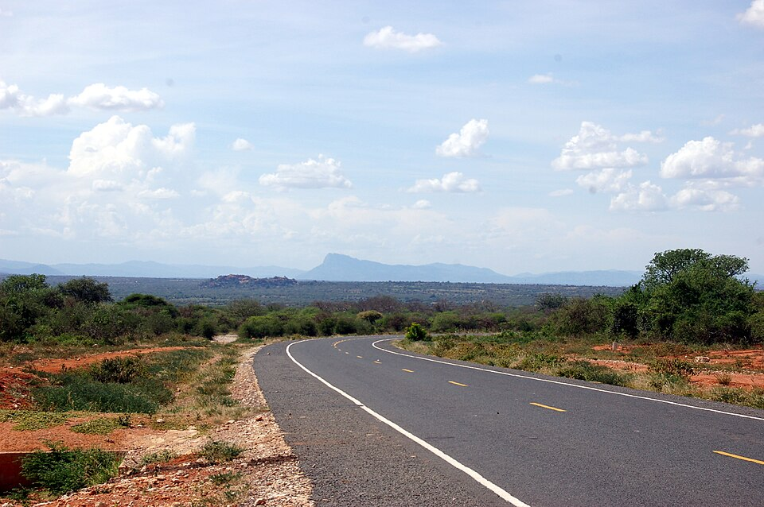
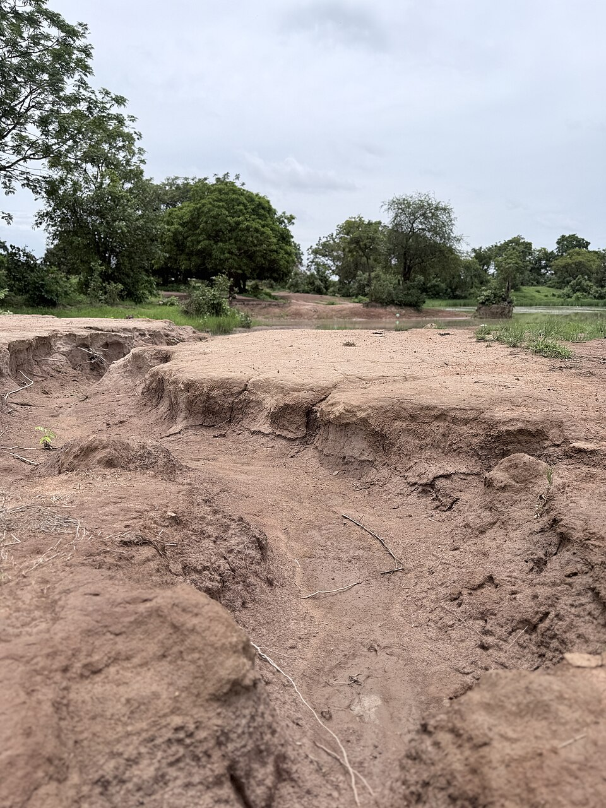
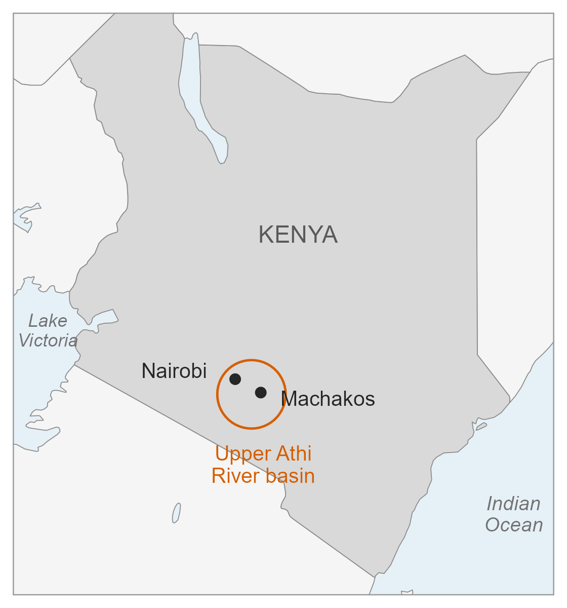
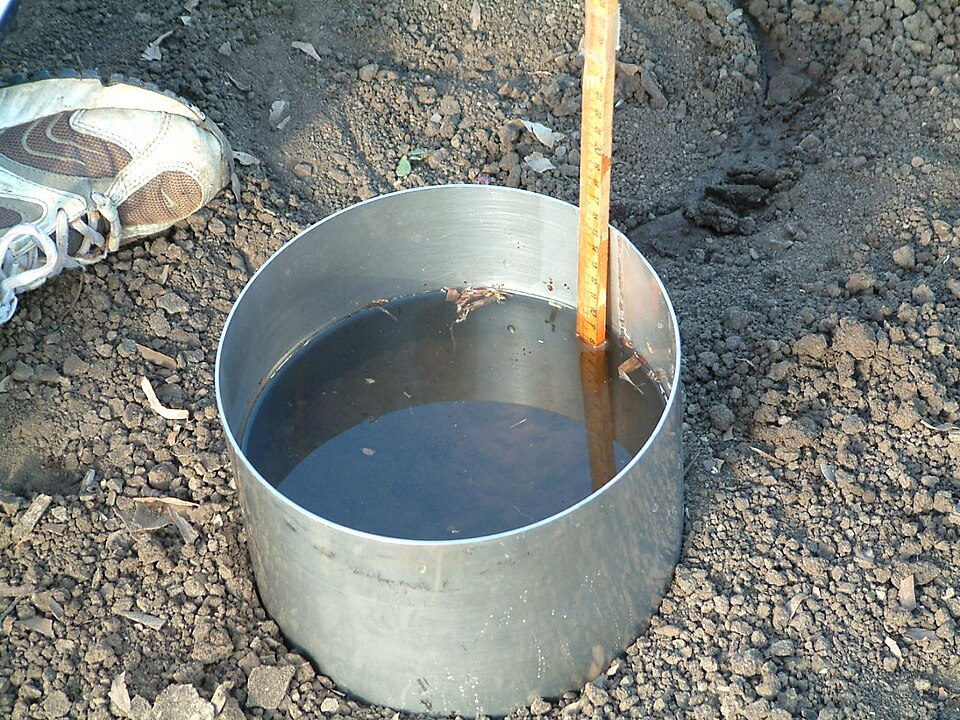
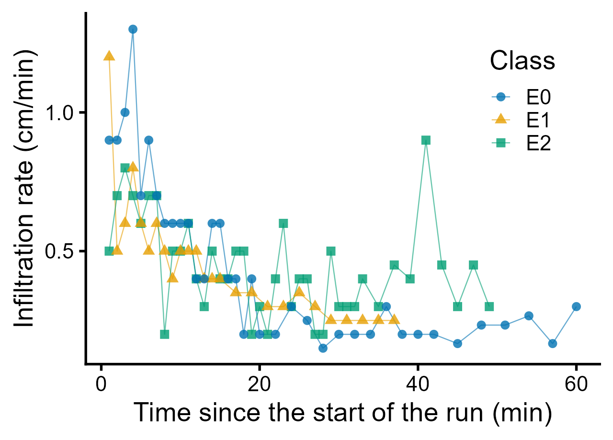

## Soil degradation and water infiltration {data-timing="120"}

:::: {.columns}
::: {.column width="58%"}
{fig-alt="A road through dry savannah near Machakos, Kenya: red bare soil at the roadside, scattered shrubs and acacia trees, and hills on the horizon under a blue sky." style="height: 330px; width: 100%; object-fit: cover;"}

::: {.caption}
Semi-arid savannah near Machakos, Kenya.
:::
:::
::: {.column width="42%"}
{fig-alt="A gully cut into bare, pale brown soil, with crumbling edges and exposed roots, and trees in the background." style="height: 330px; width: 100%; object-fit: cover;"}

::: {.caption}
Gully erosion, the most severe sign of degradation.
:::
:::
::::

::: {.incremental}
- **Infiltration:** the entry of water into the soil through its surface.
- **Physical degradation:** crusts, compaction and erosion block or remove the pores.
- **Semi-arid land:** water that does not infiltrate runs off and is lost to plants.
- **Question:** can infiltration measured in the field tell degraded from non-degraded soil?
:::

::: {.caption}
Photos: Steve Andersen (CC BY-SA 2.0), Suglo20 (CC BY-SA 4.0), Wikimedia Commons.
:::

## A field survey in the Upper Athi River basin, Kenya {.figure-slide data-timing="120"}

:::: {.columns}
::: {.column width="34%"}
{fig-alt="Map of Kenya with Lake Victoria to the west and the Indian Ocean to the south-east. Nairobi and Machakos are marked in the south of the country, and an orange circle around them marks the Upper Athi River basin, south-east of Nairobi."}
:::
::: {.column width="30%"}
{fig-alt="A metal ring pushed into bare, crumbly soil and filled with water, with a wooden ruler standing in the water to read its level."}

::: {.caption}
A single-ring infiltrometer: the water level is read as it falls.
:::
:::
::: {.column width="36%"}
::: {.incremental}
- **Survey:** plots of 30 m × 30 m, December 2002 to March 2003.
- **Classes by eye:** E0 no sign · E1 crust or compaction · E2 erosion.
- **Ring of 30 cm:** fall of the water level read every 1 or 2 minutes.
- **Our data:** one run on each of 30 plots.
:::
:::
::::

::: {.caption}
Orange circle: approximate position of the basin. Map: Natural Earth. Photo: Soil Physics
at English Wikipedia (public domain), Wikimedia Commons.
:::

## The data: infiltration rate over time in 30 plots {data-timing="150"}

:::: {.columns}
::: {.column width="56%"}
```{.text code-line-numbers="false"}
Sample PlotNo Erosion Time Rate Cumrate
     1   1lP3      E1    1  1.0     1.0
     2   1lP3      E1    2  3.0     4.0
     3   1lP3      E1    3  2.2     6.2
   ...
   138   5lP3      E2    1  0.5     0.5
   139   5lP3      E2    2  0.7     1.2
```

::: {.incremental}
- **One row:** a reading of one plot (time in min, rate in cm/min).
- **Runs:** 15 to 54 readings, 33 to 88 minutes.
- **Plots per class:** 7 in E0, 19 in E1, 4 in E2.
:::
:::
::: {.column width="44%"}
{fig-alt="Infiltration rate against time for three plots, one per class. In all three the rate starts between about 0.5 and 1.3 cm/min, falls quickly during the first 10 to 20 minutes and then varies around 0.2 to 0.5 cm/min, with much noise from reading to reading."}

::: {.caption}
Three plots, one per class (the run closest to the median of its class).
:::
:::
::::

::: {.takeaway .fragment}
Do the classes differ in how much water enters the soil, and in how the rate declines?
:::
