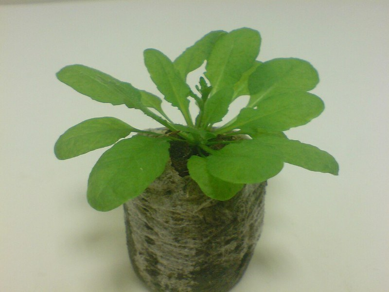
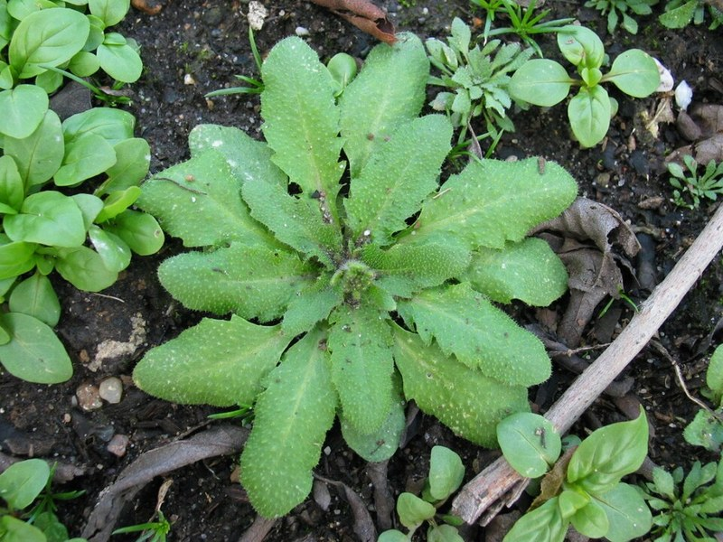
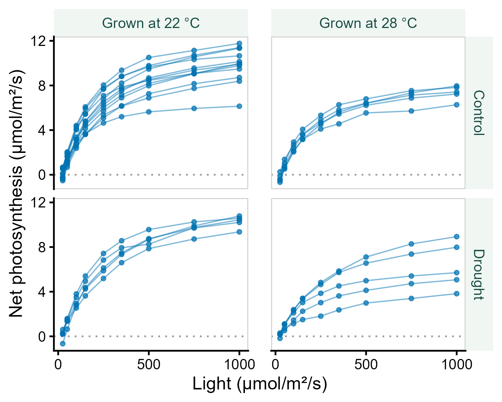

## Photosynthesis and light {data-timing="120"}

:::: {.columns}
::: {.column width="58%"}
::: {.incremental}
- **Net photosynthesis:** CO₂ fixed by the leaf minus CO₂ released by respiration.
- **Light response curve:** net photosynthesis of one leaf at a series of light levels.
- **Dim light:** the rate is limited by the light that the leaf absorbs.
- **Bright light:** the rate is limited by the capacity of the leaf.
:::
:::
::: {.column width="42%"}
{fig-alt="A young Arabidopsis plant with a rosette of about fifteen spoon-shaped green leaves, growing in a small peat pellet on a white surface."}

::: {.caption}
*Arabidopsis thaliana* Col-0, the plant of these data. Photo: Reo On (CC BY-SA 3.0),
Wikimedia Commons.
:::
:::
::::

## The experiment: growth temperature and drought {data-timing="120"}

:::: {.columns}
::: {.column width="58%"}
::: {.incremental}
- **Acclimation:** plants grown at 22 °C or 28 °C, all measured at 22 °C.
- **Progressive drought:** no water for 7 days before the measurement.
- **Five batches:** sown one week apart.
- **One curve per plant:** a leaf that fills the 6 cm² leaf chamber.
:::

| Curves | 22 °C | 28 °C |
|---|---|---|
| Control | 12 | 5 |
| Drought | 5 | 5 |
:::
::: {.column width="42%"}
{fig-alt="An Arabidopsis rosette seen from above: about twenty hairy, elongated green leaves radiate from the centre, where the flowering stem is just emerging, on dark soil among other seedlings."}

::: {.caption}
A rosette from above. Photo: Quentin Groom (public domain), Wikimedia Commons.
:::
:::
::::

## The data: nine light levels on each plant {.figure-slide data-timing="150"}

:::: {.columns}
::: {.column width="44%"}
```{.text code-line-numbers="false"}
Batch  T  W Replicate     P      I
    1 LT  C         1  0.64     25
    1 LT  C         1  6.14   1000
    1 HT  C         4 -0.40     25
    1 HT  D         5  3.82   1000
    4 HT  D        20  8.93   1000
```

::: {.incremental}
- **One row:** one light level on one plant.
- **Light:** 25 to 1,000 µmol/m²/s, from low to high.
- **Negative rates:** more CO₂ respired than fixed.
:::
:::
::: {.column width="56%"}
{fig-alt="Net photosynthesis against light in four panels: grown at 22 or 28 °C, control or drought, one line per plant. Every curve rises steeply up to about 250 µmol/m²/s and then more slowly up to 1000, without levelling off completely. At 22 °C the control plants reach about 6 to 12 µmol/m²/s at the highest light and the droughted plants about 9 to 11. At 28 °C the control plants reach about 6 to 8, and the droughted plants spread from about 4 to 9."}

::: {.caption}
Blue: net photosynthesis of each plant (µmol/m²/s), joined by lines.
:::
:::
::::

::: {.takeaway .fragment}
How do growth temperature and drought change the light response of a leaf?
:::
