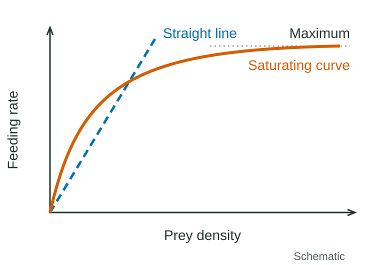
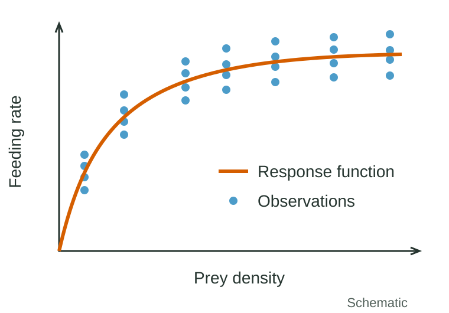
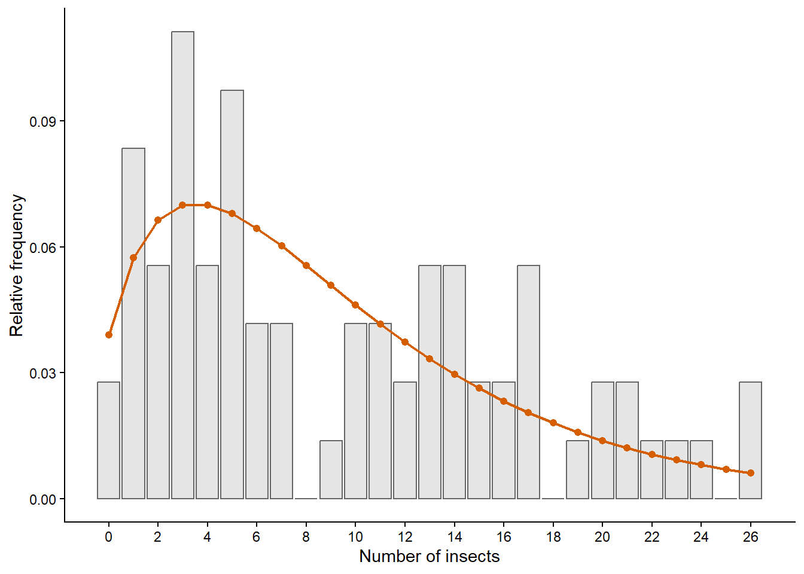
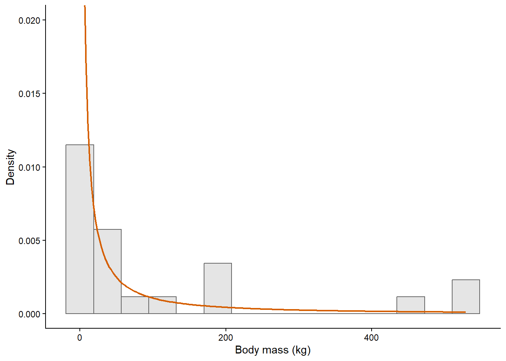
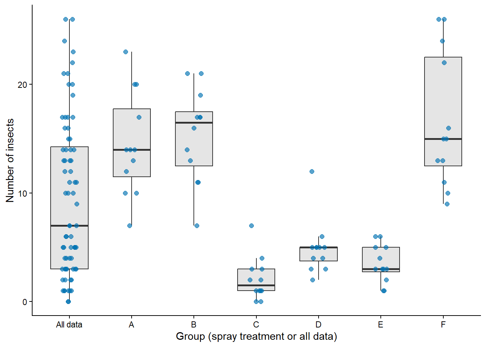
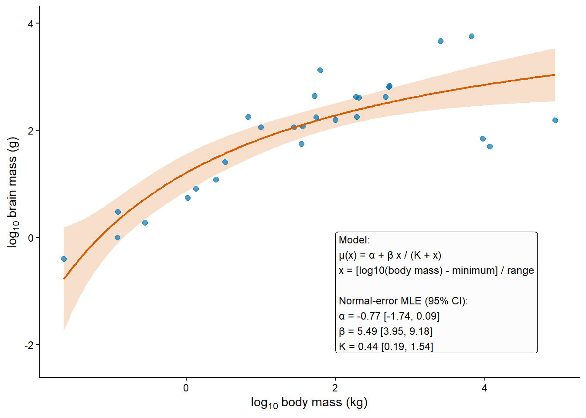
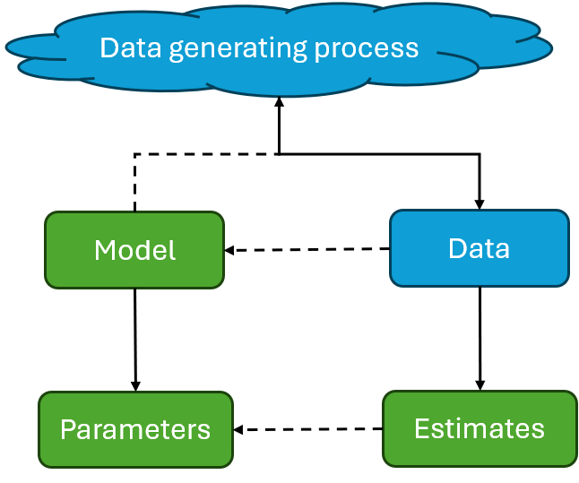

## Ecological Models and Data Analysis {.lecture-title data-timing="60"}

::: {.subtitle}
Chapter 1 · Lecture
:::

::: {.eyebrow}
Introduction and Course Overview
:::

## Overview of the lecture {data-timing="60"}

::: {.incremental}
1. **Research questions and models:** what do we want to know?
2. **The modeling cycle:** how do we integrate models and data?
3. **Variation, noise, stochasticity:** why do we need probability?
4. **Estimates and uncertainty:** what can we learn from data?
5. **The course and the practical:** what comes next?
:::

## The problem and the purpose of the course {data-timing="120"}

:::: {.columns}
::: {.column width="50%"}
::: {.fragment}
### The problem

- Ecological models: little data.
- Experiments: standard statistics.
- Real data: curved responses, not Normal, unbalanced.
:::
:::
::: {.column width="50%"}
::: {.fragment}
### This course

- Combine ecological models and statistics.
- **Likelihood-based inference**.
- **Non-linear mixed models**.
:::
:::
::::

::: {.takeaway .fragment}
The aim: an answer to an ecological question.
:::

## Ecological questions {data-timing="180"}

| Yes or no? | How much? What shape? |
|---|---|
| Does temperature affect development? | How does development change with temperature? Is there an optimum? |
| Does a treatment affect seedling survival? | How much does survival change? |

::: {.takeaway .fragment}
Question $\rightarrow$ Model: To answer my question, I need to estimate…
:::

::: {.activity .fragment}
**30 seconds:** make “Does food availability affect growth?” more specific.
:::

## A predator's feeding response {data-timing="240"}

:::: {.columns}
::: {.column width="60%"}
{fig-alt="Schematic of feeding rate against prey density, without numerical scales. A solid saturating curve rises quickly at low prey density and approaches a maximum. A dashed straight line follows the curve over part of the range and then keeps increasing above that maximum." .schematic}
:::
::: {.column width="40%"}
::: {.incremental}
- **Straight line:** keeps increasing.
- **Saturating curve:** limited by search and handling time.
- **Parameters:** the maximum, the rate at low density.
- **Answers:** compare parameters across sites, species, treatments...
:::
:::
::::

::: {.takeaway .fragment}
Questions $\rightarrow$ Models $\rightarrow$ Parameters $\rightarrow$ Answers
:::

## The components of a statistical model {data-timing="180"}

::: {.definition}
**Model:** a mathematical simplification of the process that generates the data.
:::

:::: {.columns}
::: {.column width="56%"}
{fig-alt="Schematic of feeding rate against prey density, without numerical scales. A solid saturating curve is the response function. Hypothetical observations are scattered above and below the curve at seven prey densities." .schematic}
:::
::: {.column width="44%"}
::: {.fragment}
### Response function

The expected response: the curve.
:::

::: {.fragment}
### Probability distribution

The variation around it: the scatter.
:::
:::
::::

## The modelling cycle {.diagram-slide data-timing="240"}

{fig-alt="The ecological modelling cycle. Research questions guide the choice of model and data; model and data lead to estimation and to an answer, and model comparison feeds back into the cycle. Three boxes list the tools of the course with their chapters: model (distribution 2, covariates 5 and 6, groups 7), estimation (likelihood 4, marginalise 7, optimise 4 and 8, confidence intervals 3 and 4) and comparison (information criteria 4 and 6, cross-validation 6)." .cycle-diagram}

::: {.caption}
Red numbers: chapters of the course.
:::

## Observation error and process variation {data-timing="240"}

:::: {.columns}
::: {.column width="50%"}
::: {.fragment}
### Observation error

What we record differs from what happens.

- Individuals missed or counted twice.
- Imperfect instruments.
- Protocol differences.

::: {.example}
20 insects on a plant, 16 recorded.
:::
:::
:::
::: {.column width="50%"}
::: {.fragment}
### Process variation

Real variation that the model does not explain.

- Environment, unmeasured drivers.
- Individual differences.
- Chance in births and deaths.
- Clusters and nested groups.
:::
:::
::::

::: {.activity .fragment}
If we counted every insect perfectly, would all plants have the same count?
:::

## Probability models for ecological observations {.two-plots data-timing="180"}

:::: {.columns}
::: {.column width="50%"}
### Insect counts

{fig-alt="Pooled InsectSprays counts: grey bars show relative frequencies; orange points and line show fitted Negative Binomial probabilities."}

Counts: 0, 1, 2, … · **Negative Binomial**
:::
::: {.column width="50%" .fragment}
### Animal body masses

{fig-alt="Animals body masses no greater than 2000 kg: grey bars show an observed density histogram; the orange curve shows a fitted LogNormal density."}

Positive, continuous · **LogNormal**
:::
::::

::: {.caption}
Grey: observations. Orange: fitted model.
:::

## Explaining some of the variation {.figure-slide data-timing="240"}

:::: {.columns}
::: {.column width="65%"}
{fig-alt="Boxplots and raw InsectSprays counts, first pooled as All data and then separated into spray treatments A to F."}
:::
::: {.column width="35%"}
**The same counts, by spray**

::: {.incremental}
- All data: Obs error + Process var.
- Among sprays: Process variation.
- Within spray: Obs error + Process var.
:::
:::
::::

::: {.activity .fragment}
What do we lose when we put every count in one group?
:::

## Parameters and estimates {data-timing="180"}

::: {.definition}
**Parameter:** a quantity that sets a feature of the model.
:::

::: {.incremental}
- A mean count.
- A probability of survival.
- A maximum feeding rate.
:::

::: {.definition .fragment}
**Estimate:** its value, calculated from the data.
:::

::: {.definition .fragment}
**Uncertainty:** variation in estimates, lack of perfect knowledge.
:::

## Parameter uncertainty {.figure-slide data-timing="240"}

:::: {.columns}
::: {.column width="62%"}
{fig-alt="Log10 brain mass against log10 body mass for all 28 Animals species, including three dinosaurs. Blue points are observations, the orange curve is the fitted mean response, and the band gives approximate 95% confidence intervals for that mean."}
:::
::: {.column width="38%"}
::: {.incremental}
- Several curves are compatible with the data because...
   - Observation error
   - Process variation
   - Model approimation. 
- Consequence: parameter and prediction uncertainty.
- Probability also models uncertainty!
:::
:::
::::

::: {.caption}
Points: species. Line: fitted curve. Band: uncertainty.
:::

## Discussion: which source of variation? {data-timing="180"}

::: {.incremental}
1. Two observers, the same animals, different counts.
2. Two plants, the same spray, different true counts.
3. A repeated study, a different estimate.
:::

::: {.takeaway}
Observation error · Process variation · Parameter uncertainty
:::

::: {.activity}
**30 seconds:** discuss with a neighbour.
:::

## Reality, model and data {.diagram-slide data-timing="240"}

:::: {.columns}
::: {.column width="62%"}
{fig-alt="Data generating process, model and data, linked to parameters and estimates. Solid arrows show derivation; dashed arrows show approximate statistical relationships assumed for estimation." .estimation-diagram}
:::
::: {.column width="38%"}
::: {.fragment}
**Solid arrows:** derived.
:::

::: {.fragment}
**Dashed arrows:** assumed, approximate.
:::
:::
::::

::: {.takeaway .fragment}
We treat the data as if they were a random sample from the model.
:::

## What we want from a statistical analysis {data-timing="240"}

::: {.incremental}
- How large is the response? What shape?
- How uncertain are the estimates of the parameters?
- Which model describes the data better?
- How well does the model fit the data?
:::

::: {.takeaway .fragment}
A small p-value is not the goal of an analysis.
:::

## Course roadmap: from distributions to estimation {.roadmap data-timing="120"}

| Chapter | Main question |
|---|---|
| **1. Ecological models and data** | How do questions, models and data connect? |
| **2. Probability distributions** | What can we observe, and how probable is it? |
| **3. From samples to estimates** | What does a sample tell us? |
| **4. Maximum likelihood estimation** | How do we estimate, and how uncertain are we? |

## Course roadmap: response curves to optimisation {.roadmap data-timing="120"}

| Chapter | Main question |
|---|---|
| **5. Deterministic functions in ecology** | Which curves describe ecological responses? |
| **6. Fitting ecological response curves** | How do we fit a curve to data? |
| **7. Grouped ecological response curves** | How do groups differ? |
| **8. Numerical optimisation** | What if a fit is difficult? |

## The Chapter 1 R practical {data-timing="180"}

::: {.incremental}
- **Scripts and projects:** reproducible work.
- **Vectors, matrices, lists, data frames:** store data and results.
- **Plots:** look at data and models.
- **Functions and loops:** write models, repeat calculations.
- **AI as a tutor:** try first, then ask.
:::

::: {.takeaway .fragment}
Run the examples. Try the exercises. Explain your results.
:::

## Summary and closing questions {.closing data-timing="180"}

::: {.incremental}
- The question and data guides the model.
- Probability describes observation error and process variation.
- Estimates come with uncertainty.
- Fitting, comparing and checking form a cycle.
:::

::: {.takeaway .fragment}
Question · Model · Data · Estimation · Comparison · Answer
:::

::: {.activity .fragment}
**Closing questions**

1. Why does a feeding curve need a probability model?
2. Variation among observations and uncertainty about a parameter: what is the
   difference?
:::
