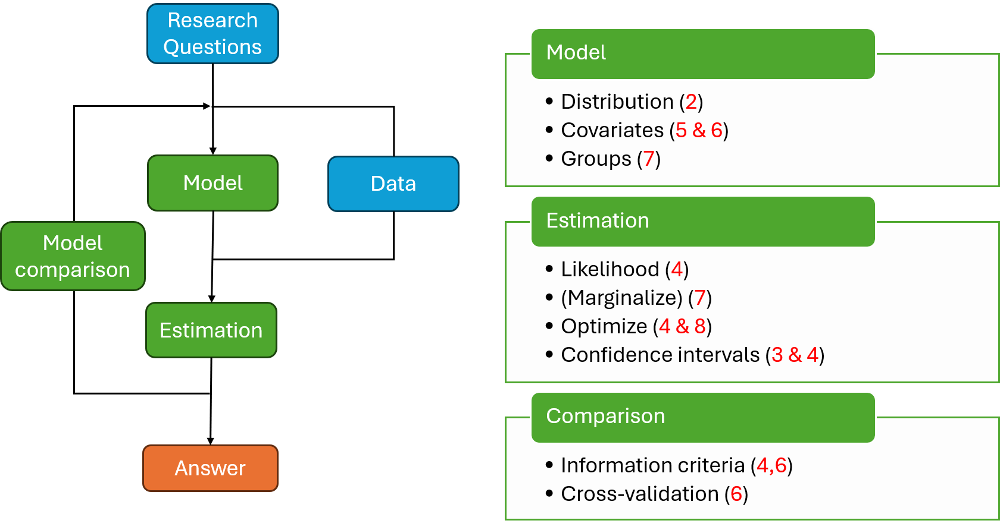
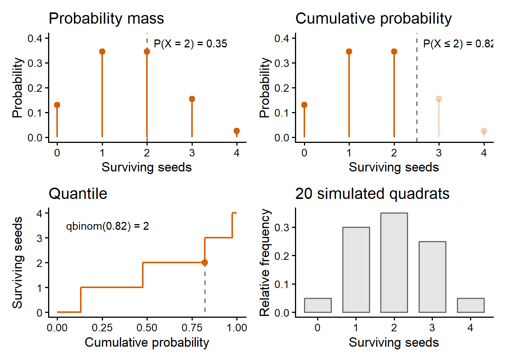
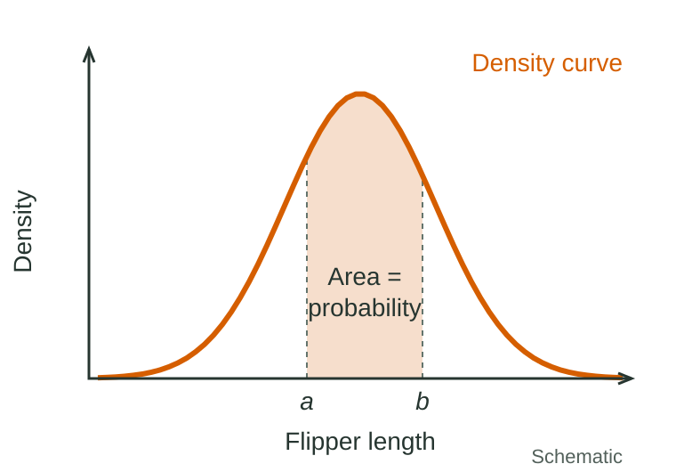
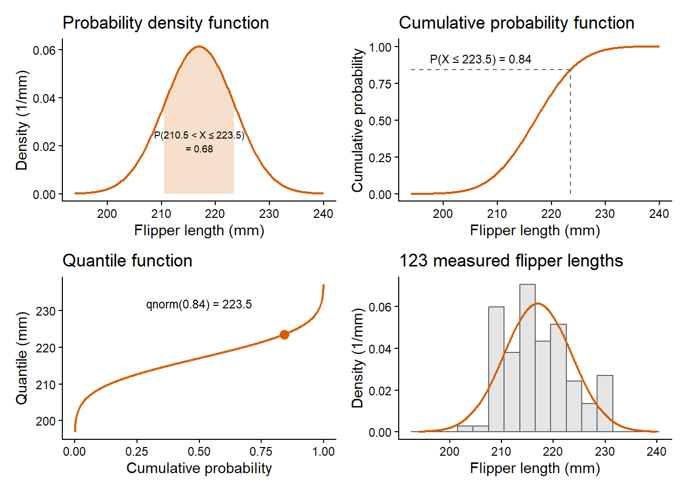
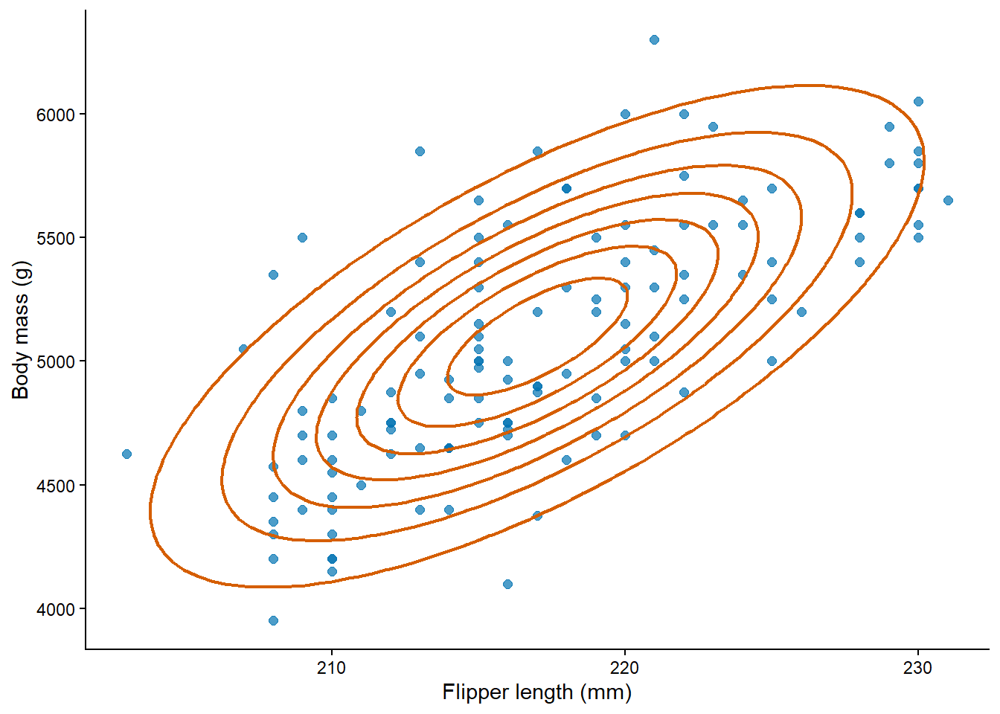
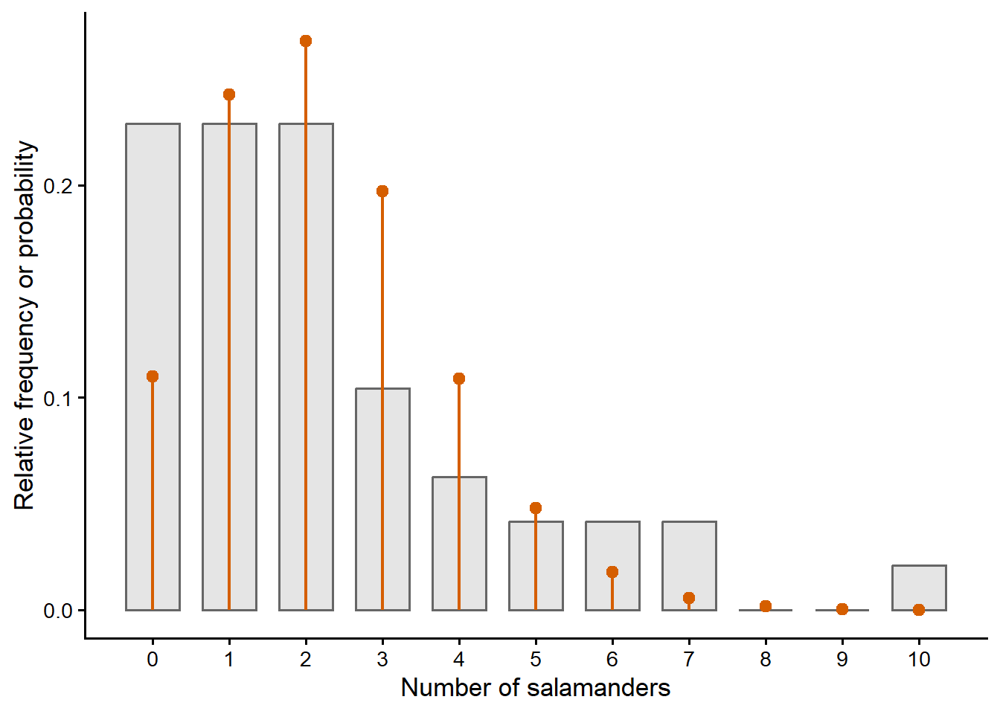

## Ecological Models and Data Analysis {.lecture-title data-timing="60"}

::: {.subtitle}
Chapter 2 · Lecture
:::

::: {.eyebrow}
Probability Distributions
:::

## Overview of the lecture {data-timing="60"}

::: {.incremental}
1. **Discrete random variables:** what can we count, and how probable is it?
2. **The four faces:** how do we calculate with a distribution?
3. **Continuous random variables:** what is a probability density?
4. **Joint distributions:** when are observations independent?
5. **Expectations:** what are the mean and the variance of a distribution?
6. **Choosing a distribution:** which distribution for which data?
7. **The practical:** what comes next?
:::

## Where we are: the modelling cycle {.diagram-slide data-timing="120"}

{fig-alt="The ecological modelling cycle. Research questions guide the choice of model and data; model and data lead to estimation and to an answer, and model comparison feeds back into the cycle. Three boxes list the tools of the course with their chapters: model (distribution 2, covariates 5 and 6, groups 7), estimation (likelihood 4, marginalise 7, optimise 4 and 8, confidence intervals 3 and 4) and comparison (information criteria 4 and 6, cross-validation 6)." .cycle-diagram}

::: {.caption}
Red numbers: chapters of the course. This lecture: the distribution (2) in the model box.
:::

## Random variables and support {data-timing="180"}

::: {.definition}
**Random variable:** a quantity whose value is uncertain before we observe it.
:::

::: {.example .fragment}
Four seeds per quadrat, $X$ = surviving seeds: $X \in \{0, 1, 2, 3, 4\}$.
:::

::: {.definition .fragment}
**Support:** the set of values that the random variable can take.
:::

::: {.incremental}
- **Finite:** 0 to 4 seeds.
- **Countably infinite:** insects in a trap, $\{0, 1, 2, \ldots\}$.
- **$X$ and $x$:** the random variable and an observed value.
:::

## Probabilities of counts {data-timing="180"}

:::: {.columns}
::: {.column width="40%"}
| $x$ | $P(X = x)$ |
|---:|---:|
| 0 | 0.05 |
| 1 | 0.15 |
| 2 | 0.30 |
| 3 | 0.30 |
| 4 | 0.20 |
:::
::: {.column width="60%"}

::: {.fragment}
- Probabilities between 0 and 1
- Probabilities add up to 1
- Probability set = sum of individual probabilities
:::

::: {.example .fragment}
At least three seeds: $P(X \geq 3) = P(X = 3) + P(X = 4) = 0.50$
:::

::: {.fragment}
$$
\sum_{\forall x} P(X = x) = 1
$$
:::


:::
::::

::: {.activity .fragment}
What is $P(X \leq 1)$?
:::

## What do these probabilities mean? {data-timing="120"}

:::: {.columns}

::: {.column width="50%"}
::: {.fragment}
### Aleatoric - Frequentist

- Relative frequency across replications.
- Observation error, process variation, parameter estimates.
:::
:::

::: {.column width="50%"}
::: {.fragment}
### Epistemic - Bayesian

- How certain are we about any unobserved value?
- Predictions, parameter estimates, latent variables.
:::
:::
::::

::: {.takeaway .fragment}
This course: probability as relative frequency (frequentist).
:::

## The Binomial distribution - Probability mass {data-timing="180"}

$$
P(X = x) = \binom{n}{x} p^x (1 - p)^{n - x}
$$

::: {.incremental}
- **Maximum number of items:** $n$ seeds.
- **Two outcomes per item:** survives (1) or not (0).
- **Same probability per item:** $p$ for every individual seed.
:::

::: {.example .fragment}
$n = 4$, $p = 0.4$: $P(X = 2) = 6 \times 0.16 \times 0.36 \approx 0.35$
:::

## The four faces of a distribution {.figure-slide data-timing="240"}

:::: {.columns}
::: {.column width="63%"}
{fig-alt="Four panels for a Binomial distribution with four seeds and a survival probability of 0.4. Top left: the probability mass as vermillion stems at 0 to 4 surviving seeds, with a dashed line at 2 and the label P(X = 2) = 0.35. Top right: the same stems, with those up to 2 seeds in full colour and the others faded, and the label P(X ≤ 2) = 0.82. Bottom left: the quantile function as a vermillion step line from cumulative probability to surviving seeds, with a point at 0.82 and 2 seeds. Bottom right: grey bars of the relative frequencies of 20 simulated quadrats."}
:::
::: {.column width="37%"}
::: {.incremental}
- **Mass:** $P(X = x)$.
- **Cumulative probability:** $P(X \leq x)$.
- **Quantile:** the inverse of cumulative probability.
- **Random sampler:** simulate possible samples.
:::
:::
::::

::: {.caption}
Vermillion: the model. Grey: 20 simulated quadrats. Dashed: the cutoff at 2 seeds.
:::

## Cumulative probability and quantiles {data-timing="180"}

::: {.definition}
**Cumulative probability:** $F_X(x) = P(X \leq x)$
:::

::: {.definition .fragment}
**Quantile:** $q_\alpha = \min\{x : F_X(x) \geq \alpha\}$
:::

::: {.example .fragment}
Seeds: $F_X(2) \approx 0.82$; the median $q_{0.5} = 2$.
:::

::: {.takeaway .fragment}
Quantiles return as confidence intervals (Chapter 3).
:::

## The four faces in R {data-timing="180"}

```{r}
#| echo: true
#| eval: false
# size = n, prob = p in formula for Binomial
seed_survival_probability = 0.4
seed_count  = 4
dbinom(x = 2,   size = seed_count, prob = seed_survival_probability)
pbinom(q = 2,   size = seed_count, prob = seed_survival_probability)
qbinom(p = 0.5, size = seed_count, prob = seed_survival_probability)
rbinom(n = 10,  size = seed_count, prob = seed_survival_probability)
```

::: {.definition .fragment}
**Name:** prefix (`d`, `p`, `q`, `r`) + distribution (`binom`).
:::

::: {.definition .fragment}
**Arguments:** first `x`, `q`, `p` or `n`, then the parameters.
:::

## Live demo: discrete distributions {.demo-slide data-timing="780"}

::: {.incremental}
1. Load the distribution functions.
2. The four faces of the Binomial.
3. Check $P(X = 2)$ by hand and in R.
4. Simulate with a seed; Practice 1 (orchid fruit set).
:::

::: {.demo}
**Follow along:** Chapter 2, *The four faces of a distribution*.
:::

## Continuous random variables {data-timing="180"}

::: {.definition}
**Continuous random variable:** can take any value within an interval.
:::

::: {.example .fragment}
123 Gentoo penguins: flipper length (mm).
:::

::: {.incremental}
- Between 217 and 218 mm: infinitely many lengths.
- Records rounded to the nearest mm.
:::

::: {.activity .fragment}
A flipper recorded as 221 mm: which lengths could it be? Is $P(X = 221) > 0$?
:::

## Probability density {data-timing="240"}

:::: {.columns}
::: {.column width="58%"}
{fig-alt="Schematic of a bell-shaped density curve over flipper length, without numerical scales. The area under the curve between two values a and b is shaded and labelled as the probability." .schematic}
:::
::: {.column width="42%"}
$$
P(a < X \leq b) = \int_a^b f_X(x)\,dx
$$

::: {.incremental}
- **Probability:** area under the curve.
- **Density:** $f_X(x) \geq 0$, total area 1.
- **Endpoints:** do not matter.
:::
:::
::::

## The Normal distribution - Probability density {data-timing="180"}

$$
f_X(x) = \frac{1}{\sigma\sqrt{2\pi}} \exp\left[-\frac{(x - \mu)^2}{2\sigma^2}\right]
$$

::: {.incremental}
- **$\mu$:** the mean, sets the centre.
- **$\sigma$:** the standard deviation, sets the spread.
:::

::: {.example .fragment}
Flipper length: $\mu = 217$ mm, $\sigma = 6.5$ mm (rounded values that describe the 123
penguins).
:::

## Mass and density {data-timing="180"}

:::: {.columns}
::: {.column width="50%"}
::: {.fragment}
### Discrete

- `d*`: a probability, $P(X = x)$.
- Sets of values: sums.
- At most 1.
:::
:::
::: {.column width="50%"}
::: {.fragment}
### Continuous

- `d*`: a density, in 1/mm.
- Intervals: integrals.
- Can exceed 1.
:::
:::
::::

::: {.example .fragment}
Density at 217 mm: 0.0614/mm, or 0.614/cm.
:::

::: {.takeaway .fragment}
A density is a probability per unit of $X$, not the probability of a value.
:::

::: {.activity .fragment}
Can a density be larger than 1?
:::

## The four faces of the Normal distribution {.figure-slide data-timing="240"}

:::: {.columns}
::: {.column width="63%"}
{fig-alt="Four panels for a Normal distribution of Gentoo penguin flipper length with a mean of 217 mm and a standard deviation of 6.5 mm. Top left: the density curve with the area between 210.5 and 223.5 mm shaded, labelled 0.68. Top right: the smooth S-shaped cumulative probability curve, with dashed lines marking a cumulative probability of 0.84 at 223.5 mm. Bottom left: the quantile function, with a point at 0.84 and 223.5 mm. Bottom right: a grey density-scaled histogram of the 123 measured flipper lengths with the model density curve over it."}
:::
::: {.column width="37%"}
::: {.incremental}
- **Density:** probability as area.
- **Cumulative probability:** smooth.
- **Quantile:** the inverse of cumulative probability.
- **Random sampler:** simulate possible samples.
:::
:::
::::

::: {.caption}
Vermillion: the model. Grey: the measured flipper lengths.
:::

## Intervals and tails in R {data-timing="180"}

$$
P(a < X \leq b) = F_X(b) - F_X(a)
$$

```{r}
#| echo: true
#| eval: false
# Between 210.5 and 223.5 mm: about 0.68
pnorm(q = 223.5, mean = 217, sd = 6.5) - pnorm(q = 210.5, mean = 217, sd = 6.5)
# Longer than 230 mm: about 0.02
pnorm(q = 230, mean = 217, sd = 6.5, lower.tail = FALSE)
# 0.95 quantile: about 227.7 mm
qnorm(p = 0.95, mean = 217, sd = 6.5)
```

## Discussion: `d`, `p`, `q` or `r`? {data-timing="180"}

::: {.incremental}
1. The probability that exactly two of four seeds survive.
2. The probability that a flipper is between 210 and 220 mm.
3. The length below which 95% of flippers fall.
4. Survival counts for 20 hypothetical quadrats.
:::

::: {.takeaway}
`d` · `p` · `q` · `r`
:::

::: {.activity}
**1 minute:** decide with a neighbour.
:::

## Live demo: continuous distributions {.demo-slide data-timing="780"}

::: {.incremental}
1. Load the penguin data.
2. The density at 217 mm, in mm and in cm.
3. Intervals, tails and quantiles.
4. Practice 3 (a flipper length threshold).
:::

::: {.demo}
**Follow along:** Chapter 2, *Mass and density* and *The four faces of a continuous
distribution*.
:::

## Joint and marginal distributions {data-timing="180"}

::: {.definition}
**Joint distribution:** a probability for every combination of values.
:::

| Two seeds | $x_1 = 0$ | $x_1 = 1$ | Marginal $X_2$ |
|---|---:|---:|---:|
| $x_2 = 0$ | $P(0, 0)$ | $P(1, 0)$ | $P(X_2 = 0)$ |
| $x_2 = 1$ | $P(0, 1)$ | $P(1, 1)$ | $P(X_2 = 1)$ |
| Marginal $X_1$ | $P(X_1 = 0)$ | $P(X_1 = 1)$ | 1 |

::: {.definition .fragment}
**Marginal distribution:** add over a row or a column.
:::

## Independence {data-timing="180"}

$$
P(X_1 = x_1, X_2 = x_2) = P(X_1 = x_1)\,P(X_2 = x_2)
$$

| Two seeds | $x_1 = 0$ | $x_1 = 1$ | Marginal $X_2$ |
|---|---:|---:|---:|
| $x_2 = 0$ | $0.4 \times 0.7 = 0.28$ | $0.6 \times 0.7 = 0.42$ | 0.70 |
| $x_2 = 1$ | $0.4 \times 0.3 = 0.12$ | $0.6 \times 0.3 = 0.18$ | 0.30 |
| Marginal $X_1$ | 0.40 | 0.60 | 1.00 |

::: {.takeaway .fragment}
Independence is an assumption of the model.
:::

::: {.activity .fragment}
Why might two seeds not be independent?
:::

## Continuous joint distribution {.figure-slide data-timing="180"}

:::: {.columns}
::: {.column width="63%"}
{fig-alt="Body mass in grams against flipper length in millimetres for the 123 Gentoo penguins, shown as blue points. Vermillion contour lines of a bivariate Normal density form tilted ellipses centred near 217 mm and 5100 g, rising from lower left to upper right, and the points follow the same tilt."}
:::
::: {.column width="37%"}
::: {.incremental}
- **Contours:** equal joint density.
- **Multivariate distribution:** marginal + dependence structure.
- **Parameters:** mean, std devs, corr
- **Tilted:** correlation of 0.7.
- **Probability above mean:** 0.25 if independent, about 0.37 here.
:::
:::
::::

::: {.caption}
Blue: the 123 penguins. Vermillion: contours of the model (Multivariate Normal).
:::

## Independent and identically distributed {data-timing="120"}

::: {.definition}
**i.i.d.:** independent and identically distributed.
:::

::: {.incremental}
- **Identically distributed:** the same distribution.
- **Independent:** a separate assumption.
:::

::: {.example .fragment}
| Two seeds | $x_1 = 0$ | $x_1 = 1$ | Marginal $X_2$ |
|---|---:|---:|---:|
| $x_2 = 0$ | $0.7 \times 0.7 = 0.49$ | $0.7 \times 0.3 = 0.21$ | 0.7 |
| $x_2 = 1$ | $0.3 \times 0.7 = 0.21$ | $0.3 \times 0.3 = 0.09$ | 0.3 |
| Marginal $X_1$ | 0.7 | 0.3 | 1 |
:::

::: {.takeaway .fragment}
The basis of estimation in Chapters 3 and 4.
:::

## Discussion: joint, marginal or independent? {data-timing="180"}

::: {.incremental}
1. The body mass of a penguin, whatever its flipper length.
2. A flipper of 210 to 225 mm and a body mass above 5000 g.
3. The acorns of two oaks under the same weather.
4. Four visits to the same stream site.
:::

::: {.takeaway}
Joint · Marginal · Independent · i.i.d.
:::

::: {.activity}
**1 minute:** decide with a neighbour.
:::

## Expectations and the mean {data-timing="180"}

$$
E[f(X)] = \sum_x f(x)\,P(X = x)
$$

::: {.incremental}
- **Expectation:** a probability-weighted average.
- **Mean:** $E[X]$, the expectation of $X$ itself.
:::

::: {.example .fragment}
Seed model ($n = 4$, $p = 0.4$): $E[X] = 1.6$ seeds, a count that no quadrat can have.
:::

## Variance and standard deviation {data-timing="120"}

$$
\operatorname{Var}(X) = E[(X - E[X])^2]
$$

::: {.incremental}
- **Variance:** the expected squared distance from the mean.
- **Standard deviation:** $\sqrt{\operatorname{Var}(X)}$, in the units of $X$.
:::

::: {.example .fragment}
Flipper model: 42.25 mm², standard deviation 6.5 mm (the parameter $\sigma$).

Seed model: mean 1.6, variance 0.96 (not parameters).
:::

## Choosing a distribution {data-timing="180"}

:::: {.columns}
::: {.column width="50%"}
::: {.fragment}
### Discrete

- **Upper limit:** Binomial.
- **No upper limit:** Poisson, Negative Binomial.
:::
:::
::: {.column width="50%"}
::: {.fragment}
### Continuous

- **Unconstrained:** Normal.
- **Positive:** LogNormal.
- **Constrained:** Beta.
:::
:::
::::

::: {.takeaway .fragment}
No correct distribution, only plausible candidates: range of values, mean–variance
relationship, fit to the data.
:::

## Overdispersion {.figure-slide data-timing="180"}

:::: {.columns}
::: {.column width="63%"}
{fig-alt="Grey bars of the relative frequencies of 48 counts of spring salamanders, from 0 to 10 per visit, with vermillion stems of a Poisson distribution with the same mean of 2.21. The counts have more zeros and more large counts (6, 7 and 10) than the Poisson, and fewer counts of 3 and 4."}
:::
::: {.column width="37%"}
::: {.incremental}
- **Poisson:** $E[X] = \operatorname{Var}(X) = \lambda$.
- **Dispersion ratio:** sample variance / sample mean.
- **Salamanders:** mean 2.21, variance 4.98, ratio about 2.3.
:::
:::
::::

::: {.caption}
Grey: 48 salamander counts. Vermillion: Poisson with the same mean.
:::

## Distributions for overdispersed counts {data-timing="120"}

::: {.definition}
**Negative Binomial:** mean $\mu$, shape $k$.
:::

$$
\operatorname{Var}(X) = \mu + \frac{\mu^2}{k}
$$

::: {.incremental}
- **Small $k$:** more variance.
- **Large $k$:** close to the Poisson.
:::

::: {.activity .fragment}
Why could the salamander counts be overdispersed?
:::

## Live demo: expectations and overdispersion {.demo-slide data-timing="1020"}

::: {.incremental}
1. Mean and variance of the seed model.
2. Mean and variance of the flipper model by integration.
3. The dispersion ratio of the salamander counts.
4. Practice 4 (fruit set on orchid plants).
:::

::: {.demo}
**Follow along:** Chapter 2, *Expectations and central moments* and *Overdispersion*.
:::

## Course roadmap: from distributions to estimates {.roadmap data-timing="120"}

| Chapter | Main question |
|---|---|
| **2. Probability distributions** | What can we observe, and how probable is it? |
| **3. From samples to estimates** | What does a sample tell us? |
| **4. Maximum likelihood estimation** | How do we estimate, and how uncertain are we? |

## The Chapter 2 R practical {data-timing="120"}

::: {.incremental}
- **Seedling survival and bill length:** worked examples.
- **Overdispersion:** insect counts by spray.
- **Negative Binomial:** quadrat counts.
- **LogNormal:** body mass.
- **Beta:** vegetation cover.
:::

::: {.takeaway .fragment}
Read the supplement entries first. Try, then check.
:::

## Summary and closing questions {.closing data-timing="180"}

::: {.incremental}
- A distribution assigns probabilities to sets of values.
- Four faces: `d`, `p`, `q`, `r`.
- Mass is a probability; density is per unit of $X$.
- Independence and i.i.d. are assumptions.
- Mean and variance are expectations.
- Choose by the range of values and the mean–variance relationship.
:::

::: {.takeaway .fragment}
Random variable · Distribution · Four faces · Density · Independence · Expectation ·
Overdispersion
:::

::: {.activity .fragment}
**Closing questions**

1. Why is `dnorm()` at 217 mm not the probability of a 217 mm flipper?
2. A dispersion ratio of 2.3: what does it tell us, and what does it not?
:::
