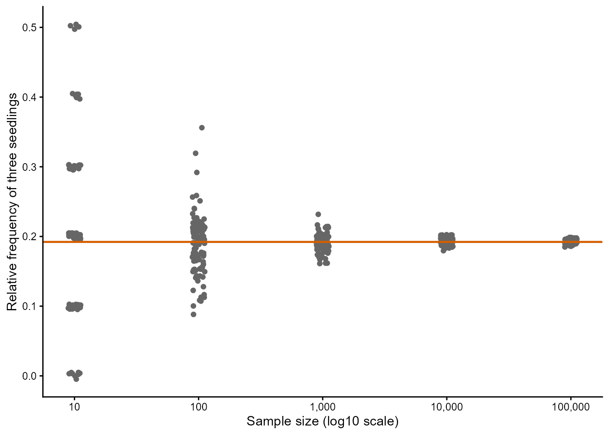
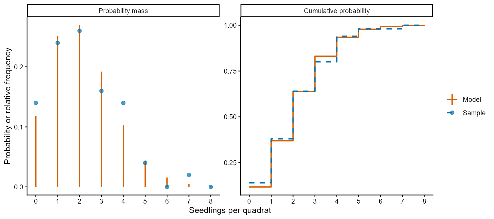
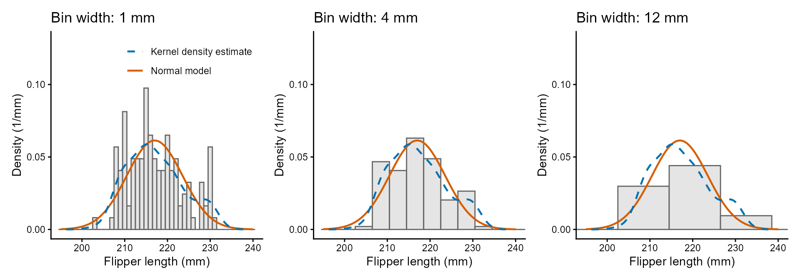
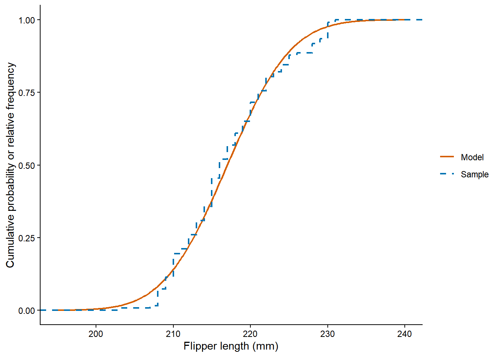
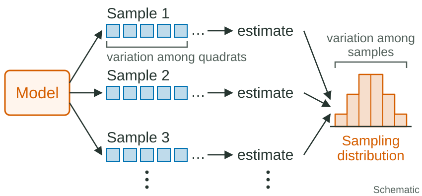
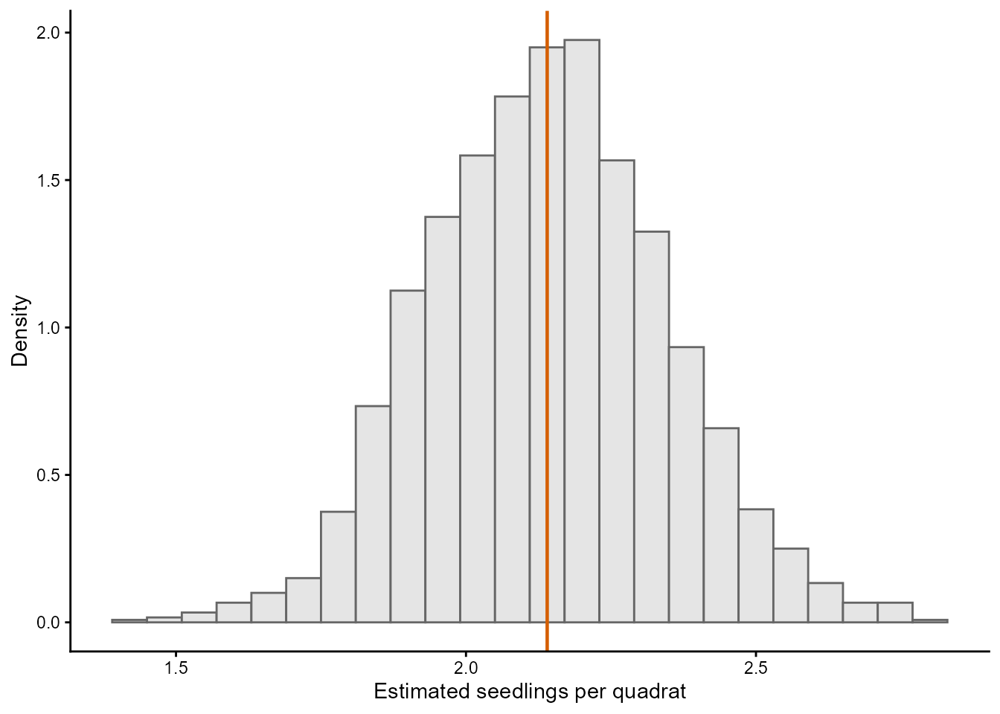
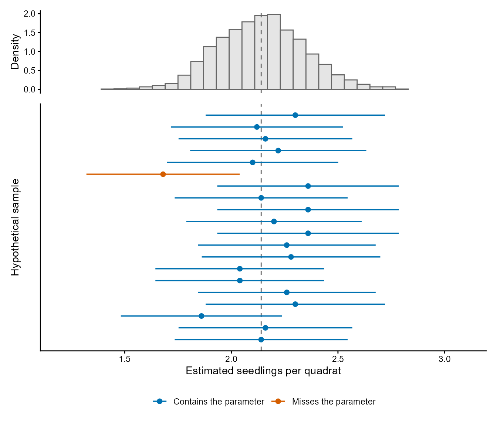
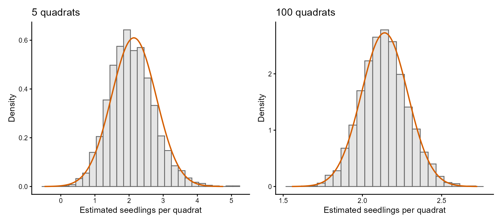

## Ecological Models and Data Analysis {.lecture-title data-timing="60"}

::: {.subtitle}
Chapter 3 · Lecture
:::

::: {.eyebrow}
From Samples to Estimates
:::

## Overview of the lecture {data-timing="120"}

::: {.incremental}
1. **Samples and distributions:** how does a sample relate to a model?
2. **Continuous samples:** how do we compare measurements with a density?
3. **Estimators:** how do we calculate a parameter from a sample?
4. **Sampling distributions:** how much would an estimate change in another sample?
5. **Standard errors and confidence intervals:** how uncertain is an estimate?
6. **Large samples:** what happens as the sample grows?
7. **The practical:** what comes next?
:::

## Where we are: the modelling cycle {.diagram-slide data-timing="60"}

{fig-alt="The ecological modelling cycle. Research questions guide the choice of model and data; model and data lead to estimation and to an answer, and model comparison feeds back into the cycle. Three boxes list the tools of the course with their chapters: model (distribution 2, covariates 5 and 6, groups 7), estimation (likelihood 4, marginalise 7, optimise 4 and 8, confidence intervals 3 and 4) and comparison (information criteria 4 and 6, cross-validation 6)." .cycle-diagram}

::: {.caption}
Red numbers: chapters of the course. This lecture: confidence intervals (3) in the estimation
box.
:::

## From data to estimates {.diagram-slide data-timing="120"}

:::: {.columns}
::: {.column width="62%"}
{fig-alt="Data generating process, model and data, linked to parameters and estimates. Solid arrows show derivation: the data come from the data generating process, the parameters belong to the model and the estimates are calculated from the data. Dashed arrows show approximate statistical relationships assumed for estimation: the model approximates the data generating process, the data are treated as a sample from the model and the estimates stand for the parameters." .estimation-diagram}
:::
::: {.column width="38%"}
::: {.takeaway .fragment}
Chapter 2: parameters $\rightarrow$ data

Chapter 3: data $\rightarrow$ estimates
:::
:::
::::

## Samples and distributions {data-timing="240"}

::: {.incremental}
- **Data generating process:** approximated by a model.
- **Data:** treated as if it were a random sample from the model.
:::

::: {.example .fragment}
Balsam fir seedlings in 50 quadrats. Poisson model, mean 2.14 seedlings per quadrat.
:::

::: {.incremental}
- **i.i.d.:** a simplification; neighbouring quadrats may be alike (Chapter 7).
:::

## From frequency to probability {data-timing="300"}

::: {.definition}
**Relative frequency:** the number of times a value appears, divided by the sample size.
:::

| Seedlings | 0 | 1 | 2 | 3 | 4 | 5 | 6 | 7 | 8 |
|---|---:|---:|---:|---:|---:|---:|---:|---:|---:|
| Relative frequency | 0.14 | 0.24 | 0.26 | 0.16 | 0.14 | 0.04 | 0.00 | 0.02 | 0.00 |
| Poisson probability | 0.12 | 0.25 | 0.27 | 0.19 | 0.10 | 0.04 | 0.02 | 0.00 | 0.00 |

::: {.incremental}
- **Relative frequencies:** between 0 and 1, sum to 1.
- **Compared with the model:** similar, but not equal.
:::

::: {.activity .fragment}
Why are the two rows not equal?
:::

## Relative frequencies in R {data-timing="180"}

```{r}
#| echo: true
#| eval: false
# Counts of balsam fir seedlings in 50 quadrats (see ?boot::fir).
data(fir, package = "boot")
seedling_counts = fir$count
n_quadrats = length(seedling_counts)

# Count each value from zero to eight seedlings and divide by the sample size.
count_values = seq.int(from = 0, to = 8)
count_table = table(factor(x = seedling_counts, levels = count_values))
relative_frequency = count_table / n_quadrats

# Probabilities of the Poisson model with the mean of the 50 counts.
model_mean = 2.14
dpois(x = count_values, lambda = model_mean)
```

::: {.definition .fragment}
**`factor()` levels:** keep the counts that no quadrat has, with frequency zero.
:::

## The law of large numbers {.figure-slide data-timing="300"}

:::: {.columns}
::: {.column width="63%"}
{fig-alt="Relative frequency of exactly three seedlings in simulated samples of 10, 100, 1,000, 10,000 and 100,000 quadrats from a Poisson model with a mean of 2.14, with 100 grey points per sample size on a logarithmic axis. At 10 quadrats the points spread from 0 to 0.5; the spread narrows with each tenfold increase, and at 100,000 quadrats the points sit on the vermillion line of the Poisson probability, about 0.19."}
:::
::: {.column width="37%"}
::: {.incremental}
- **100 simulated samples** per sample size.
- **Spread:** narrows as the sample grows.
- **Average:** converges to probability.
:::
:::
::::

::: {.caption}
Grey: simulated relative frequencies of three seedlings. Vermillion: the Poisson probability.
:::

::: {.takeaway .fragment}
Frequencies converge to probabilities as sample sizes increase.
:::

## The empirical distribution {.figure-slide data-timing="240"}

::: {.definition}
**Empirical distribution:** the mass of each count is its relative frequency.
:::

{fig-alt="Two panels for the seedling counts of the 50 fir quadrats, from 0 to 8 seedlings per quadrat. Left, probability mass: vermillion stems of the Poisson probabilities with a mean of 2.14 and blue points of the relative frequencies; the points lie close to the stems, above them at 0, 4 and 7 seedlings and below them at 1, 3 and 6. Right, cumulative probability: the model as a solid vermillion step line and the sample as a dashed blue step line, both rising from just over 0.1 at zero seedlings to 1, and nearly overlapping."}

::: {.caption}
Blue: the 50 quadrats. Vermillion: the Poisson model with a mean of 2.14.
:::

## Summaries of a sample {data-timing="300"}

::: {.incremental}
- **Sample mean ($\overline{X}$):** the mean of the empirical distribution (coincides with arithmetic mean, 2.14).
- **Sample variance ($S^2_X$):** the variance of the empirical distribution (divide by $n$ not $n - 1$, results in 2.36).
- **Median:** invert the empirical cumulative distribution (2).
:::

::: {.takeaway .fragment}
Large i.i.d. samples: the mean, variance and quantiles approach those of the model.
:::

## Samples of continuous measurements {data-timing="180"}

::: {.incremental}
- **Continuous measurements:** never repeat (in principle)
- **Relative frequency:** every relative frequency would be $1/n$.
- **123 Gentoo penguins:** Flipper lengths rounded to nearest mm.
- **Histogram:** counts the observations in intervals (bins).
:::

::: {.example .fragment}
214.5 to 218.5 mm: $31/123 \approx 0.252$; model probability about 0.241.
:::

## Density-scaled histograms {.figure-slide data-timing="360"}

{fig-alt="Three density-scaled histograms of the flipper lengths of 123 Gentoo penguins, with bins of 1 mm, 4 mm and 12 mm, each with the vermillion density curve of the Normal model and a dashed blue smooth estimate from the sample. With 1 mm bins the bar heights jump up and down around the curves; with 4 mm bins they follow the curves, and the bar from 214.5 to 218.5 mm is close to the top of the model curve; with 12 mm bins the shape within each bar is lost."}

::: {.caption}
Grey bars: the 123 flipper lengths. Vermillion solid: the Normal model. Blue dashed: a
smooth estimate from the sample (kernel density).
:::

::: {.incremental}
- **Height:** relative frequency / bin width, $0.252/4 = 0.063$/mm; model density
  0.061/mm.
- **Bin width (histogram):** our choice.
- **Bandwidth (kernel density):** our choice.
:::

::: {.activity .fragment}
Would another 123 penguins give the same histogram? Would a different bin width change the
mean?
:::

## The empirical cumulative distribution {data-timing="180"}

{fig-alt="Empirical cumulative distribution of flipper lengths of 123 Gentoo penguins (blue) and in vermillion for the Normal model."}

::: {.caption}
Vermillion solid: the Normal model. Blue dashed: Empirical cumulative distribution.
:::

::: {.incremental}
- **No bins and no bandwidth.**
- **Steps of $1/n$:** multiples where rounded values coincide.
:::

::: {.takeaway .fragment}
It converges to the cumulative probability function of the model.
:::

## Parameters, estimators and estimates {data-timing="240"}

$$
X_i \sim \operatorname{Poisson}(\lambda)
$$

$\lambda$: the expected number of seedlings per quadrat.

$X_i$: the number of seedlings in quadrat $i$

::: {.definition .fragment}
**Parameter:** fixed and unknown; it defines the model.
:::

::: {.definition .fragment}
**Estimator:** a rule to estimate a parameter from a random sample of a model.
:::

::: {.definition .fragment}
**Estimate:** the number that the rule gives for one particular sample ($\hat\lambda$).
:::

## The method of moments {data-timing="240"}


::: {.incremental}
- **Estimator for expectations** equate expectations of model and empirical distribution.
- **One parameter:** mean model = mean sample.
- **Two parameters:** mean and variance model = mean and variance sample.
- **Three+ parameters:** other expectations (kurtosis, skewness, etc.).
:::

::: {.example .fragment}

$$
\hat\lambda = \overline X
$$

50 fir quadrats: $\hat\lambda = 2.14$ seedlings per quadrat.
:::

::: {.takeaway .fragment}
Maximum likelihood in Chapter 4; next slides apply to any estimator.
:::

## Discussion: parameter, estimator or estimate? {data-timing="240"}

::: {.incremental}
1. The expected number of seedlings per quadrat, $\lambda$.
2. "Add the counts and divide by the number of quadrats."
3. 2.14 seedlings per quadrat for the 50 fir quadrats that were measured.
4. The mean of the 50 quadrats that a colleague will count next year.
:::

::: {.takeaway}
Parameter · Estimator · Estimate
:::

::: {.activity}
**1 minute:** decide with a neighbour.
:::

## The sampling distribution {data-timing="360"}

::: {.definition}
**Sampling distribution:** the distribution of the estimates across repeated hypothetical
samples with the same design and sample size.
:::

:::: {.columns}
::: {.column width="58%"}
{fig-alt="Schematic without numbers. A model on the left generates three hypothetical samples, each a row of quadrats, with dots for further samples. Each sample gives one estimate, and the estimates are gathered into a histogram labelled sampling distribution. A bracket over the quadrats of one sample marks the variation among quadrats; a bracket over the histogram marks the variation among samples." .schematic}
:::
::: {.column width="42%"}
::: {.incremental}
- **Within a sample:** quadrats vary ($X_i$).
- **Between samples:** estimates vary ($\hat\lambda$).
- **Data:** treated as a random sample from the model.
- **Sampling distributions are simulated, never measured**

:::
:::
::::

## Hypothetical samples in R {data-timing="180"}

```{r}
#| echo: true
#| eval: false
# Parameter of the model, quadrats per sample and number of hypothetical samples.
set.seed(seed = 401)
true_lambda = 2.14
n_quadrats = 50
n_samples = 2000

# Each run simulates one sample of 50 quadrats and returns its estimate of lambda.
lambda_estimates = replicate(
  n = n_samples,
  expr = mean(rpois(n = n_quadrats, lambda = true_lambda))
)

# Mean and standard deviation of the 2,000 estimates (one per hypothetical sample).
mean(lambda_estimates)
sd(lambda_estimates)
```

::: {.definition .fragment}
**`replicate()`:** evaluates `expr` `n` times and collects the results.
:::

## A simulated sampling distribution {.figure-slide data-timing="180"}

:::: {.columns}
::: {.column width="63%"}
{fig-alt="Histogram in grey of 2,000 simulated estimates of the mean number of seedlings per quadrat, each from a hypothetical sample of 50 quadrats. The histogram is bell-shaped, runs from about 1.4 to 2.8 and is centred on a vertical vermillion line at 2.14, the parameter used in the simulation."}
:::
::: {.column width="37%"}
::: {.incremental}
- **Properties** of an estimator (bias, var, MSE).
- **Uncertainty** (std error, conf intervals).
- **Plug-in estimates** Replace $\lambda$ with $\hat \lambda$.
- It has a mean (2.14) and variance (0.042).
- We do not (always) know its "formula".
:::
:::
::::

::: {.caption}
Grey: 2,000 simulated estimates ($\hat \lambda$). Vermillion: the "true" parameter value ($\lambda$).
:::

## Bias and variance {data-timing="360"}

$$
\operatorname{Bias}(\hat\theta) = E[\hat\theta] - \theta
$$

::: {.incremental}
- **Unbiased:** the mean of a sample, intercepts and slopes, (sometimes) variances.
- **Biased in finite samples:** most estimators, bias reduced with larger samples
- **Variance of the estimator:** decreases with larger samples.
:::

::: {.example .fragment}
Simulation: bias about 0.001; variance 0.0419 against $2.14/50 = 0.0428$.
:::

::: {.activity .fragment}
Two studies of 50 quadrats report 1.9 and 2.3 seedlings per quadrat. What varies? Is the
estimator biased?
:::

## Mean squared error {data-timing="180"}

$$
\operatorname{MSE}(\hat\theta) = \operatorname{Var}(\hat\theta) +
\operatorname{Bias}(\hat\theta)^2
$$

::: {.incremental}
- **Mean squared error (MSE):** the expected squared distance between estimates and the "true" value.
- **Use:** compare estimators of the same parameter.
- **Trade-off:** a biased estimator can have a smaller MSE.
:::

## Standard errors {data-timing="300"}

::: {.incremental}
- **Standard error (SE):** the standard deviation of the sampling distribution of an estimator
- **Plug-in estimate:** Use $\hat\theta$ instead of $\theta$
:::

::: {.fragment}

$$
\widehat{\operatorname{SE}}(\hat\lambda) = \sqrt{\frac{\hat\lambda}{n}}
$$

:::

::: {.example .fragment}
50 fir quadrats: about 0.21 seedlings per quadrat.
:::

## Discussion: standard deviation or standard error? {data-timing="240"}

::: {.incremental}
1. How much the counts differ across the 50 quadrats.
2. How much the mean of 50 quadrats would differ among hypothetical repetitions.
3. The spread of the histogram on slide 19.
4. How much the count for one quadrat varies under the model.
:::

::: {.takeaway}
Standard deviation · Standard error
:::

::: {.activity}
**1 minute:** decide with a neighbour.
:::

## Confidence intervals {data-timing="240"}

::: {.definition}
**Confidence interval:** a range estimate (lower-upper) for a parameter with a given confidence level.
:::

::: {.definition .fragment}
**Confidence level:** the fraction of hypothetical samples in which the interval would
contain the parameter.
:::

::: {.incremental}
- There are different confidence interval estimators.
- **Wald (confidence) interval:** assumes sampling distribution is Normal.
:::

::: {.fragment}
$$
\hat\theta \pm z_{0.975}\,\widehat{\operatorname{SE}}(\hat\theta),
\qquad z_{0.975} \approx 1.96
$$
:::


## Wald interval in R {data-timing="120"}

```{r}
#| echo: true
#| eval: false
# Estimate of lambda and number of quadrats in the sample.
lambda_hat = mean(seedling_counts)
n_counts = length(seedling_counts)
# Plug the estimate into the formula of the standard error.
estimated_se = sqrt(lambda_hat / n_counts)

# 0.975 quantile of the standard Normal distribution.
critical_value = qnorm(p = 0.975)
# Lower and upper endpoints of the interval: about 1.73 and 2.55.
interval = lambda_hat + c(-1, 1) * critical_value * estimated_se
interval
```

::: {.takeaway .fragment}
An interval estimate of the mean ($\lambda$), not for the count of single quadrats ($X_i$).
:::

## The dance of the confidence intervals {.figure-slide data-timing="300"}

:::: {.columns}
::: {.column width="60%"}
{fig-alt="Two stacked panels on the same horizontal axis of estimated seedlings per quadrat, from 1.2 to 3.1, with a dashed vertical line at the parameter 2.14. Top: grey histogram of 2,000 simulated estimates from samples of 50 quadrats. Bottom: 20 hypothetical samples, one per row, each a point estimate with a horizontal 95% Wald interval. Nineteen intervals in blue cross the dashed line; the sixth, in vermillion, lies entirely below it."}
:::
::: {.column width="40%"}
::: {.incremental}
- **Parameter:** fixed (dashed line).
- **Interval:** changes from sample to sample.
- **95%:** describes the procedure.
:::
:::
::::

::: {.caption}
Top: the simulated sampling distribution. Below: 20 hypothetical samples; vermillion:
the one interval that misses the parameter.
:::

::: {.takeaway .fragment}
The interval from a sample either contains $\lambda$ or it does not.
:::

## Coverage checked by simulation {data-timing="240"}

::: {.definition}
**Coverage:** the fraction of hypothetical samples in which the interval actually
contains the parameter.
:::

::: {.example .fragment}
2,000 samples of 50 quadrats: coverage 0.9525.
:::

::: {.incremental}
- **Small samples:** Lower coverage; the lower endpoint can be negative.
:::

::: {.activity .fragment}
A study reports a 95% confidence interval (1.5 - 2.9 seedlings per quadrat). What does the 95% refer to?
:::

## Estimation of two parameters {data-timing="300"}

- **Flipper lengths:** $X_i \sim \operatorname{Normal}(\mu, \sigma^2)$.

$$
\widehat{\sigma^2}_{\mathrm{MM}} = \frac{1}{n}\sum_{i=1}^{n}(X_i - \overline X)^2
$$


::: {.example .fragment}
$\hat\mu \approx 217.2$ mm. $\widehat{\sigma^2}_{\mathrm{MM}} \approx 41.7$ mm².
:::

::: {.takeaway .fragment}
**Variance estimator** $1/n$: biased. $1/(n - 1)$: unbiased.
:::

## Consistency {data-timing="180"}

::: {.definition}
**Consistent estimator:** The sample-based estimate converges (in probability) to the "true" value as the sample size increases.
:::

::: {.incremental}
- **As for relative frequencies** (slide 8): a trend, not true for a given sample.
- **Bias decreases**: As sample grows, bias decreases towards 0.
- **Variance decreases**: As sample grows, variance decreases towards 0.
- All relevant statistical estimators are consistent.
:::

::: {.activity .fragment}
20 quadrats give 2.1 and 100 quadrats give 2.3; the model mean is 2.14. Does this
contradict consistency?
:::

## Asymptotic normality {.figure-slide data-timing="300"}

{fig-alt="Two grey histograms of 2,000 simulated means of Poisson counts with a mean of 2.14, each with the vermillion density of its Normal approximation. Left, 5 quadrats: the bars sit at steps of 0.2 from 0 to about 5, the histogram is ragged and has a longer tail to the right. Right, 100 quadrats: the bars run from about 1.6 to 2.7 and follow the Normal curve closely."}

::: {.caption}
Grey: 2,000 simulated means. Vermillion: the Normal approximation.
:::

:::: {.columns}
::: {.column width="40%"}
$$
\hat\lambda \overset{\mathrm{approx}}{\sim} \operatorname{Normal}\left(\lambda,
\frac{\lambda}{n}\right)
$$
:::
::: {.column width="60%"}
::: {.incremental}
- **Asymptotic normality:** Sampling distributions become approximately Normal as sample size grows.
- **5 quadrats:** skewed, long tail. 
- **100 quadrats:** close to Normal.
:::
:::
::::

::: {.takeaway .fragment}
It justifies the Wald interval; how large $n$ must be depends on the model and estimator.
:::

## Discussion: empirical or sampling distribution? {data-timing="180"}

::: {.incremental}
1. A histogram of the 123 flipper lengths.
2. A histogram of 2,000 simulated means of 50 quadrats.
3. The relative frequencies of the 50 fir counts.
4. The distribution that a standard error describes.
:::

::: {.takeaway}
Empirical distribution · Sampling distribution
:::

::: {.activity}
**1 minute:** decide with a neighbour.
:::

## Course roadmap: from samples to response curves {.roadmap data-timing="120"}

| Chapter | Main question |
|---|---|
| **3. From samples to estimates** | What does a sample tell us? |
| **4. Maximum likelihood estimation** | How do we estimate, and how uncertain are we? |
| **5. Deterministic functions in ecology** | Which curves describe ecological responses? |

## The Chapter 3 R practical {data-timing="120"}

::: {.incremental}
- **Barn owl calls:** worked on the page; Negative Binomial by the method of moments,
  standard error, Wald interval.
- **Asymptotic convergence:** Beta model of leaf damage.
- **Tree heights:** two variance estimators, bias and mean squared error.
- **Body mass:** LogNormal model, coverage of Wald intervals.
:::

::: {.takeaway .fragment}
Read the Beta and LogNormal entries of the supplement first. Try, then check.
:::

## Summary and closing questions {.closing data-timing="240"}

::: {.incremental}
- A sample is treated as random draws from a model.
- Frequencies, histograms and cumulative distributions compare a sample with the model.
- An estimator is a rule; an estimate is its value for one sample.
- The sampling distribution gives the bias, the standard error and the mean squared error.
- A 95% interval describes the coverage of a procedure.
- Large samples: consistency and asymptotic normality. Small samples: check by simulation.
:::

::: {.takeaway .fragment}
Empirical distribution · Estimator · Sampling distribution · Bias · Standard error ·
Confidence interval · Coverage
:::

::: {.activity .fragment}
**Closing questions**

1. Why does the standard error shrink with more quadrats, while the standard deviation of
   the counts does not?
2. What does the 95% of a confidence interval describe?
:::
