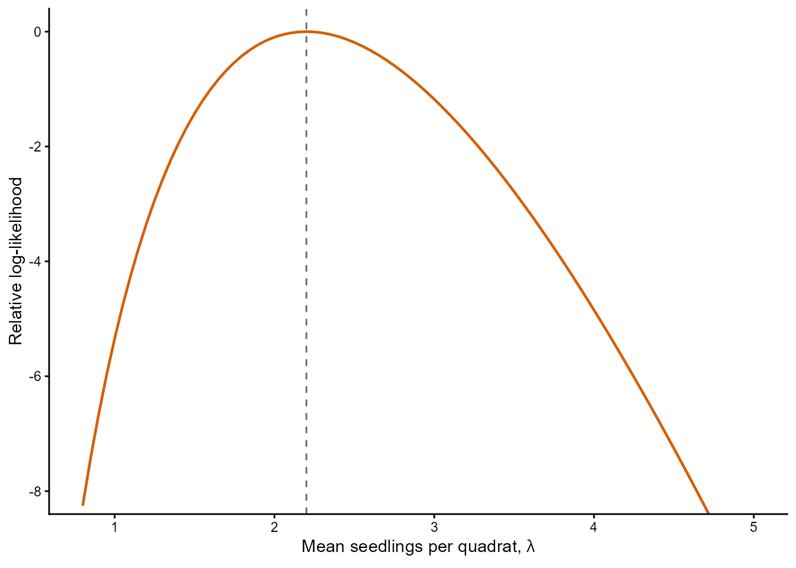
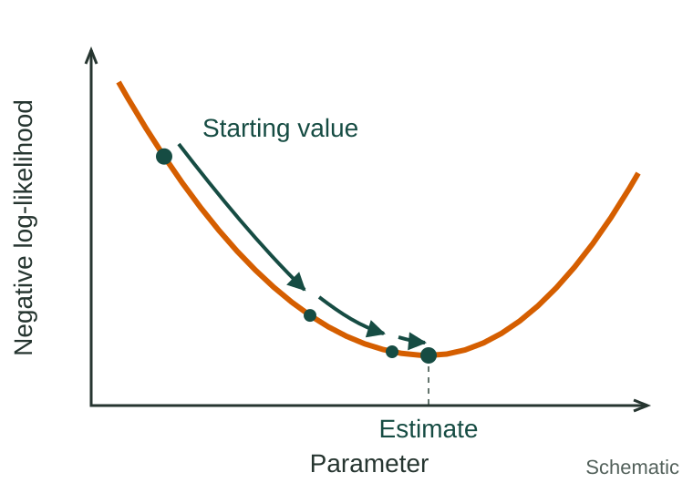
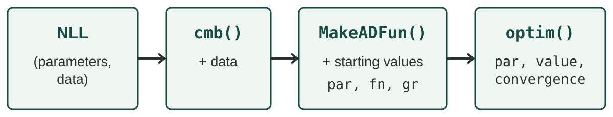
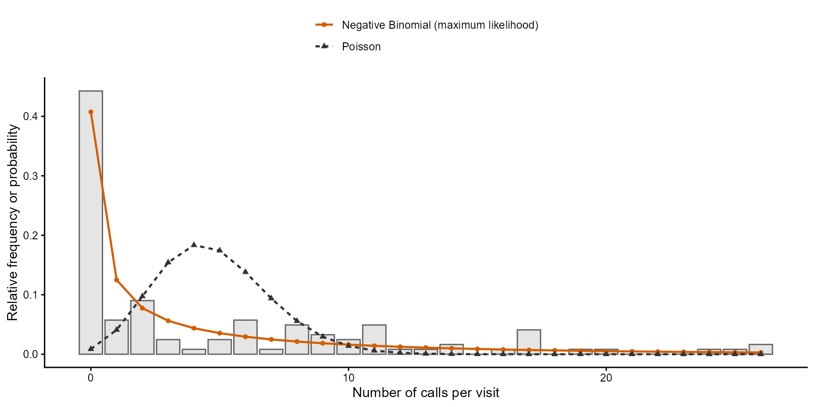
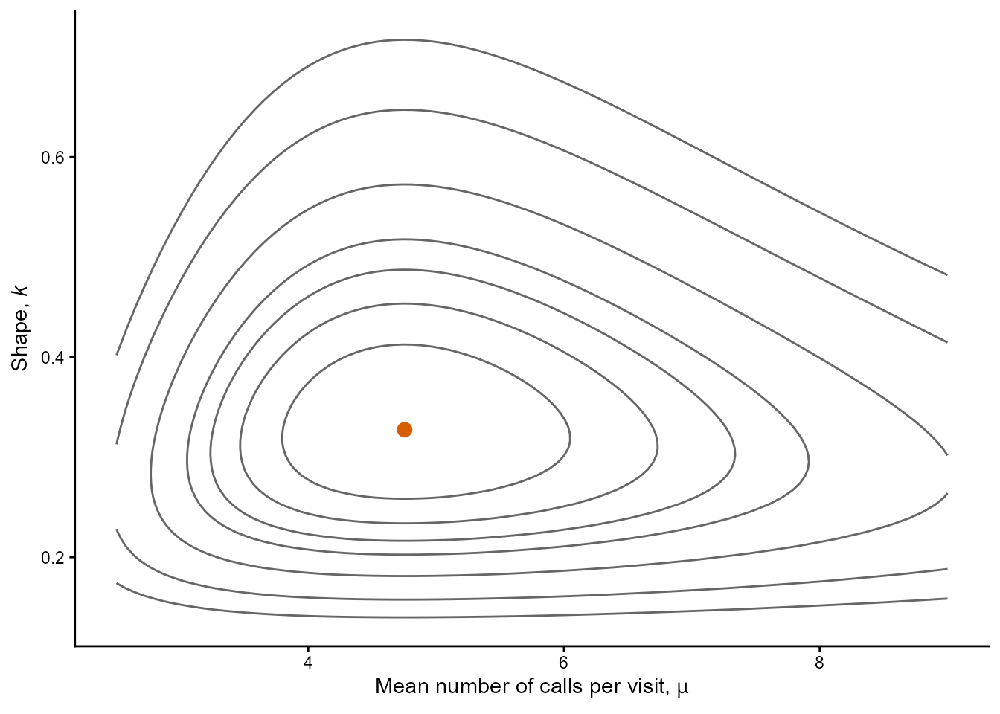
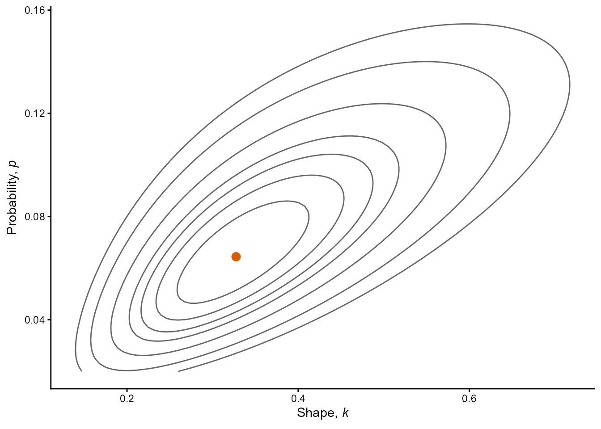
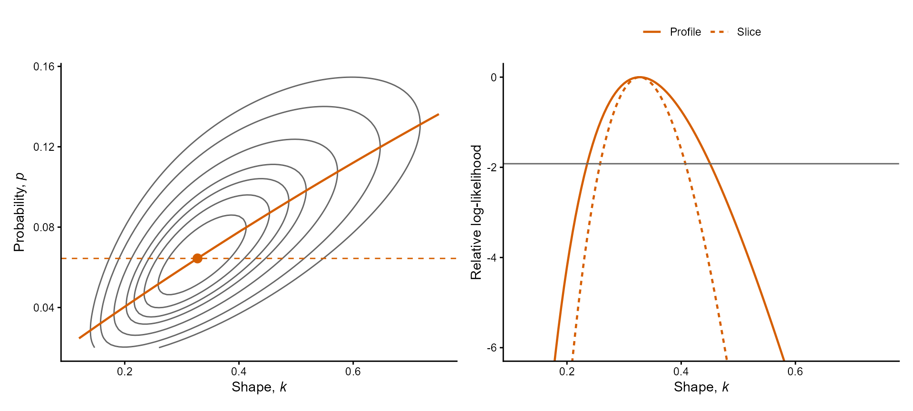

## Ecological Models and Data Analysis {.lecture-title data-timing="60"}

::: {.subtitle}
Chapter 4 · Lecture 1
:::

::: {.eyebrow}
Maximum Likelihood Estimation: the Method
:::

## Overview of the lecture {data-timing="120"}

::: {.incremental}
1. **The likelihood:** how probable are the data for a given parameter value?
2. **The log-likelihood:** why do we work with logarithms?
3. **Maximum likelihood estimation:** which value is best supported?
4. **The fit in R:** how do we find it numerically?
5. **Transformations:** how do we keep a parameter within its range?
6. **Several parameters:** what does the likelihood say about one of them?
7. **The practical:** what do we try next?
:::

## Where we are: the modelling cycle {.diagram-slide data-timing="60"}

{fig-alt="The ecological modelling cycle. Research questions guide the choice of model and data; model and data lead to estimation and to an answer, and model comparison feeds back into the cycle. Three boxes list the tools of the course with their chapters: model (distribution 2, covariates 5 and 6, groups 7), estimation (likelihood 4, marginalise 7, optimise 4 and 8, confidence intervals 3 and 4) and comparison (information criteria 4 and 6, cross-validation 6)." .cycle-diagram}

::: {.caption}
Red numbers: chapters of the course. This lecture: likelihood (4) and optimise (4) in the
estimation box.
:::

## From the method of moments to maximum likelihood {data-timing="120"}

:::: {.columns}
::: {.column .fragment width="50%"}
### Method of moments

Uses the mean and the variance of a sample.
:::
::: {.column .fragment width="50%"}
### Maximum likelihood

Uses the probability of every observation. Works for any model with a mass or density
function.
:::
::::

::: {.example .fragment}
Two running examples: fir seedlings in 50 quadrats (Poisson); barn owl calls at 122 visits
(Negative Binomial).
:::

::: {.takeaway .fragment}
Same concepts (estimator, sampling distribution, standard error, confidence interval), a
different estimator: the method of the rest of the course.
:::

## The likelihood function {data-timing="300"}

::: {.definition}
**Likelihood:** the joint probability of the observed sample, read as a function of the
parameters with the data held fixed.
:::

$$
L(\theta\mid x_1,\ldots,x_n)
= P(X_1=x_1,\ldots,X_n=x_n\mid\theta)
= \prod_{i=1}^{n}P(X_i=x_i\mid\theta)
$$

::: {.incremental}
- **The bar:** reads "for a given value of".
- **The product:** comes from independence.
- **Continuous data:** densities replace probabilities.
:::

::: {.example .fragment}
Fir seedlings: $X_i \sim \operatorname{Poisson}(\lambda)$, with $x_i$ the seedlings in
quadrat $i$.
:::

## Probability and likelihood {data-timing="180"}

:::: {.columns}
::: {.column .fragment width="50%"}
### Probability

Parameters fixed, data vary (Chapter 2).
:::
::: {.column .fragment width="50%"}
### Likelihood

Data fixed, parameters vary.
:::
::::

::: {.example .fragment}
The Poisson mass $e^{-\lambda}\lambda^{x}/x!$: a function of $x$ for a fixed $\lambda$, or
a function of $\lambda$ for an observed $x$.
:::

::: {.takeaway .fragment}
A parameter value under which the sample is more probable is better supported by the data.
:::

## A likelihood by hand {data-timing="240"}

::: {.incremental}
- **Each observation:** contributes its probability.
- **The contributions:** are multiplied.
- **Parameter values:** are compared through their likelihoods.
:::

::: {.example .fragment}
First three quadrats (0, 1 and 2 seedlings):

$$
L(\lambda\mid 0,1,2)
= \frac{e^{-\lambda}\lambda^{0}}{0!}\times
  \frac{e^{-\lambda}\lambda^{1}}{1!}\times
  \frac{e^{-\lambda}\lambda^{2}}{2!}
= \frac{e^{-3\lambda}\lambda^{3}}{2}
$$

0.0249 at $\lambda=1$ and 0.0099 at $\lambda=2$: about 2.5 times more probable under a mean
of 1.
:::

## The value of a likelihood {data-timing="180"}

::: {.incremental}
- **Every observation:** multiplies the likelihood by a probability below one.
- **Its value:** depends on the number of observations and means nothing by itself.
- **What we use:** comparisons between parameter values, for the same data.
:::

::: {.example .fragment}
All 50 quadrats: $4.2\times10^{-50}$ at $\lambda=1$ and $1.3\times10^{-39}$ at $\lambda=2$,
so about $3\times10^{10}$ times more probable under a mean of 2.
:::

## A likelihood is not the probability of a parameter value {data-timing="240"}

::: {.incremental}
- **The parameter:** fixed in the model.
- **Probabilities:** describe data and estimates across hypothetical samples.
- **Over parameter values:** a likelihood need not add up or integrate to one.
:::

::: {.example .fragment}
50 quadrats: the area under the likelihood is about $8.7\times10^{-40}$.
:::

::: {.takeaway .fragment}
Use a likelihood to compare parameter values.
:::

## Discussion: probability or likelihood? {data-timing="180"}

::: {.incremental}
1. How probable are three seedlings in a quadrat at $\lambda=2$?
2. How well do the counts 0, 1 and 2 support $\lambda=1$ against $\lambda=2$?
3. A quantity that sums to one over all possible counts.
4. A curve whose area is $8.7\times10^{-40}$.
:::

::: {.takeaway}
Probability · Likelihood
:::

::: {.activity}
**1 minute:** decide with a neighbour.
:::

## The log-likelihood {data-timing="240"}

$$
\ell(\theta) = \log(L(\theta)) = \sum_{i=1}^{n}\log(P(X_i=x_i\mid\theta))
$$

::: {.incremental}
- **The product:** becomes a sum.
- **The logarithm:** is increasing, so the maximum is at the same value.
- **Products of many probabilities:** fall below what the computer can represent.
:::

::: {.example .fragment}
1,000 simulated counts with $\lambda=4$: `prod()` returns 0; the sum of the log
probabilities is $-2094.6$.
:::

## Log-likelihoods in R {data-timing="180"}

::: {.incremental}
- **`log = TRUE`:** an argument of every `d*` function.
- **More accurate:** than taking the logarithm afterwards.
- **The log-likelihood:** the sum of these values.
:::

```{r}
#| echo: true
#| eval: false
# Counts of balsam fir seedlings in 50 quadrats (see ?boot::fir).
data(fir, package = "boot")
seedling_counts = fir$count

# Log-likelihood at lambda = 2: about -89.52.
sum(dpois(x = seedling_counts, lambda = 2, log = TRUE))

# The same number, from the logarithm of the product.
log(prod(dpois(x = seedling_counts, lambda = 2)))
```

## Continuous data {data-timing="180"}

::: {.incremental}
- **The contributions:** densities, which have units and can exceed one.
- **A log-likelihood:** can be positive, and its value changes with the units.
- **Differences** between parameter values, or models, do not change.
:::

::: {.example .fragment}
Body masses from grams to kilograms: every density is multiplied by 1,000, and the
log-likelihood of $n$ masses increases by $n\log(1000)$.
:::

## Practice 1: crab burrows {data-timing="300"}

::: {.activity}
**3 minutes:** on paper.

Three plots on a mudflat contain 3, 1 and 2 crab burrows; the counts are i.i.d. Poisson.

1. Write the likelihood as a function of $\lambda$.
2. Calculate the likelihood and the log-likelihood at $\lambda=2$ and at $\lambda=3$ burrows
   per plot.
3. Which of the two values is better supported by the data?
:::

## The maximum likelihood estimator {data-timing="240"}

::: {.definition}
**Maximum likelihood estimator (MLE):** the value of the parameter for which the likelihood
of the observed sample is highest.
:::

$$
\hat\theta
= \underset{\theta}{\arg\max}\;L(\theta\mid x_1,\ldots,x_n)
= \underset{\theta}{\arg\max}\;\ell(\theta\mid x_1,\ldots,x_n)
$$

::: {.incremental}
- **$\arg\max$:** the location of the maximum; $\max$ gives its height.
- **MLE:** stands for both the estimator and the estimate.
:::

## Closed-form solutions {data-timing="180"}

::: {.incremental}
- **At the maximum:** the slope of the log-likelihood is zero.
- **Closed form:** differentiate, set to zero, solve.
- **Only a few models:** otherwise the equations cannot be solved with algebra.
- **All the others:** we search numerically.
:::

::: {.example .fragment}
Poisson: $\hat\lambda=\overline x$, 2.14 seedlings per quadrat, which is also the
method-of-moments estimate.
:::

## The likelihood curve {.figure-slide data-timing="300"}

:::: {.columns}
::: {.column width="58%"}
{fig-alt="Relative log-likelihood of the counts of fir seedlings in the first ten quadrats under a Poisson model, against the mean number of seedlings per quadrat from 0.8 to 5. The vermillion curve rises from about -8 at 0.8 to zero at 2.2, marked by a dashed vertical line, and falls more slowly to the right, back to -8 at about 4.7, so the curve is not symmetric."}
:::
::: {.column width="42%"}
$$
\ell(\theta)-\ell(\hat\theta)
$$

::: {.incremental}
- **Relative log-likelihood:** zero at the estimate, negative elsewhere.
- **This scale:** only differences have meaning.
- **How fast it falls:** how well the data discriminate.
- **Shape:** need not be symmetric.
:::

::: {.example .fragment}
First ten quadrats (22 seedlings): $\hat\lambda=2.2$; $-3.33$ at 1.2 and $-1.76$ at 3.2.
:::
:::
::::

::: {.caption}
Vermillion: relative log-likelihood. Dashed: the estimate.
:::

## Numerical optimisation {data-timing="180"}

::: {.definition}
**Optimiser:** searches for the values at which a function reaches its minimum.
:::

:::: {.columns}
::: {.column width="56%"}
{fig-alt="Schematic without numbers. A bowl-shaped vermillion curve of the negative log-likelihood against a parameter. Three dark green arrows go from a starting value high on the left down the curve to its lowest point, which is marked as the estimate on the horizontal axis." .schematic}
:::
::: {.column width="44%"}
::: {.incremental}
- **Starts** from values that we provide.
- **Moves** step by step to lower values.
- **Stops** when it cannot improve.
- **`optim()` minimises:** we give it the **negative log-likelihood** (NLL), $-\ell(\theta)$.
:::
:::
::::

## The negative log-likelihood in R {data-timing="240"}

::: {.incremental}
- **A function of two named lists:** `parms` and `data`.
- **`getAll()`:** makes their elements available by name.
- **Returns:** minus the sum of the log probabilities.
:::

```{r}
#| echo: true
#| eval: false
# Negative log-likelihood of Poisson counts. The first argument holds the parameters
# and the second the data, both as named lists.
poisson_nll_lambda = function(parms, data) {
  # Make the elements of both lists available by name.
  getAll(parms, data)
  -sum(dpois(x = counts, lambda = lambda, log = TRUE))
}
```

::: {.takeaway .fragment}
This is the form of every NLL in the course.
:::

## From the negative log-likelihood to a fit {data-timing="180"}

{fig-alt="Schematic of four boxes from left to right, joined by arrows: the negative log-likelihood, a function of parameters and data; cmb(), which adds the data; MakeADFun(), which adds the starting values and returns par, fn and gr; and optim(), which returns par, value and convergence."}

::: {.incremental}
- **`cmb()`:** connects a likelihood to a data set; works again on other data with the same
  names.
- **`MakeADFun()`:** processes the NLL for the tools of the course, and takes the starting
  values.
- **`par`, `fn`, `gr`:** the starting values, the NLL and its gradients.
- **`optim()`:** minimises `fn` from `par`, using `gr`.
:::

## A fit in R {data-timing="300"}

The same three steps for every model:

```{r}
#| echo: true
#| eval: false
# Step 1: connect a likelihood to a data set.
cmb = function(f, d) function(p) f(p, d)

# Step 2: process the NLL of the 50 counts, with a starting value of 1 seedling per quadrat.
fir_lambda_obj = MakeADFun(
  cmb(poisson_nll_lambda, list(counts = seedling_counts)),
  list(lambda = 1),
  silent = TRUE
)

# Step 3: minimise fn, starting from par and using the slope gr.
fir_lambda_fit = optim(
  par = fir_lambda_obj$par,
  fn = fir_lambda_obj$fn,
  gr = fir_lambda_obj$gr,
  method = "BFGS"
)
```

## The result of `optim()` {data-timing="180"}

::: {.incremental}
- **`par`:** the estimates.
- **`value`:** the NLL at the estimates.
- **`convergence`:** zero when the search stopped normally; the first thing to check.
- **A code other than zero:** `par` holds no estimates.
:::

```{r}
#| echo: true
#| eval: false
fir_lambda_fit$par          # 2.14 seedlings per quadrat
fir_lambda_fit$value        # NLL at the estimate
fir_lambda_fit$convergence  # 0: a normal stop
```

## Constraints and transformations {data-timing="300"}

::: {.definition}
**Constraint:** a restriction on the values that a parameter can take.
:::

::: {.incremental}
- **An optimiser:** can try any real number; an impossible value gives `NaN`.
- **Transformation:** the search is over a quantity that can be any real number, and the NLL
  converts it.
- **Positive parameter:** logarithm, with `exp()` back.
- **Probability:** logit, with `qlogis()` and `plogis()`.
:::

```{r}
#| echo: true
#| eval: false
poisson_nll = function(parms, data) {
  getAll(parms, data)
  # Transform the parameter to the original scale.
  lambda = exp(log_lambda)
  -sum(dpois(x = counts, lambda = lambda, log = TRUE))
}
# After the fit, as before: 2.14 seedlings per quadrat.
exp(fir_fit$par)
```

## Invariance {data-timing="240"}

$$
\widehat{g(\theta)} = g(\hat\theta)
$$

::: {.incremental}
- **Invariance:** the MLE of a function of a parameter is that function of the MLE.
- **The reason:** a transformation only relabels the axis of the likelihood curve, so the
  highest point is the same on both scales.
- **Other quantities:** the MLE of anything calculated from the parameter follows.
:::

::: {.example .fragment}
Probability of an empty quadrat: $e^{-\hat\lambda}\approx 0.12$ (7 of the 50 quadrats in
the sample). Chapter 3 showed that this estimator is biased.
:::

::: {.takeaway .fragment}
Invariance carries over the estimate and not unbiasedness.
:::

## Practice 2: back to the ecological scale {data-timing="180"}

::: {.activity}
**2 minutes:** R as a calculator.

A colleague fits two models with `optim()`:

- the logarithm of the mean number of ticks per lizard, with result `par = 0.92`;
- the logit of the probability that a seed germinates, with result `par = -0.85`.

Report both estimates on the ecological scale. Are they the maximum likelihood estimates of
the mean and of the probability?
:::

## Models with several parameters {data-timing="240"}

::: {.incremental}
- **The likelihood:** a function of all parameters jointly.
- **The MLE:** the combination with the highest likelihood.
- **The curve:** becomes a surface.
- **New questions:** how to look at it, how the estimates depend on each other, what the
  data say about one parameter.
:::

::: {.example .fragment}
Barn owls: 122 visits, mean 4.75 calls per visit, variance 42.3.

$$
X_i \sim \operatorname{NegBin}(\mu,k),
\qquad \operatorname{Var}(X_i)=\mu+\frac{\mu^2}{k}
$$

:::

## A fit with two parameters in R {data-timing="300"}

:::: {.columns}
::: {.column width="34%"}
::: {.incremental}
- **One list element** per parameter.
- **Every constrained parameter:** transformed.
- **Starting values:** from the method of moments.
:::
:::
::: {.column width="66%"}

```{r}
#| echo: true
#| eval: false
# dnbinom2() of RTMBdist takes mu and size.
nb_nll = function(parms, data) {
  getAll(parms, data)
  mu = exp(log_mu)
  k = exp(log_k)
  -sum(dnbinom2(x = calls, mu = mu, size = k, log = TRUE))
}
owl_obj = MakeADFun(
  cmb(nb_nll, list(calls = call_counts)),
  list(log_mu = log(mu_hat), log_k = log(k_mom)),
  silent = TRUE
)
owl_fit = optim(
  par = owl_obj$par, fn = owl_obj$fn,
  gr = owl_obj$gr, method = "BFGS"
)
# mu: about 4.75 calls per visit.
# k: about 0.33 (0.60 by the method of moments).
exp(owl_fit$par)
```

:::
::::

## Checking the fitted model {.figure-slide data-timing="240"}

:::: {.columns}
::: {.column width="66%"}
{fig-alt="Relative frequencies of the number of calls per visit in the owl sample as grey bars, from 0 to about 26 calls, with a tall bar of 0.44 at zero and a long right tail. The fitted Negative Binomial model, a vermillion line with points, follows the bars, with 0.41 at zero. The fitted Poisson model, a dark grey line with points, is near zero at zero calls and concentrates its probability in a narrow peak around 4 and 5 calls."}
:::
::: {.column width="34%"}
::: {.incremental}
- **`optim()`:** returns estimates for any model, so we compare the fit with the data.
- **For counts:** relative frequencies against fitted probabilities.
- **Reference:** a simpler model.
:::
:::
::::

::: {.caption}
Bars: the sample. Lines and points: the fitted models.
:::

::: {.example .fragment}
Zero calls: 44% of visits, 0.41 Negative Binomial, 0.009 Poisson. The log-likelihood is
about 335 units higher.
:::

## The likelihood surface {.figure-slide data-timing="240"}

:::: {.columns}
::: {.column width="60%"}
{fig-alt="Contours of the relative log-likelihood of the owl data, with the mean number of calls per visit from 2.5 to 9 on the horizontal axis and the shape from 0.12 to 0.75 on the vertical axis. The inner contours form untilted, egg-shaped rings around a vermillion circle at a mean of about 4.75 and a shape of about 0.33, and the contours are further apart towards large values of both parameters."}
:::
::: {.column width="40%"}
::: {.incremental}
- **Contours:** join combinations with the same relative log-likelihood.
- **The MLE:** the top of the hill.
- **Contours not tilted:** the estimates hardly depend on each other.
:::

::: {.example .fragment}
$\mu$ and $k$: the best $\mu$ is the sample mean for every $k$.
:::
:::
::::

::: {.caption}
Grey: contours of the relative log-likelihood. Vermillion circle: the MLE.
:::

## Parameterisation {.figure-slide data-timing="300"}

:::: {.columns}
::: {.column width="56%"}
{fig-alt="Contours of the relative log-likelihood of the owl data, with the shape k from 0.12 to 0.75 on the horizontal axis and the probability p from 0.02 to 0.16 on the vertical axis. The contours are elongated rings tilted upwards to the right around a vermillion circle at a shape of about 0.33 and a probability of about 0.064, so a larger k goes with a larger p."}
:::
::: {.column width="44%"}
::: {.definition}
**Parameterisation:** the same model written with different parameters.
:::

::: {.incremental}
- **Same:** maximum and fitted model.
- **Different:** shape of the surface.
- **Tilted contours:** estimates that depend on each other.
- **In this course:** the mean, where possible.
:::

::: {.example .fragment}
Shape $k$ and $p=k/(k+\mu)$: maximum $-299.44$ in both; $\hat p\approx0.064$; a larger $k$
goes with a larger $p$.
:::
:::
::::

## Slices and profiles {data-timing="240"}

::: {.definition}
**Slice:** fix the other parameters, normally at their estimates.
:::

::: {.definition .fragment}
**Profile:** re-estimate them for every value of the parameter of interest.
:::

::: {.fragment}
$$
\ell_{\mathrm{prof}}(\theta_1)=\max_{\theta_2}\,\ell(\theta_1,\theta_2)
$$
:::

::: {.incremental}
- **Nuisance parameters:** the ones re-estimated; which they are depends on the question.
:::

::: {.example .fragment}
Shape $k$ and probability $p$: $\ell(k,\hat p)$ is a slice; $\max_p\,\ell(k,p)$ is the
profile of $k$.
:::

## Slice against profile {.figure-slide data-timing="300"}

{fig-alt="Two panels for the shape k of the owl model. Left: tilted contours in k and p, with a dashed vermillion horizontal line for the slice at the estimate of p and a solid vermillion line along the ridge of the surface for the profile; both pass through the vermillion circle of the estimate. Right: relative log-likelihood against k, with the slice as a dashed curve and the profile as a solid curve; both reach zero at about 0.33, the profile is above the slice everywhere else, and a horizontal line marks -1.92."}

::: {.caption}
Left: contours with the slice (dashed) and the ridge (solid). Right: the two curves.
:::

:::: {.columns}
::: {.column width="68%"}
::: {.incremental}
- **Both:** pass through the MLE; the profile is never below.
- **A slice:** treats the others as known, so it is narrower.
- **The profile:** the same however the others are written.
:::
:::
::: {.column width="32%"}
::: {.example .fragment}
$k$ within 1.92 units: slice 0.26 to 0.41, profile 0.24 to 0.45.
:::
:::
::::

::: {style="height: 45px;"}
:::

## Discussion: slice or profile? {data-timing="180"}

::: {.incremental}
1. $k$ varies with $p$ fixed at its estimate.
2. $k$ varies with $p$ re-estimated at each value.
3. What the data would say about $k$ if we knew $p$ exactly.
4. A curve that takes into account that $p$ is estimated from the same data.
:::

::: {.takeaway}
Slice · Profile
:::

::: {.activity}
**1 minute:** decide with a neighbour.
:::

## The Chapter 4 R practical: first part {data-timing="120"}

::: {.incremental}
- **Reed frog tadpoles** (Exercise 1, questions 1 to 3): likelihood by hand, estimator, fit;
  worked on the page.
- **Glacier lily seedlings** (Exercise 2, questions 1 to 3): method of moments, fit,
  contours.
:::

::: {.takeaway .fragment}
Leave standard errors and the joint region for after Lecture 2. Try, then check.
:::

## Summary and closing questions {.closing data-timing="240"}

::: {.incremental}
- The likelihood is the probability of the sample, read as a function of the parameters.
- The log-likelihood is a sum, and only differences have meaning.
- The MLE is the value with the highest likelihood, found with `optim()`.
- Transformations keep parameters in range, and invariance carries the estimate back.
- Several parameters: a surface whose shape depends on the parameterisation.
- Slices fix the other parameters and profiles re-estimate them.
:::

::: {.takeaway .fragment}
Likelihood · Log-likelihood · MLE · NLL · Transformation · Invariance · Surface · Profile
:::

::: {.activity .fragment}
**Closing questions**

1. Why is a likelihood not the probability of a parameter value?
2. Why is a slice narrower than a profile?
:::
