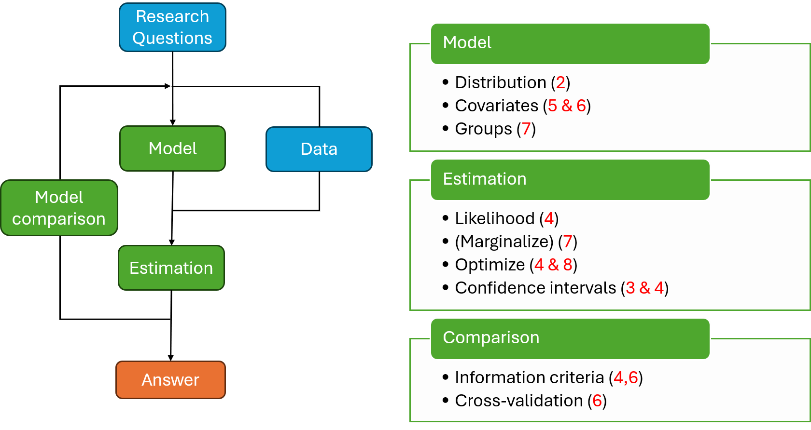
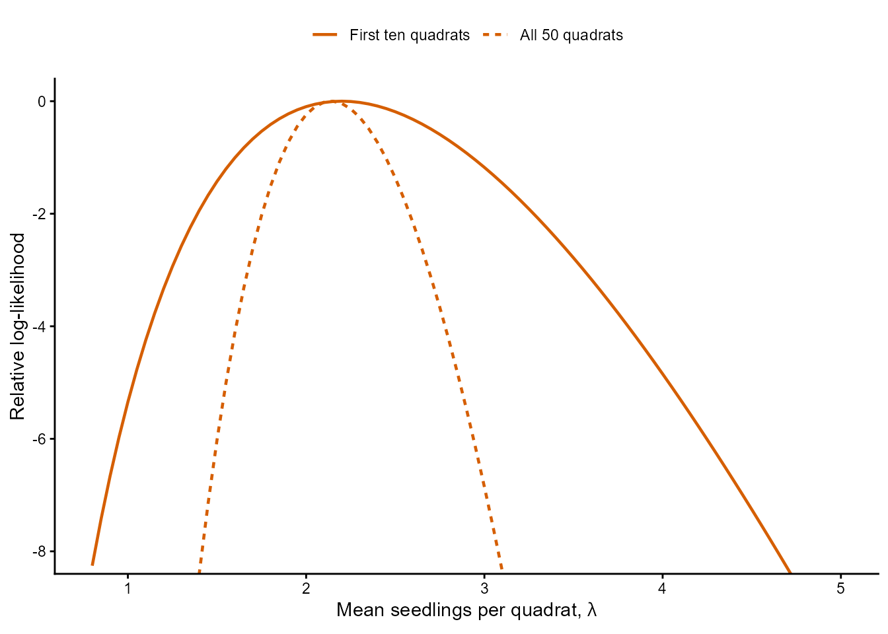
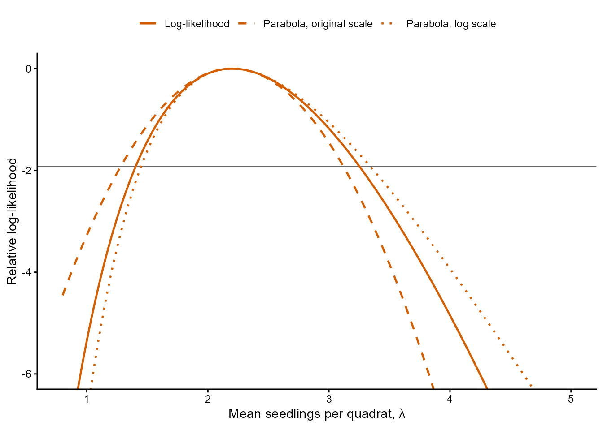
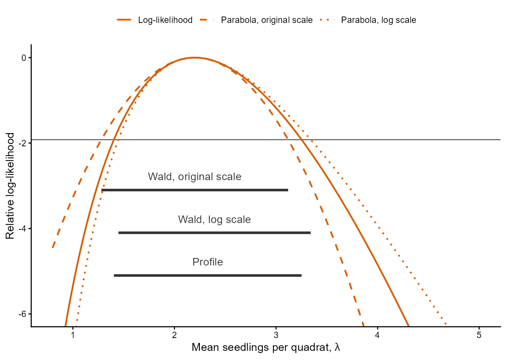
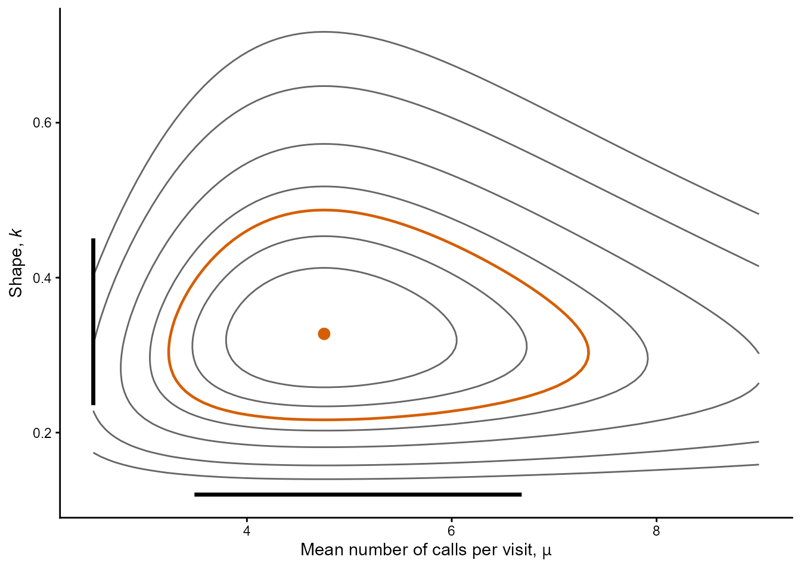
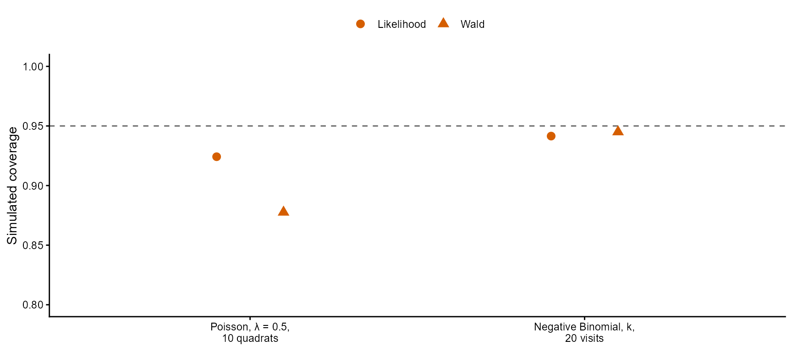

## Ecological Models and Data Analysis {.lecture-title data-timing="60"}

::: {.subtitle}
Chapter 4 · Lecture 2
:::

::: {.eyebrow}
Maximum Likelihood Estimation: Uncertainty, Properties and Model Comparison
:::

## Overview of the lecture {data-timing="120"}

::: {.incremental}
1. **Standard errors:** how precise is an estimate?
2. **Wald intervals:** what do we get from the curvature?
3. **Likelihood profile intervals:** which values do the data support?
4. **Coverage:** do the intervals do what they promise?
5. **Properties:** why does the method work, and when does it fail?
6. **Properties in R:** how do we check them by simulation?
7. **Model comparison:** which model do the data support?
8. **The practical:** what comes next?
:::

## Where we are: the modelling cycle {.diagram-slide data-timing="60"}

{fig-alt="The ecological modelling cycle. Research questions guide the choice of model and data; model and data lead to estimation and to an answer, and model comparison feeds back into the cycle. Three boxes list the tools of the course with their chapters: model (distribution 2, covariates 5 and 6, groups 7), estimation (likelihood 4, marginalise 7, optimise 4 and 8, confidence intervals 3 and 4) and comparison (information criteria 4 and 6, cross-validation 6)." .cycle-diagram}

::: {.caption}
Red numbers: chapters of the course. This lecture: confidence intervals (3 and 4) in the
estimation box, information criteria (4) in the comparison box.
:::

## Recap: the steps of a fit {data-timing="120"}

::: {.incremental}
1. **Write the model:** the random variable, its distribution, the assumptions.
2. **Write the NLL:** two lists, `getAll()`, `log = TRUE`, transformations.
3. **Connect and process it:** `cmb()` and `MakeADFun()`.
4. **Minimise it:** `optim()`, and check `convergence`.
5. **Transform back:** and compare with the data.
:::

::: {.example .fragment}
Fir seedlings, 50 quadrats: $\hat\lambda=2.14$ seedlings per quadrat. Owls:
$\hat\mu\approx4.75$ calls per visit, $\hat k\approx0.33$.
:::

::: {.takeaway .fragment}
Today: how uncertain, why it works, which model.
:::

## Uncertainty from the likelihood {data-timing="180"}

:::: {.columns}
::: {.column .fragment width="50%"}
### Wald interval

The curvature of the log-likelihood at its maximum, and asymptotic normality. Fast; what
software usually reports.
:::
::: {.column .fragment width="50%"}
### Likelihood profile interval

The whole shape around the maximum. The reference method; it needs many fits.
:::
::::

::: {.takeaway .fragment}
Both work for any parameter of any model estimated via maximum likelihood.
:::

## Asymptotic normality of the MLE {data-timing="240"}

$$
\hat\theta \overset{\mathrm{approx}}{\sim}
\operatorname{Normal}\left(\theta,\operatorname{SE}(\hat\theta)^2\right)
\quad\text{for sufficiently large }n
$$

::: {.incremental}
- **Several parameters:** a multivariate Normal (Chapter 2), with a covariance matrix.
- **Wald interval:** $\hat\theta\pm1.96\,\widehat{\operatorname{SE}}(\hat\theta)$, as in
  Chapter 3.
- **Conditions:** not on the boundary of its range; support independent of the parameter;
  smooth log-likelihood; number of parameters does not grow with $n$.
:::

::: {.example .fragment}
Poisson mean: $\operatorname{Normal}(\lambda,\lambda/n)$, the result of Chapter 3.
:::

## Curvature and standard errors {.figure-slide data-timing="240"}

$$
\ell(\theta)-\ell(\hat\theta)\approx
-\frac{(\theta-\hat\theta)^2}{2\,\widehat{\operatorname{SE}}(\hat\theta)^2}
$$

:::: {.columns}
::: {.column width="52%"}
{fig-alt="Relative log-likelihood against the mean number of seedlings per quadrat, for the first ten quadrats as a solid vermillion curve and for all 50 quadrats as a dotted vermillion curve. Both reach zero near 2.2. The curve of the 50 quadrats falls much faster on both sides: it reaches -8 at about 1.4 and 3.1, whereas the curve of the ten quadrats reaches -8 at about 0.8 and 4.7."}
:::
::: {.column width="48%"}
::: {.incremental}
- **Large sample:** near its maximum, the log-likelihood is close to a parabola.
- **Falls slowly:** low curvature, many values supported, large standard error.
- **One parameter:** standard error = $1/\sqrt{\text{curvature}}$.
- **Several:** the curvatures give the covariance matrix.
:::

::: {.example .fragment}
Standard error of $\hat\lambda$: ten quadrats, 0.47; 50 quadrats, 0.207 seedlings per
quadrat.
:::
:::
::::

::: {.caption}
Relative log-likelihood of the same Poisson model. Solid: the first ten quadrats. Dotted:
all 50.
:::

## `sdreport()`: standard errors and correlations {data-timing="240"}

:::: {.columns}
::: {.column width="46%"}
::: {.incremental}
- **`sdreport(obj)`:** after the fit; the curvature at the estimates.
- **`summary()`:** a row per parameter, with `Estimate` and `Std. Error`, on the optimised
  scale.
- **`cov.fixed`:** the covariance matrix; `cov2cor()` gives the correlations.
- **Tilted contours:** correlated estimates.
:::
:::
::: {.column width="54%"}

```{r}
#| echo: true
#| eval: false
# Standard errors after the fit of the owl model.
owl_sd = sdreport(owl_obj)
summary(owl_sd)
#        Estimate Std. Error
# log_mu    1.559      0.164
# log_k    -1.116      0.165

# Correlation between the two estimates.
cov2cor(owl_sd$cov.fixed)  # about 0
```

:::
::::

::: {.example .fragment}
Correlation of the estimates: $\log(\mu)$ and $\log(k)$, about 0; $\log(k)$ and
$\operatorname{logit}(p)$, 0.71, the tilt of the surface in Lecture 1.
:::

## Back-transforming a standard error {data-timing="300"}

`sdreport()` gives the standard error on the scale that was optimised.

:::: {.columns}
::: {.column .fragment width="50%"}
### A non-linear function and an average

For a non-linear $g$: $E[g(X)]\neq g(E[X])$.

A variance is an average and a standard error its square root, so applying $g$ to them
gives no standard error. Estimates and endpoints are values: they transform.
:::
::: {.column .fragment width="50%"}
### The delta method

Treats $g$ as a straight line near the estimate: an approximation (Chapter 6).

`ADREPORT(k)` in the NLL: `sdreport()` adds a row with the standard error of $k$.
:::
::::

::: {.example .fragment}
Ten quadrats (Poisson): `log_lambda`: 0.79 (0.21). `exp(log_lambda)`: 2.2 (1.24) but from the
formula we know std error of $\hat\lambda$ is 0.47.
:::

::: {.takeaway .fragment}
Transform estimates and endpoints; for a standard error on the new scale, use `ADREPORT()`.
:::

## A Wald interval depends on the scale {.figure-slide data-timing="240"}

:::: {.columns}
::: {.column width="52%"}
{fig-alt="Relative log-likelihood of the first ten quadrats against the mean number of seedlings per quadrat. The solid vermillion curve is the log-likelihood, the dashed curve a parabola on the original scale and the dotted curve a parabola on the log scale. All touch at zero at 2.2. Near a horizontal grey line at -1.92 the dashed curve lies outside the solid curve on the left and inside it on the right, and the dotted curve lies inside it on the left and outside it on the right."}
:::
::: {.column width="48%"}
::: {.incremental}
- **Wald interval:** replaces the log-likelihood by a parabola.
- **Optimised scale:** an unconstrained parameter is closer to Normal; calculate it there.
- **Endpoints:** an increasing transformation keeps the coverage.
- **Positive parameter:** stays positive, and asymmetry is captured.
:::

::: {.example .fragment}
Ten quadrats: 1.28 to 3.12 on the original scale; 1.45 to 3.34 from the log scale. Owls,
$k$: 0.221 to 0.434; 0.237 to 0.453.
:::
:::
::::

::: {.caption}
Solid: the log-likelihood. Dashed and dotted: parabolas on the original and the log scale.
Grey line: $-1.92$.
:::

## Practice 3: an interval from the log scale {data-timing="240"}

::: {.activity}
**2 minutes:** R as a calculator.

A fit on the log scale returned `par = 0.92` for the logarithm of the mean number of ticks
per lizard, and `sdreport()` reports a standard error of 0.141.

1. Calculate a 95% Wald interval for the mean number of ticks per lizard.
2. Why is it not symmetric around the estimate?
:::

## Likelihood profile intervals {data-timing="240"}

::: {.definition}
**Likelihood profile interval:** the values whose relative profile log-likelihoods are 1.92
units from the maximum.
:::

::: {.incremental}
- **1.92:** half the 0.95 quantile of a chi-squared distribution with one degree of freedom
  ($1.92 = 1.96^2/2$).

```{r}
#| echo: true
#| eval: false
qchisq(p = 0.95, df = 1) / 2  # 1.92
```

- **Wilks' theorem:** explains why the chi-squared distribution comes from and relationship
to asymptotic normality (same regularity conditions apply).
:::


## Reading a likelihood profile interval {.figure-slide data-timing="300"}

:::: {.columns}
::: {.column width="58%"}
{fig-alt="The relative log-likelihood of the first ten quadrats with its two parabolas and a horizontal grey line at -1.92, as on the earlier slide. Three dark horizontal segments below the line show the 95% intervals: Wald on the original scale from 1.28 to 3.12, Wald from the log scale from 1.45 to 3.34, and profile from 1.40 to 3.25, whose endpoints lie where the solid curve crosses the grey line."}
:::
::: {.column width="42%"}
::: {.incremental}
- **Shape:** the interval follows the curve, so it need not be symmetric.
- **Scale:** it does not depend on it.
- **Inner fits:** move the parameter, re-estimate the others, record the NLL, find the two
  crossings of the cutoff.
- **Larger sample:** closer to a parabola, so the intervals agree.
:::

::: {.example .fragment}
Ten quadrats: profile 1.40 to 3.25. With all 50 the three intervals nearly coincide.
:::
:::
::::

::: {.caption}
95% intervals: Wald on the original scale, 1.28 to 3.12; Wald from the log scale, 1.45 to
3.34; profile, 1.40 to 3.25.
:::

## `tmbprofile()` and `confint()` {data-timing="120"}

::: {.incremental}
- **`TMB::tmbprofile(obj, name, trace = FALSE)`:** profiles one parameter, named as in the
  list of parameters; returns a data frame.
- **`confint()`:** finds the two crossings of the cutoff.
- **Both on the optimised scale:** transform the endpoints back.
:::

```{r}
#| echo: true
#| eval: false
# Ten quadrats: 1.40 to 3.25 seedlings per quadrat.
fir_ten_profile = TMB::tmbprofile(fir_ten_obj, name = "log_lambda", trace = FALSE)
exp(confint(fir_ten_profile))

# Owls: k from 0.235 to 0.451.
owl_profile_k = TMB::tmbprofile(owl_obj, name = "log_k", trace = FALSE)
exp(confint(owl_profile_k))
```

## Profile intervals with several parameters {data-timing="240"}

::: {.incremental}
- **Each parameter:** its own profile, with the others re-estimated.
- **Wald, optimised scale:** can come close.
- **Wald, original scale:** may miss the asymmetry.
- **The reference:** the likelihood profile interval.
:::

::: {.example .fragment}

| 95% interval | Mean $\mu$ (calls per visit) | Shape $k$ |
|---|---|---|
| Profile | 3.49 to 6.68 | 0.235 to 0.451 |
| Wald, from the log scale | 3.45 to 6.55 | 0.237 to 0.453 |
| Wald, original scale | | 0.221 to 0.434 |

:::

## Joint confidence regions {.figure-slide data-timing="240"}

::: {.definition}
**Joint confidence region:** the combinations whose relative log-likelihood is above a
cutoff; 3.00 for two parameters (half the 0.95 quantile with two degrees of freedom).
:::

:::: {.columns}
::: {.column width="50%"}
{fig-alt="Contours of the relative log-likelihood of the owl data in the mean and the shape, with a vermillion contour at -3.00 around a vermillion circle at the estimate. Dark segments along the axes show the likelihood profile intervals of the two parameters, from about 3.49 to 6.68 for the mean and from about 0.235 to 0.451 for the shape. The vermillion contour extends beyond both segments."}
:::
::: {.column width="50%"}
::: {.incremental}
- **The region:** lies inside one contour of the surface.
- **Beyond each interval:** it extends further than either.
- **The rectangle** of two intervals is not a 95% region.
- **Use:** an interval for one parameter, a region for a combination.
:::
:::
::::

::: {.caption}
The owl model. Vermillion contour: the region. Segments on the axes: the two profile
intervals.
:::

## Simulating from a fitted model {data-timing="180"}

::: {.incremental}
- **`OBS()`** in the NLL: marks the data as observations.
- **`obj$simulate()`:** draws a hypothetical sample of the size of the data, for parameters
  on the optimised scale.
- **Placeholder data** of another length: give another sample size.
:::

```{r}
#| echo: true
#| eval: false
# The complete NLL of the Negative Binomial model.
nb_nll = function(parms, data) {
  getAll(parms, data)
  # Mark the data as observations, so that they can be simulated.
  calls = OBS(calls)
  mu = exp(log_mu)
  k = exp(log_k)
  ADREPORT(k)
  -sum(dnbinom2(x = calls, mu = mu, size = k, log = TRUE))
}
# After processing and fitting: the first 20 counts of one hypothetical sample.
owl_obj$simulate(owl_fit$par)$calls[1:20]
```

## Coverage of Wald and profile intervals {.figure-slide data-timing="240"}

:::: {.columns}
::: {.column width="62%"}
{fig-alt="Simulated coverage of nominal 95% intervals, with a dashed line at 0.95. Poisson with a mean of 0.5 and 10 quadrats: likelihood interval 0.924, Wald interval 0.878. Negative Binomial, shape k, 20 visits: likelihood interval 0.942, Wald interval 0.945, both close to the dashed line."}

::: {.caption}
Dashed line: the nominal level. Likelihood: the likelihood profile interval. Poisson: Wald
on the original scale. Negative Binomial: Wald from the log scale.
:::
:::
::: {.column width="38%"}
::: {.incremental}
- **Simulate** from known parameters: does each interval contain them?
- **Wald, original scale:** fails where the log-likelihood is far from a parabola.
- **Wald, suitable scale:** can match the profile, with one fit.
- **Simulated coverage:** has its own noise.
:::
:::
::::

::: {.example .fragment}
Wald 0.878 and profile 0.924 (Poisson); 0.945 and 0.942 (Negative Binomial).
:::

::: {.takeaway .fragment}
Profile intervals: closer to 95% in small samples, at the cost of many fits. Wald on the
log scale: the fast approximation.
:::

## Discussion: Wald or profile? {data-timing="180"}

::: {.incremental}
1. Uses the curvature at the maximum.
2. Gives the same interval on any scale.
3. Needs a single fit.
4. Can include negative values for a positive parameter.
:::

::: {.takeaway}
Wald · Profile
:::

::: {.activity}
**1 minute:** decide with a neighbour.
:::

## Consistency and asymptotic normality {data-timing="300"}

::: {.definition}
**Consistent estimator:** the chance of missing the parameter by more than any given margin
becomes small as the sample grows.
:::

::: {.incremental}
- **An MLE is an estimator:** it has a sampling distribution, a bias and a variance.
- **MLEs are consistent:** when the observations are i.i.d. from the model; a statement
  about probabilities, not about every sample.
- **Normal approximation:** how large $n$ must be depends on the model and the parameter.
- **Large $n$:** the standard error of one fit describes the spread across samples.
:::

::: {.example .fragment}
Missing $k$ by 0.1 or more: 45% with 20 visits, 7% with 122, none with 500.
:::

## Efficiency {data-timing="240"}

::: {.definition}
**More efficient:** estimates vary less across hypothetical samples.
:::

::: {.incremental}
- **Maximum likelihood:** uses the probability of each observation; the method of moments
  only the mean and the variance.
- **Asymptotically efficient:** in large samples no other regular estimator is more precise.
- **The limit:** the variance from the curvature of the log-likelihood is the smallest that
  such an estimator can have.
:::

::: {.example .fragment}
Standard deviation of $\hat k$: 122 visits, 0.055 against 0.086; 500 visits, 0.024 against
0.042. The method of moments would need about 2.5 times as many visits.
:::

::: {.takeaway .fragment}
The reason to use maximum likelihood whenever the likelihood can be written.
:::

## Bias in finite samples {data-timing="240"}

::: {.incremental}
- **MLEs:** in general biased in finite samples.
- **The bias:** shrinks as the sample grows, faster than the standard error.
- **Small sample:** these properties are approximations.
- **Check by simulation:** simulate hypothetical samples from the fit, refit each, and
  compare the mean of the estimates with the value used to simulate.
:::

::: {.example .fragment}
Relative bias of $\hat k$: 21%, 2.6% and 0.6% for 20, 122 and 500 visits.
:::

## Live demo: properties by simulation {.demo-slide data-timing="1080"}

::: {.incremental}
1. **One hypothetical sample:** `obj$simulate()` at the estimates, fitted like the data.
2. **Many samples:** placeholder data set the sample size; keep every estimate.
3. **Sampling distributions:** a histogram of the estimates for each sample size.
4. **Properties:** consistency, the standard error, efficiency and bias from the estimates.
:::

::: {.demo}
**Script:** `demo-properties.R`, sections 1 to 4 (the owl model; section 3 runs for about a
minute).
:::

## Misspecified models {data-timing="240"}

::: {.definition}
**Misspecified:** the model does not contain the distribution of the data generating
process, for any parameter values.
:::

::: {.incremental}
- **The MLE:** converges to the values that bring the model closest to that process (the
  Kullback–Leibler divergence).
- **The fit:** the best approximation that the model offers.
- **Standard errors and intervals:** become approximations.
:::

## The Akaike information criterion {data-timing="360"}

$$
\mathrm{AIC}=2K-2\,\ell(\hat\theta)
$$

::: {.incremental}
- **$K$:** the number of estimated parameters.
- **More parameters:** more freedom to adapt to its own sample; when a model contains
  another as a special case, its maximum cannot be lower.
- **Lowest AIC:** preferred; only differences between models fitted to the same observations
  in the same units are meaningful.
- **It estimates:** the distance to the data generating process when predicting new data.
- **AICc:** adds $2K(K+1)/(n-K-1)$ for small samples; an approximation.
:::

::: {.example .fragment}
Owls: Poisson, $K=1$, $\ell=-634.16$, AIC = 1270.

Negative Binomial, $K=2$, $\ell=-299.44$, AIC = 603.
:::

## Using AIC {data-timing="180"}

::: {.incremental}
- **It ranks** the candidates that we give it.
- **It does not show** that the best one describes the data well.
- **"Reject unless AIC drops by two units":** null hypothesis testing in disguise.
- **One criterion among others:** for evidence and prediction.
:::

::: {.example .fragment}
Negative Binomial far better than Poisson for the owls, and still an approximation (visits
to the same nest).
:::

## Practice 4: waiting for a pollinator {data-timing="240"}

::: {.activity}
**2 minutes:** on paper.

An Exponential model ($K=1$) and a Gamma model ($K=2$) are fitted to the same waiting times
between visits of pollinators to a flower. The maximum log-likelihoods are $-231.0$ and
$-230.4$.

1. Calculate the AIC of both models. Which one is lower?
2. Could the log-likelihood of the Gamma model have been the lower of the two?
:::

## A recipe for a fit {data-timing="120"}

::: {.incremental}
1. **Write the model:** random variable, distribution, assumptions.
2. **Write the NLL:** `getAll()`, `log = TRUE`, transformations.
3. **Connect and process it:** `cmb()`, `MakeADFun()`, starting values.
4. **Minimise it:** `optim()`, `method = "BFGS"`, check `convergence`.
5. **Transform back:** compare the fitted model with the data.
6. **Standard errors and Wald intervals:** `sdreport()`, `ADREPORT()`.
7. **Likelihood profile intervals:** `TMB::tmbprofile()`, `confint()`.
8. **Compare the candidates:** AIC.
:::

::: {.takeaway .fragment}
The same steps for every model in the rest of the book.
:::

## The Chapter 4 R practical {data-timing="120"}

::: {.incremental}
- **Reed frog tadpoles** (Exercise 1, questions 3 to 6): standard errors, intervals,
  adequacy, predators.
- **Glacier lily seedlings** (Exercise 2): joint region, intervals, AIC.
- **Zero inflation** (Exercise 3).
- **Timber volume** (Exercise 4): Gamma model, slice and profile.
- **Simulation** (Exercise 5): extra.
:::

::: {.takeaway .fragment}
Exercises 1 to 4 are the core. Try, then check.
:::

## Summary and closing questions {.closing data-timing="180"}

::: {.incremental}
- In large samples an MLE is approximately Normal, with a covariance matrix from the
  curvature of the log-likelihood.
- `sdreport()` gives standard errors on the optimised scale; endpoints transform back,
  standard errors need `ADREPORT()`.
- Profile intervals follow the likelihood and do not depend on the scale.
- Simulation checks coverage and the properties of estimators.
- MLEs are consistent and asymptotically efficient, and biased in small samples.
- AIC ranks candidates and shows nothing about whether they are good.
:::

::: {.takeaway .fragment}
Curvature · Standard errors · Wald · Profile · Coverage · Efficiency · AIC
:::

::: {.activity .fragment}
**Closing questions**

1. Why can we transform the endpoints of an interval and not a standard error?
2. What does AIC not tell us?
:::
