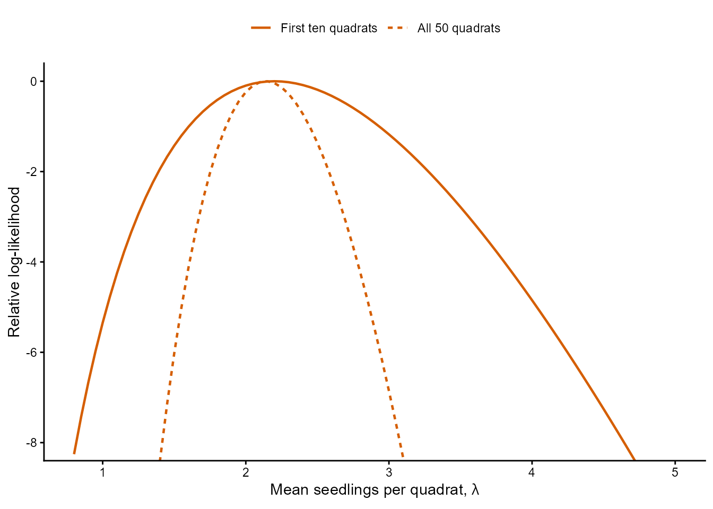
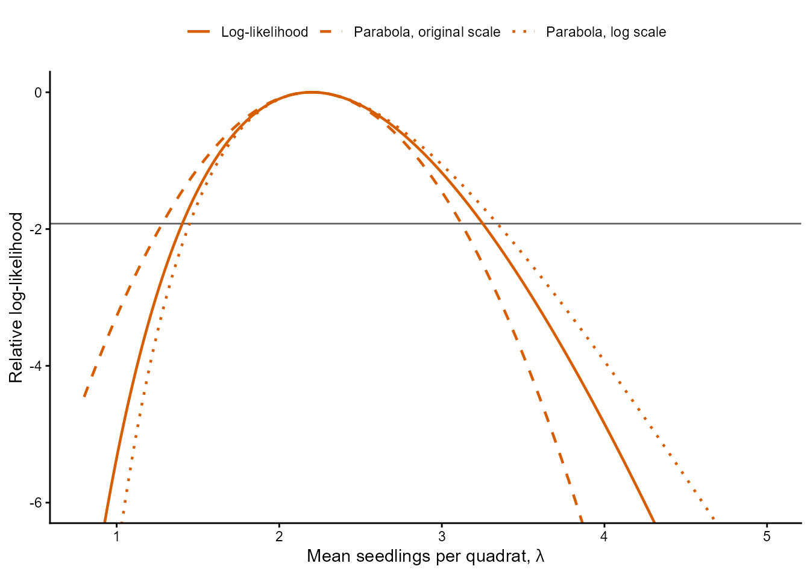
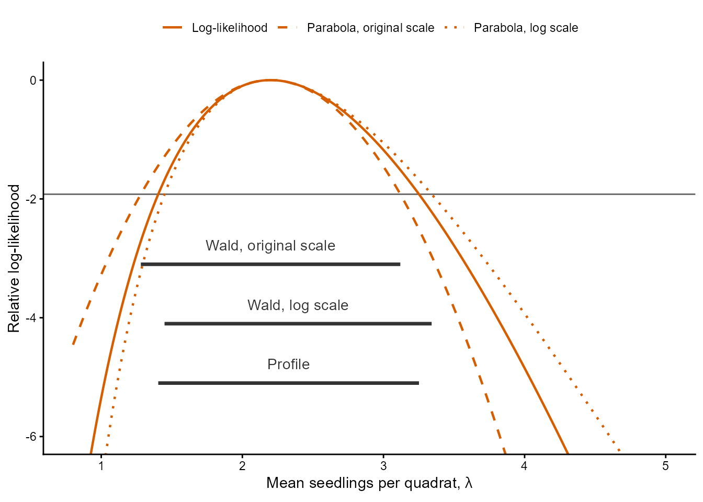
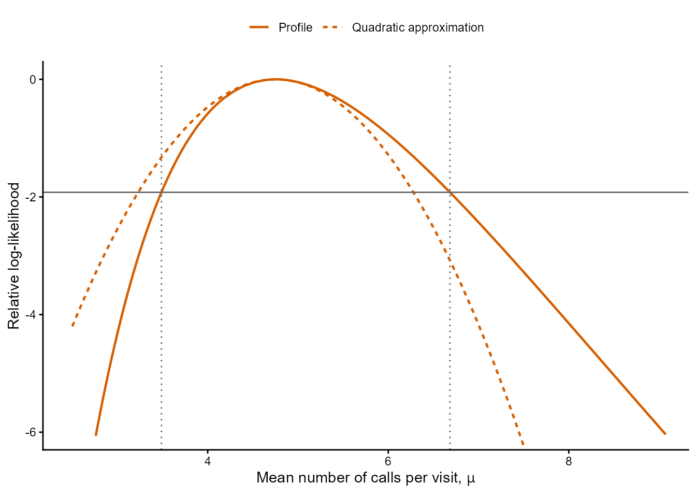
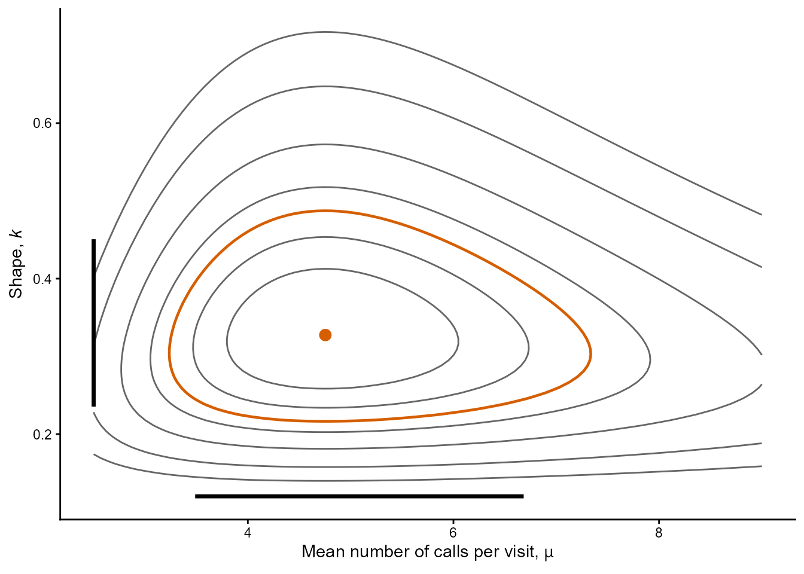
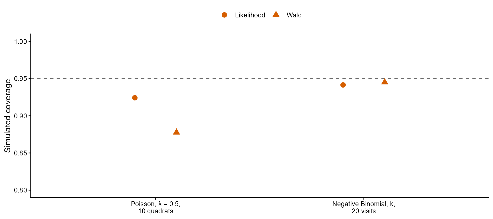
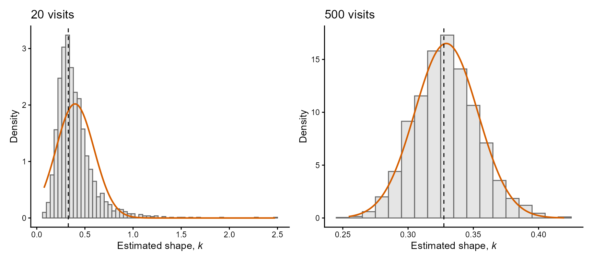

## Ecological Models and Data Analysis {.lecture-title data-timing="60"}

::: {.subtitle}
Chapter 4 · Lecture 2
:::

::: {.eyebrow}
Maximum Likelihood Estimation: Uncertainty, Properties and Model Comparison
:::

## Overview of the lecture {data-timing="120"}

::: {.incremental}
1. **Standard errors:** how precise is an estimate?
2. **Wald intervals:** what do we get from the curvature?
3. **Profile likelihood intervals:** which values do the data support?
4. **Coverage:** do the intervals do what they promise?
5. **Properties:** why does the method work, and when does it fail?
6. **Model comparison:** which model do the data support?
7. **The practical:** what comes next?
:::

## Where we are: the modelling cycle {.diagram-slide data-timing="60"}

{fig-alt="The ecological modelling cycle. Research questions guide the choice of model and data; model and data lead to estimation and to an answer, and model comparison feeds back into the cycle. Three boxes list the tools of the course with their chapters: model (distribution 2, covariates 5 and 6, groups 7), estimation (likelihood 4, marginalise 7, optimise 4 and 8, confidence intervals 3 and 4) and comparison (information criteria 4 and 6, cross-validation 6)." .cycle-diagram}

::: {.caption}
Red numbers: chapters of the course. This lecture: confidence intervals (3 and 4) in the
estimation box, information criteria (4) in the comparison box.
:::

## Recap: the steps of a fit {data-timing="120"}

::: {.incremental}
1. **Write the model:** the random variable, its distribution, the assumptions.
2. **Write the NLL:** two lists, `getAll()`, `log = TRUE`, transformations.
3. **Connect and process it:** `cmb()` and `MakeADFun()`.
4. **Minimise it:** `optim()`, and check `convergence`.
5. **Transform back:** and compare with the data.
:::

::: {.example .fragment}
Fir seedlings, 50 quadrats: $\hat\lambda=2.14$ seedlings per quadrat. Owls:
$\hat\mu\approx4.75$ calls per visit, $\hat k\approx0.33$.
:::

::: {.takeaway .fragment}
Today: how uncertain, why it works, which model.
:::

## Uncertainty from the likelihood {data-timing="180"}

:::: {.columns}
::: {.column .fragment width="50%"}
### Wald interval

The curvature of the log-likelihood at its maximum, and asymptotic normality. Fast; what
software usually reports.
:::
::: {.column .fragment width="50%"}
### Profile likelihood interval

The whole shape around the maximum. The reference method; it needs many fits.
:::
::::

::: {.takeaway .fragment}
Both work for any model fitted with `optim()`, without a formula for the variance.
:::

## Asymptotic normality of the MLE {data-timing="240"}

$$
\hat\theta \overset{\mathrm{approx}}{\sim}
\operatorname{Normal}\left(\theta,\frac{1}{\mathcal I(\theta)}\right)
\quad\text{for sufficiently large }n
$$

::: {.incremental}
- **Fisher information** $\mathcal I(\theta)$: what the sample contains about $\theta$.
- **More information:** a narrower bell.
- **Conditions:** not on the boundary of its range; support independent of the parameter;
  smooth log-likelihood; number of parameters does not grow with $n$.
:::

::: {.example .fragment}
Poisson mean: $\operatorname{Normal}(\lambda,\lambda/n)$, the result of Chapter 3.
:::

## Fisher information {.figure-slide data-timing="300"}

$$
\hat{\mathcal I}=-\ell''(\hat\theta),
\qquad
\widehat{\operatorname{Var}}(\hat\theta)=\frac{1}{\hat{\mathcal I}},
\qquad
\widehat{\operatorname{SE}}(\hat\theta)=\frac{1}{\sqrt{\hat{\mathcal I}}}
$$

:::: {.columns}
::: {.column width="52%"}
{fig-alt="Relative log-likelihood against the mean number of seedlings per quadrat, for the first ten quadrats as a solid vermillion curve and for all 50 quadrats as a dotted vermillion curve. Both reach zero near 2.2. The curve of the 50 quadrats falls much faster on both sides: it reaches -8 at about 1.4 and 3.1, whereas the curve of the ten quadrats reaches -8 at about 0.8 and 4.7."}
:::
::: {.column width="48%"}
::: {.incremental}
- **Observed information:** the curvature at the maximum.
- **Sharp:** the data discriminate; small variance.
- **Flat:** many values almost equally supported; large variance.
:::

::: {.example .fragment}
Poisson: $\hat{\mathcal I}=n/\hat\lambda$. Ten quadrats: standard error 0.47; 50 quadrats:
0.207 seedlings per quadrat.
:::
:::
::::

::: {.caption}
Relative log-likelihood of the same Poisson model. Solid: the first ten quadrats. Dotted:
all 50.
:::

## The Hessian matrix {data-timing="240"}

::: {.definition}
**Hessian:** the matrix of second derivatives of a function.
:::

::: {.incremental}
- **Hessian of the NLL at the estimates:** the observed information matrix.
- **Its inverse:** variances on the diagonal, covariances off the diagonal.
- **`optim(hessian = TRUE)`:** returns it for the parameters that it searched over.
- **Tilted contours:** correlated estimates; `cov2cor()` gives the correlation.
:::

::: {.example .fragment}
Correlation of the estimates: $\log(\mu)$ and $\log(k)$, about 0; $\log(k)$ and
$\operatorname{logit}(p)$, 0.71, the tilt of the surface in Lecture 1.
:::

## From the Hessian to standard errors in R {data-timing="180"}

::: {.incremental}
- **`solve()`:** the inverse of the Hessian.
- **`diag()`:** the variances, from its diagonal.
- **`sqrt()`:** the standard errors.
:::

```{r}
#| echo: true
#| eval: false
# Fit the owl model again, now asking optim() for the Hessian.
owl_fit = optim(
  par = owl_obj$par, fn = owl_obj$fn, gr = owl_obj$gr,
  method = "BFGS", hessian = TRUE
)

# Invert the Hessian, take the variances from its diagonal and their square roots.
owl_covariance = solve(owl_fit$hessian)
sqrt(diag(owl_covariance))  # log_mu: 0.164, log_k: 0.165
```

::: {.takeaway .fragment}
Standard errors of $\log(\mu)$ and $\log(k)$, not of $\mu$ and $k$.
:::

## Transformed parameters {data-timing="300"}

The Hessian gives the standard error on the scale that was optimised.

:::: {.columns}
::: {.column .fragment width="50%"}
### Endpoints can be transformed back

The transformation is increasing, so the interval contains the parameter in the same
hypothetical samples: coverage is kept.
:::
::: {.column .fragment width="50%"}
### A standard error cannot

It is built from expectations, which do not pass through non-linear functions (Jensen's
inequality). The correction is the **delta method** (Chapter 6).
:::
::::

::: {.example .fragment}
Ten quadrats: 0.213 on the log scale. Its `exp()` is about 1.24, which is wrong;
$0.213\times2.2$ gives 0.47, the standard error of $\hat\lambda$.
:::

## A Wald interval depends on the scale {.figure-slide data-timing="240"}

$$
\ell(\theta)-\ell(\hat\theta)\approx
-\frac{(\theta-\hat\theta)^2}{2\,\widehat{\operatorname{SE}}(\hat\theta)^2}
$$

:::: {.columns}
::: {.column width="52%"}
{fig-alt="Relative log-likelihood of the first ten quadrats against the mean number of seedlings per quadrat. The solid vermillion curve is the log-likelihood, the dashed curve a parabola on the original scale and the dotted curve a parabola on the log scale. All touch at zero at 2.2. Near a horizontal grey line at -1.92 the dashed curve lies outside the solid curve on the left and inside it on the right, and the dotted curve lies inside it on the left and outside it on the right."}
:::
::: {.column width="48%"}
::: {.incremental}
- **Wald interval:** replaces the log-likelihood by a parabola.
- **Good:** if close to a parabola on that scale.
- **Optimised scale:** calculate it there, then transform the endpoints.
- **Positive parameter:** stays positive, and asymmetry is captured.
:::

::: {.example .fragment}
Ten quadrats: 1.28 to 3.12 on the original scale; 1.45 to 3.34 from the log scale.
:::
:::
::::

::: {.caption}
Solid: the log-likelihood. Dashed and dotted: parabolas on the original and the log scale.
Grey line: $-1.92$.
:::

## `sdreport()` and `ADREPORT()` {data-timing="240"}

:::: {.columns}
::: {.column width="46%"}
::: {.incremental}
- **`sdreport(obj)`:** after the fit, calculates the Hessian and reads the estimates.
- **`summary()`:** a row per parameter, with `Estimate` and `Std. Error`, on the optimised
  scale.
- **`ADREPORT()`** in the NLL: adds a row for a quantity calculated from the parameters.
:::
:::
::: {.column width="54%"}

```{r}
#| echo: true
#| eval: false
nb_nll = function(parms, data) {
  getAll(parms, data)
  mu = exp(log_mu)
  k = exp(log_k)
  # Ask for the standard error of k itself.
  ADREPORT(k)
  -sum(dnbinom2(x = calls, mu = mu, size = k,
                log = TRUE))
}
# Process the new NLL and fit it again (as before),
# then calculate the standard errors.
owl_sd = sdreport(owl_obj)
summary(owl_sd)
#        Estimate Std. Error
# log_mu    1.559      0.164
# log_k    -1.116      0.165
# k         0.327      0.054
```

:::
::::

::: {.example .fragment}
Wald intervals from the log scale: $\mu$, 3.45 to 6.55 calls per visit; $k$, 0.237 to 0.453.
On the original scale: $k$, 0.221 to 0.434.
:::

## Practice 3: an interval from the log scale {data-timing="240"}

::: {.activity}
**2 minutes:** R as a calculator.

A fit on the log scale returned `par = 0.92` for the logarithm of the mean number of ticks
per lizard, and `sdreport()` reports a standard error of 0.141.

1. Calculate a 95% Wald interval for the mean number of ticks per lizard.
2. Why is it not symmetric around the estimate?
:::

## Profile likelihood intervals {data-timing="300"}

::: {.definition}
**Profile likelihood interval:** all the values whose relative profile log-likelihood is
within 1.92 units of the maximum; the other parameters are re-estimated for each value.
:::

::: {.incremental}
- **1.92:** half the 0.95 quantile of a chi-squared distribution with one degree of freedom
  (3.84, the square of 1.96).
- **Wilks' theorem:** twice the drop at the generating value behaves like the square of a
  standard Normal variable.
- **So:** about 95% of hypothetical samples fall within the cutoff.
:::

```{r}
#| echo: true
#| eval: false
qchisq(p = 0.95, df = 1) / 2  # 1.92
```

## Reading a profile likelihood interval {.figure-slide data-timing="240"}

:::: {.columns}
::: {.column width="58%"}
{fig-alt="The relative log-likelihood of the first ten quadrats with its two parabolas and a horizontal grey line at -1.92, as on the earlier slide. Three dark horizontal segments below the line show the 95% intervals: Wald on the original scale from 1.28 to 3.12, Wald from the log scale from 1.45 to 3.34, and profile from 1.40 to 3.25, whose endpoints lie where the solid curve crosses the grey line."}
:::
::: {.column width="42%"}
::: {.incremental}
- **Shape:** the interval follows the curve, so it need not be symmetric.
- **Scale:** it does not depend on it.
- **Inner fits:** move the parameter, re-estimate the others, record the NLL, find the two
  crossings of the cutoff.
:::

::: {.example .fragment}
Ten quadrats: profile 1.40 to 3.25; 0.80 below and 1.05 above the estimate.
:::
:::
::::

::: {.caption}
95% intervals: Wald on the original scale, 1.28 to 3.12; Wald from the log scale, 1.45 to
3.34; profile, 1.40 to 3.25.
:::

## `tmbprofile()` and `confint()` {data-timing="180"}

::: {.incremental}
- **`TMB::tmbprofile(obj, name, trace = FALSE)`:** profiles one parameter, named as in the
  list of parameters; returns a data frame.
- **`confint()`:** finds the two crossings of the cutoff.
- **Both on the optimised scale:** transform the endpoints back.
:::

```{r}
#| echo: true
#| eval: false
# Ten quadrats: 1.40 to 3.25 seedlings per quadrat.
fir_ten_profile = TMB::tmbprofile(fir_ten_obj, name = "log_lambda", trace = FALSE)
exp(confint(fir_ten_profile))

# Owls: k from 0.235 to 0.451.
owl_profile_k = TMB::tmbprofile(owl_obj, name = "log_k", trace = FALSE)
exp(confint(owl_profile_k))
```

## Intervals and sample size {data-timing="240"}

::: {.incremental}
- **Larger sample:** the log-likelihood is closer to a parabola around its maximum.
- **So:** the intervals agree more closely, and all are narrower.
- **Small sample:** the method matters.
:::

::: {.example .fragment}

| Interval for $\lambda$ | 10 quadrats | 50 quadrats |
|---|---|---|
| Wald, original scale | 1.28 to 3.12 | 1.73 to 2.55 |
| Wald, from the log scale | 1.45 to 3.34 | 1.77 to 2.59 |
| Profile | 1.40 to 3.25 | 1.76 to 2.57 |

:::

## Profile intervals with several parameters {.figure-slide data-timing="300"}

:::: {.columns}
::: {.column width="54%"}
{fig-alt="Relative profile log-likelihood of the mean number of calls per visit for the owl data as a solid vermillion curve, with the quadratic approximation on the original scale as a dashed curve. Both reach zero near 4.75. To the right of the estimate the profile falls more slowly than the parabola, and to the left it falls faster. A horizontal grey line marks -1.92, and dotted vertical lines mark the endpoints of the profile likelihood interval at about 3.49 and 6.68."}

::: {.caption}
Solid: the profile. Dashed: the parabola on the original scale. Horizontal line: $-1.92$.
Vertical lines: the profile likelihood interval.
:::
:::
::: {.column width="46%"}
::: {.incremental}
- **Each parameter:** its own profile, with the others re-estimated.
- **Wald, optimised scale:** can come close.
- **Wald, original scale:** may miss the asymmetry.
:::

::: {.example .fragment}
$k$: profile 0.235 to 0.451; Wald from the log scale 0.237 to 0.453; Wald on the original
scale 0.221 to 0.434.

$\mu$: profile 3.49 to 6.68; Wald from the log scale 3.45 to 6.55 calls per visit.
:::
:::
::::

## Joint confidence regions {.figure-slide data-timing="240"}

::: {.definition}
**Joint confidence region:** the combinations whose relative log-likelihood is above a
cutoff; 3.00 for two parameters (half the 0.95 quantile with two degrees of freedom).
:::

:::: {.columns}
::: {.column width="50%"}
{fig-alt="Contours of the relative log-likelihood of the owl data in the mean and the shape, with a vermillion contour at -3.00 around a vermillion circle at the estimate. Dark segments along the axes show the profile likelihood intervals of the two parameters, from about 3.49 to 6.68 for the mean and from about 0.235 to 0.451 for the shape. The vermillion contour extends beyond both segments."}
:::
::: {.column width="50%"}
::: {.incremental}
- **The region:** lies inside one contour of the surface.
- **Beyond each interval:** it extends further than either.
- **The rectangle** of two intervals is not a 95% region.
- **Use:** an interval for one parameter, a region for a combination.
:::
:::
::::

::: {.caption}
The owl model. Vermillion contour: the region. Segments on the axes: the two profile
intervals.
:::

## Simulating from a fitted model {data-timing="180"}

::: {.incremental}
- **`OBS()`** in the NLL: marks the data as observations.
- **`obj$simulate()`:** draws a hypothetical sample of the size of the data, for parameters
  on the optimised scale.
- **Placeholder data** of another length: give another sample size.
:::

```{r}
#| echo: true
#| eval: false
# The complete NLL of the Negative Binomial model.
nb_nll = function(parms, data) {
  getAll(parms, data)
  # Mark the data as observations, so that they can be simulated.
  calls = OBS(calls)
  mu = exp(log_mu)
  k = exp(log_k)
  ADREPORT(k)
  -sum(dnbinom2(x = calls, mu = mu, size = k, log = TRUE))
}
# After processing and fitting: the first 20 counts of one hypothetical sample.
owl_obj$simulate(owl_fit$par)$calls[1:20]
```

## Coverage of Wald and profile intervals {.figure-slide data-timing="240"}

:::: {.columns}
::: {.column width="62%"}
{fig-alt="Simulated coverage of nominal 95% intervals, with a dashed line at 0.95. Poisson with a mean of 0.5 and 10 quadrats: likelihood interval 0.924, Wald interval 0.878. Negative Binomial, shape k, 20 visits: likelihood interval 0.942, Wald interval 0.945, both close to the dashed line."}
:::
::: {.column width="38%"}
::: {.incremental}
- **Simulate** from known parameters: does each interval contain them?
- **Wald, original scale:** fails when counts are few.
- **Wald, suitable scale:** can match the profile, with one fit.
- **Simulated coverage:** has its own noise.
:::
:::
::::

::: {.caption}
Dashed line: the nominal level. Likelihood: the profile likelihood interval. Poisson: Wald
on the original scale. Negative Binomial: Wald from the log scale.
:::

::: {.example .fragment}
Poisson, $\lambda=0.5$, 10 quadrats: Wald 0.878, profile 0.924. Negative Binomial, $k$, 20
visits: Wald 0.945, profile 0.942. Noise about 0.005 for 2,000 samples.
:::

## Discussion: Wald or profile? {data-timing="180"}

::: {.incremental}
1. Uses the curvature at the maximum.
2. Gives the same interval on any scale.
3. Needs a single fit.
4. Can include negative values for a positive parameter.
:::

::: {.takeaway}
Wald · Profile
:::

::: {.activity}
**1 minute:** decide with a neighbour.
:::

## Consistency {data-timing="240"}

::: {.definition}
**Consistent estimator:** the chance of missing the parameter by more than any given margin
becomes small as the sample grows.
:::

::: {.incremental}
- **An MLE is an estimator:** it has a sampling distribution, a bias and a variance.
- **MLEs are consistent:** when the observations are i.i.d. from the model.
- **A statement about probabilities:** not about every sample.
:::

::: {.example .fragment}
2,000 hypothetical samples from the owl fit ($\mu=4.75$, $k=0.327$). Missing $k$ by 0.1 or
more: 45% with 20 visits, 7% with 122, none with 500.
:::

## Asymptotic normality in a simulation {.figure-slide data-timing="240"}

{fig-alt="Two grey histograms of maximum likelihood estimates of the shape k from 2,000 hypothetical samples, each with a vermillion Normal curve with the mean and standard deviation of the estimates and a dashed vertical line at 0.327. With 20 visits the histogram is strongly skewed, with a tail that reaches about 2.5, and the Normal curve describes it poorly. With 500 visits the histogram runs from about 0.25 to 0.42, is nearly symmetric and follows the Normal curve closely."}

::: {.caption}
Bars: the estimates. Curves: Normal distributions with their mean and standard deviation.
Dashed line: the $k$ used to simulate.
:::

:::: {.columns}
::: {.column width="68%"}
::: {.incremental}
- **How large $n$ must be:** depends on model and parameter.
- **Small samples:** can be skewed.
- **Large $n$:** one fit's standard error describes the spread.
:::
:::
::: {.column width="32%"}
::: {.example .fragment}
20 visits: mean 0.40. 500 visits: mean 0.329. 122 visits: standard deviation of
$\log(\hat k)$ 0.162, standard error 0.165.
:::
:::
::::

::: {style="height: 45px;"}
:::

## Efficiency {data-timing="240"}

::: {.definition}
**More efficient:** estimates vary less across hypothetical samples.
:::

::: {.incremental}
- **Maximum likelihood:** uses the probability of each observation; the method of moments
  only the mean and the variance.
- **Asymptotically efficient:** in large samples no other regular estimator is more precise.
- **The limit:** the inverse of the Fisher information is the smallest variance that such an
  estimator can have.
:::

::: {.example .fragment}
Standard deviation of $\hat k$: 122 visits, 0.055 against 0.086; 500 visits, 0.024 against
0.042. Mean squared error at 122 visits: 0.0031 against 0.0085. The method of moments would
need about 2.5 times as many visits.
:::

## Bias in finite samples {data-timing="240"}

::: {.incremental}
- **MLEs:** in general biased in finite samples.
- **The bias:** shrinks as the sample grows, faster than the standard error.
- **Small sample:** these properties are approximations; check by simulation.
- **`checkConsistency(obj, n, estimate = TRUE)`:** simulates samples at the estimates and
  fits each of them.
:::

::: {.example .fragment}
Relative bias of $\hat k$: 21%, 2.6% and 0.6% for 20, 122 and 500 visits.
:::

```{r}
#| echo: true
#| eval: false
set.seed(seed = 801)
owl_check = checkConsistency(owl_obj, n = 2000, estimate = TRUE)
check_estimates = summary(owl_check)$estimate$par
mean(exp(check_estimates$log_k)) / k_mle - 1  # 3.0% for 122 visits
```

## Misspecified models {data-timing="240"}

::: {.definition}
**Misspecified:** the model does not contain the distribution of the data generating
process, for any parameter values.
:::

::: {.incremental}
- **The MLE:** converges to the values that bring the model closest to that process (the
  Kullback–Leibler divergence).
- **The fit:** the best approximation that the model offers.
- **Standard errors and intervals:** become approximations.
:::

::: {.example .fragment}
Owls: implied variance 74, sample 42; zeros 41% against 44%; 122 visits from 24 nests.
:::

## Discussion: which property? {data-timing="180"}

::: {.incremental}
1. None of 2,000 estimates from 500 visits misses $k$ by 0.1.
2. A histogram of estimates that has become bell-shaped.
3. One method needs 2.5 times the visits of another.
4. A mean estimate 21% too high with 20 visits.
:::

::: {.takeaway}
Consistency · Asymptotic normality · Efficiency · Bias
:::

::: {.activity}
**1 minute:** decide with a neighbour.
:::

## The Akaike information criterion {data-timing="300"}

$$
\mathrm{AIC}=2K-2\,\ell(\hat\theta)
$$

::: {.incremental}
- **$K$:** the number of estimated parameters.
- **More parameters:** more freedom to adapt to its own sample; when a model contains
  another as a special case, its maximum cannot be lower.
- **Lowest AIC:** preferred; only differences between models fitted to the same observations
  in the same units are meaningful.
- **It estimates:** the distance to the data generating process when predicting new data.
:::

::: {.example .fragment}
Owls: Poisson, $K=1$, $\ell=-634.16$; Negative Binomial, $K=2$, $\ell=-299.44$. Difference
in AIC about 667.
:::

## Corrected AIC {data-timing="180"}

$$
\mathrm{AICc}=\mathrm{AIC}+\frac{2K(K+1)}{n-K-1}
$$

::: {.incremental}
- **Few observations per parameter:** $2K$ is too small.
- **Each parameter:** costs $2n/(n-K-1)$.
- **Use:** as AIC, as a difference.
- **Derived for linear models with Normal errors:** an approximation here, but common in the
  literature.
:::

::: {.example .fragment}
Owls: 0.03 and 0.10 units, against a difference of 667.
:::

## Using AIC {data-timing="180"}

::: {.incremental}
- **It ranks** the candidates that we give it.
- **It does not show** that the best one describes the data well.
- **"Reject unless AIC drops by two units":** null hypothesis testing in disguise.
- **One criterion among others:** for evidence and prediction.
:::

::: {.example .fragment}
Negative Binomial far better than Poisson for the owls, and still an approximation (visits
to the same nest).
:::

## Practice 4: waiting for a pollinator {data-timing="240"}

::: {.activity}
**2 minutes:** on paper.

An Exponential model ($K=1$) and a Gamma model ($K=2$) are fitted to the same waiting times
between visits of pollinators to a flower. The maximum log-likelihoods are $-231.0$ and
$-230.4$.

1. Calculate the AIC of both models. Which one is lower?
2. Could the log-likelihood of the Gamma model have been the lower of the two?
:::

## A recipe for a fit {data-timing="180"}

::: {.incremental}
1. **Write the model:** random variable, distribution, assumptions.
2. **Write the NLL:** `getAll()`, `log = TRUE`, transformations.
3. **Connect and process it:** `cmb()`, `MakeADFun()`, starting values.
4. **Minimise it:** `optim()`, `method = "BFGS"`, check `convergence`.
5. **Transform back:** compare the fitted model with the data.
6. **Standard errors and Wald intervals:** `sdreport()`, `ADREPORT()`.
7. **Profile likelihood intervals:** `TMB::tmbprofile()`, `confint()`.
8. **Compare the candidates:** AIC.
:::

::: {.takeaway .fragment}
The same steps for every model in the rest of the book.
:::

## Course roadmap: from likelihood to response curves {.roadmap data-timing="60"}

| Chapter | Main question |
|---|---|
| **4. Maximum likelihood estimation** | How do we estimate, and how uncertain are we? |
| **5. Deterministic functions in ecology** | Which curves describe ecological responses? |
| **6. Fitting ecological response curves** | How do we fit a curve to data? |

## The Chapter 4 R practical {data-timing="120"}

::: {.incremental}
- **Reed frog tadpoles** (Exercise 1, questions 3 to 6): standard errors, intervals,
  adequacy, predators.
- **Glacier lily seedlings** (Exercise 2): joint region, intervals, AIC.
- **Zero inflation** (Exercise 3).
- **Timber volume and body mass** (Exercise 4): Gamma model, units.
- **Simulation** (Exercise 5): extra.
:::

::: {.takeaway .fragment}
Exercises 1 to 4 are the core. Try, then check.
:::

## Summary and closing questions {.closing data-timing="240"}

::: {.incremental}
- In large samples an MLE is approximately Normal, with variance from the inverse of the
  information.
- `sdreport()` gives standard errors on the optimised scale, and endpoints transform back.
- Profile intervals follow the likelihood and do not depend on the scale.
- Simulation checks coverage.
- MLEs are consistent and asymptotically efficient, and biased in small samples.
- AIC ranks candidates and shows nothing about whether they are good.
:::

::: {.takeaway .fragment}
Fisher information · Hessian · Wald · Profile · Coverage · Efficiency · AIC
:::

::: {.activity .fragment}
**Closing questions**

1. Why can we transform the endpoints of an interval and not a standard error?
2. What does AIC not tell us?
:::
