## Ecological Models and Data Analysis {.lecture-title data-timing="60"}

::: {.subtitle}
Chapter 5 · Lecture
:::

::: {.eyebrow}
Deterministic functions
:::

## Overview of the lecture {data-timing="120"}

::: {.incremental}
1. **The model:** how to bring more ecology into statistics?
2. **Visiting the zoo:** what are key properties of models?
3. **Shifting, scaling:** how to adjust standard models?
4. **Eyeballing parameters:** where to start fitting?
5. **Transformations:** what can axis transformations reveil about likely functions?
6. **The practical:** what comes next?
:::

## Where we are: the modelling cycle {.diagram-slide data-timing="60"}

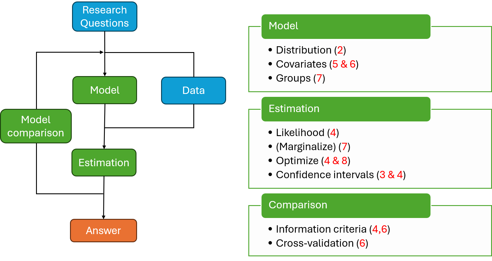{fig-alt="The ecological modelling cycle. Research questions guide the choice of model and data; model and data lead to estimation and to an answer, and model comparison feeds back into the cycle. Three boxes list the tools of the course with their chapters: model (distribution 2, covariates 5 and 6, groups 7), estimation (likelihood 4, marginalise 7, optimise 4 and 8, confidence intervals 3 and 4) and comparison (information criteria 4 and 6, cross-validation 6)." .cycle-diagram}

::: {.caption}
Red numbers: chapters of the course. This lecture goes round the whole cycle for one data
set: covariates (6) in the model box, information criteria and cross-validation (6) in the
comparison box.
:::

## Two pillars: functions and distributions {data-timing="180"}

:::: {.columns}
::: {.column .fragment width="50%"}
### Distributions and likelihood

Chapters 2 to 4: a distribution for the observations, its parameters estimated by maximum
likelihood.
:::
::: {.column .fragment width="50%"}
### Deterministic functions

Chapter 5: curves that describe how an expected response changes with a predictor.
:::
::::

::: {.example .fragment}
Reed frog tadpoles: 16 tanks with 5 to 100 tadpoles each; the number killed by dragonfly
larvae in 14 days.
:::

::: {.takeaway .fragment}
A curve gives a parameter of the distribution of each observation.
:::

## A response curve as a parameter of a distribution {.figure-slide data-timing="240"}

$$
\theta_i=f(x_i;\boldsymbol\beta)
$$

:::: {.columns}
::: {.column width="56%"}
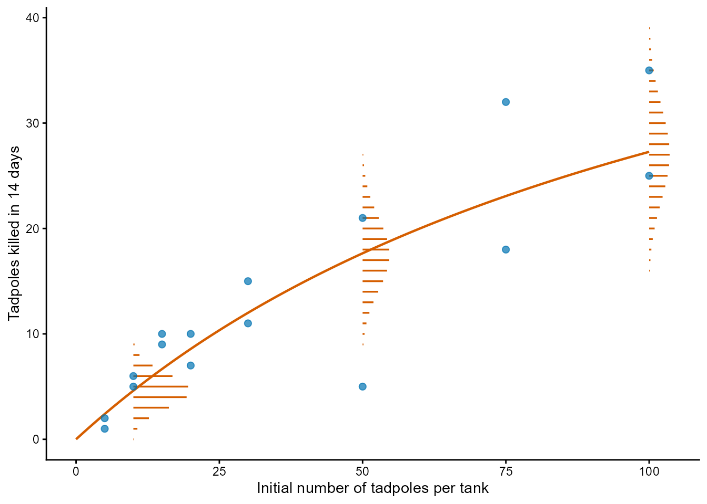{fig-alt="The number of tadpoles killed in 16 tanks (blue points) against the initial number of tadpoles per tank, from 5 to 100, rising from 1 or 2 killed at 5 tadpoles to 25 and 35 at 100. A vermillion curve rises and bends, reaching about 27 killed at 100 tadpoles. At 10, 50 and 100 tadpoles, horizontal vermillion bars show the Binomial probability of each number killed: a narrow distribution around 5 at 10 tadpoles, and wider, flatter distributions around 18 at 50 and around 27 at 100 tadpoles."}
:::
::: {.column width="44%"}
::: {.incremental}
- **One distribution per observation:** its parameter is the curve at its own $x_i$.
- **Other parameters:** often shared.
- **Independent:** but not identically distributed.
- **Today:** How to find the curve(**s**).
:::

::: {.example .fragment}
$K_i\sim\operatorname{Binomial}\left(N_i,p(N_i)\right)$, with
$p(N)=\alpha/(1+\alpha HN)$
:::
:::
::::

::: {.caption}
Blue: the 16 tanks. Line: expected number killed with the values read by eye in Chapter 5
($\alpha=0.5$, $H=1/60$). Bars: Binomial probabilities at 10, 50 and 100 tadpoles.
:::

## Where do models come from? {data-timing="120"}

::: {.incremental}
1. **Mechanistic:** derived from fundamental principles or a hypothesis about the system
- **Examples:** Michaelis-Menten, Holling type II-III-IV, logistic, monomolecular, $\ldots$
- Often solutions to differential equations
2. **Phenomenological:** curve has a sensible shape 
- **Examples:** splines, mechanistic functions used out of context, $\ldots$
:::

## The model zoo 
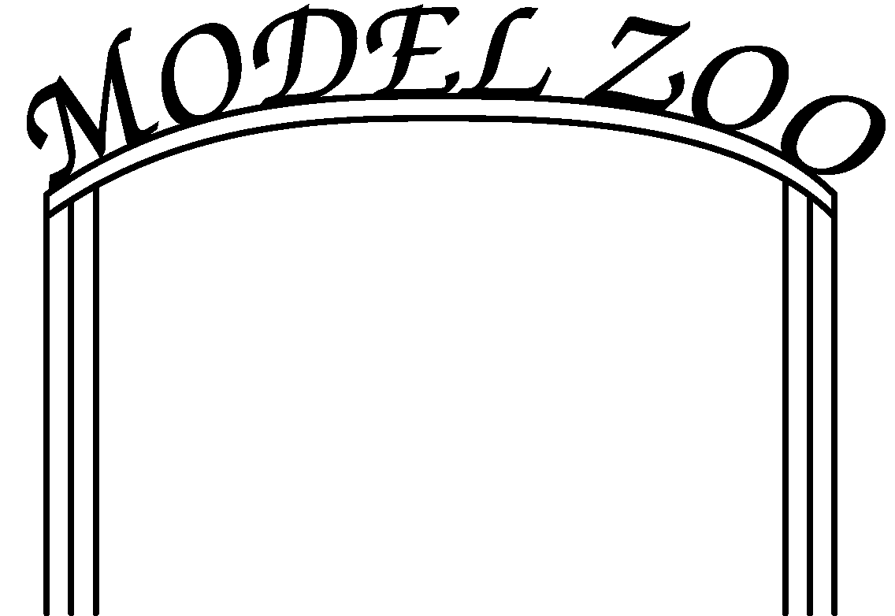{fig-alt="cartoon fence with the words Model Zoo on top" .cycle-diagram}

## The model zoo {data-timing="180"}

::: {.activity}
**2 minutes:** From the supplement, find different curves that 

start low and

saturate at some maximum level $>0$.
:::

## Inspecting functions: initial slope

:::: {.columns}
::: {.column width="54%"}
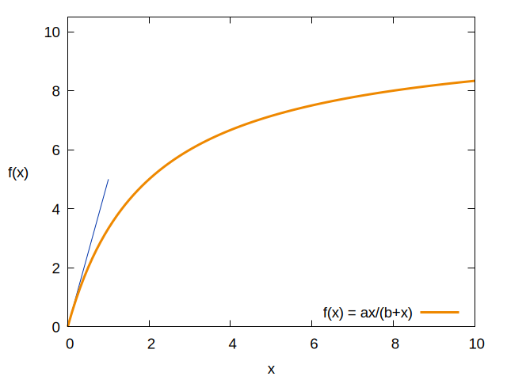{fig-alt="graph" .cycle-diagram}
:::
::: {.column width="46%"}
::: {.incremental}
- Slope = derivative
- Find derivative $f'(x)$
- Evaluate at 0 (compute $f'(0)$)
:::
:::
::::

## Reminder: differentiation rules
::: {.incremental}
- Product rule
  $$ 
\left(f(x) g(x)\right)' = f'(x) g(x) + f(x) g'(x)
  $$
- Chain rule
  $$
  f(g(x))' = f'(g(x)) g'(x)
  $$
- Quotient rule
$$
\left(\frac{f(x)}{g(x)}\right)' = \frac{f'(x)g(x) - f(x)g'(x)}{g(x)^2}
$$
:::

## Inspecting functions: initial slope
::: {.activity}
**3 minutes:** Find the initial slope of the function
:::

:::: {.columns .fragment}
::: {.column width="54%"}
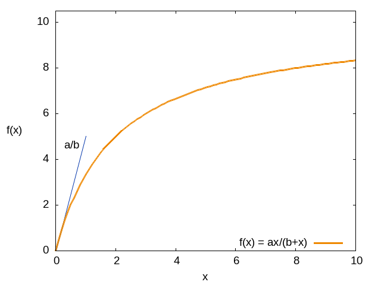{fig-alt="graph" .cycle-diagram}
:::
::::

## Inspecting functions: asymptotic behaviour
:::: {.columns}
::: {.column width="54%"}
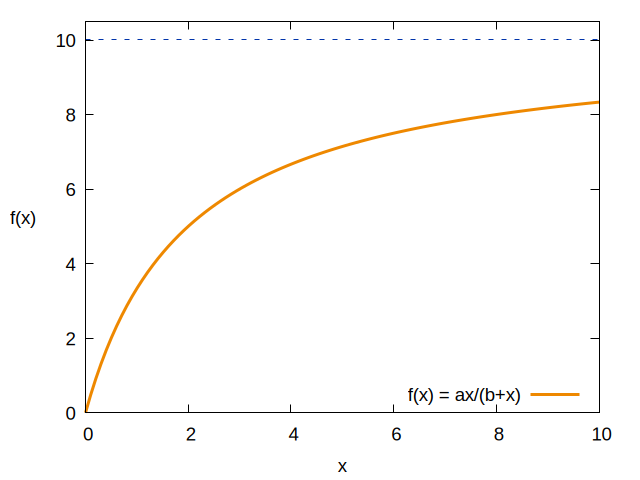{fig-alt="graph" .cycle-diagram}
:::
::: {.column width="46%"}
::: {.incremental}
- Saturating function
- $$\lim_{x\rightarrow\infty} f(x)$$
:::
:::
::::

## Inspecting functions: asymptotic behaviour
::: {.activity}
**1 minutes:** Find the limit
:::

:::: {.columns .fragment}
::: {.column width="54%"}
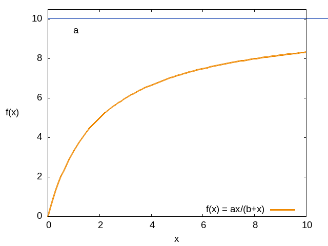{fig-alt="graph" .cycle-diagram}
:::
::::

## The model zoo 
{fig-alt="cartoon fence with the words Model Zoo on top" .cycle-diagram}

## The model zoo {data-timing="180"}
::: {.activity}
**2 minutes:** From the supplement, find different curves that 

have a local maximum
:::

## Inspecting functions: where is the local maximum (or minimum)
:::: {.columns}
::: {.column width="54%"}
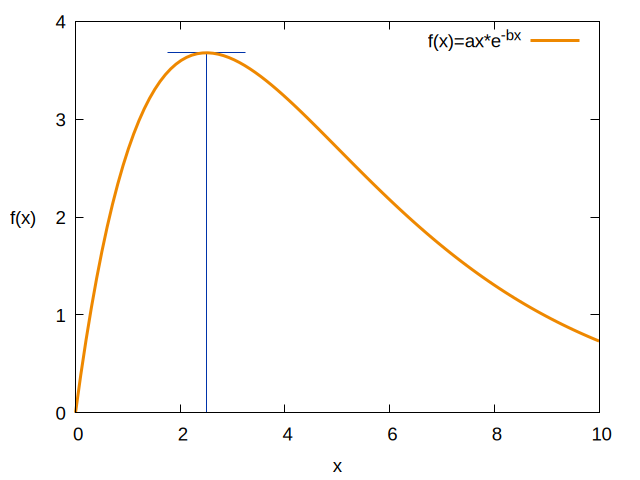{fig-alt="graph" .cycle-diagram}
:::
::: {.column width="46%"}
::: {.incremental}
- Stationairy points ($\bar{x}$: maximum, minum) have a horizontal tangent line.
- Derivative $f'(\bar{x})=0$.
- Corresponding value: $f(\bar{x})$.
- If you don't know whether it is a minimum or maximum:
  - compute $f''(\bar{x})$ (second derivative)
  - if $f''(\bar{x})>0$: minimum
  - if $f''(\bar{x})<0$: maximum
:::
:::
::::

## Inspecting functions: asymptotic behaviour
::: {.activity}
**5 minutes:** Find the location and value of the maximum
:::

:::: {.columns .fragment}
::: {.column width="54%"}
{fig-alt="graph" .cycle-diagram}
:::
::::

## Inspecting functions: where is the inflection point?
:::: {.columns .fragment}
::: {.column width="54%"}
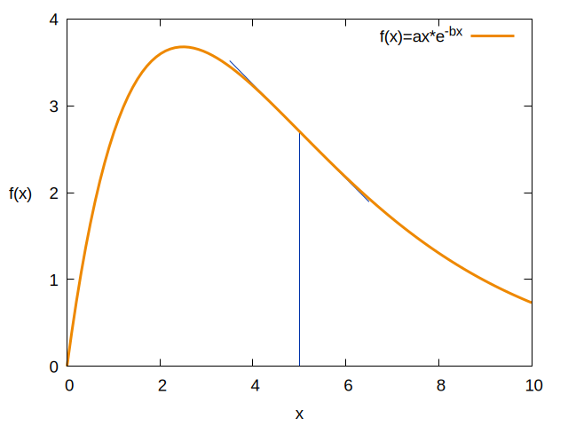{fig-alt="graph" .cycle-diagram}
:::
::: {.column width="46%"}
::: {.incremental}
- At the inflection point, a curve switches between convex and concave
- We look for the minimum/maximum of the derivative 
- The second derivative $f''(x)=0$. 
:::
:::
::::

## Adjusting functions: shifting 
:::: {.columns }
::: {.column width="33%"}
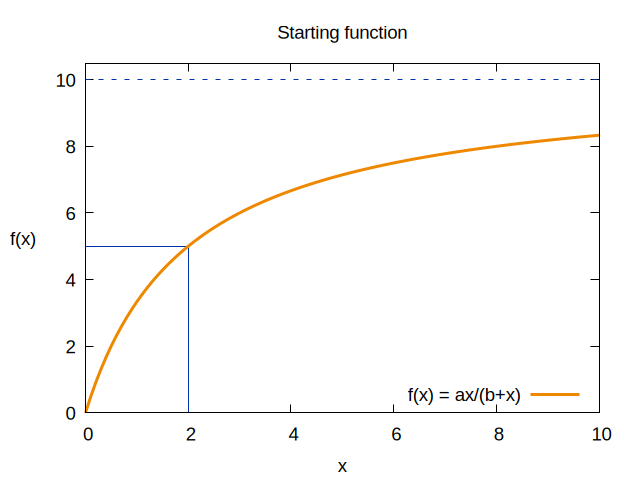{fig-alt="graph" .cycle-diagram}
:::
::: {.column width="33%" .fragment}
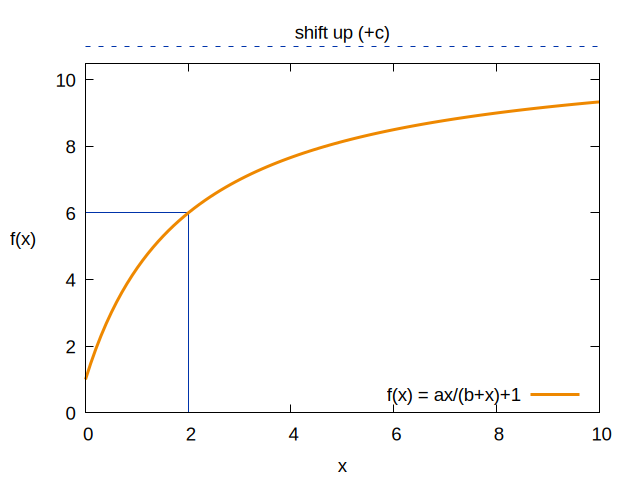{fig-alt="graph" .cycle-diagram}
:::
::: {.column width="33%" .fragment}
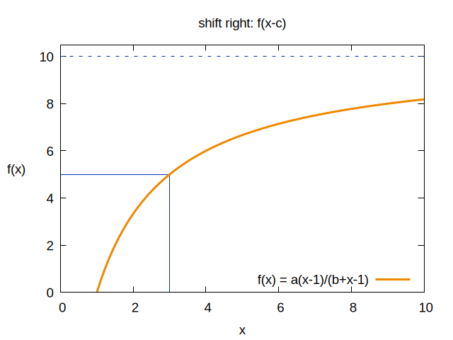{fig-alt="graph" .cycle-diagram}
:::
::::

## Adjusting functions: scaling
:::: {.columns }
::: {.column width="33%"}
{fig-alt="graph" .cycle-diagram}
:::
::: {.column width="33%" .fragment}
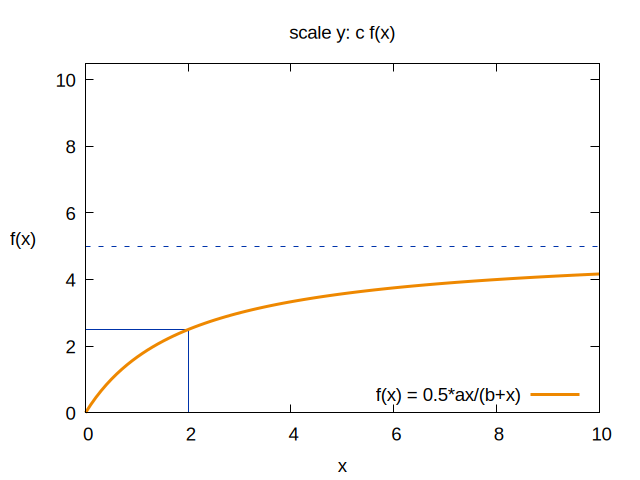{fig-alt="graph" .cycle-diagram}
:::
::: {.column width="33%" .fragment}
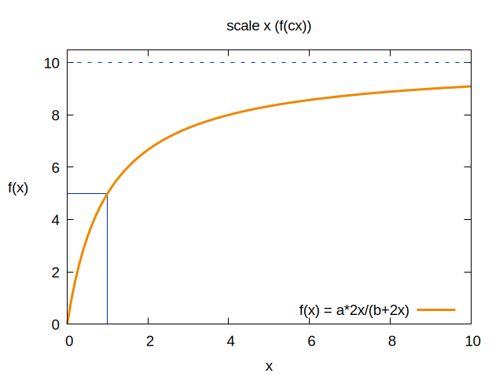{fig-alt="graph" .cycle-diagram}
:::
::::

## Eyeballing
::: {.activity}
**15 minutes:** In groups: find the function that matches the curves that you received on paper. Estimate the parameters. 
:::

##  discussion of eyeballing functions
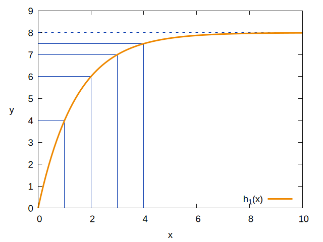{fig-alt="graph" .cycle-diagram}

##  discussion of eyeballing functions
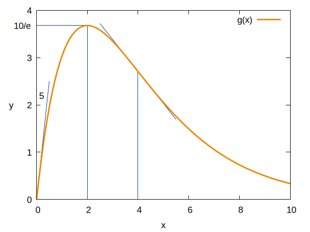{fig-alt="graph" .cycle-diagram}

##  discussion of eyeballing functions
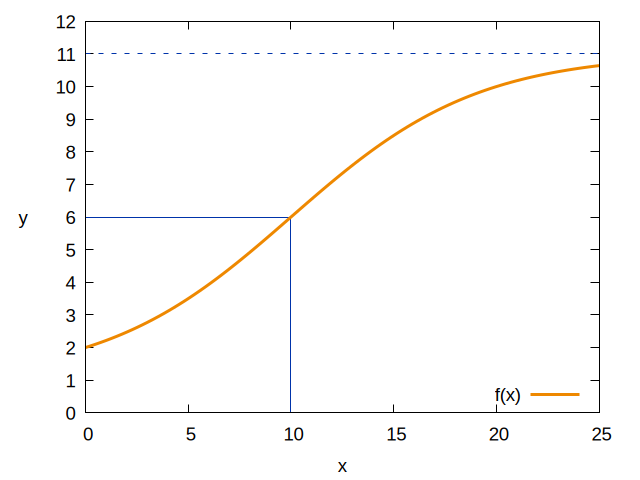{fig-alt="graph" .cycle-diagram}

## Axis transformations
Some transformations turn specific curves into straight lines

::: {.incremental}
- Exponential $(f(x) = a b^x$; $f(x) = a e^{cx})$ with logarithmic y-axis
- Power function $(f(x) = a x^b)$ with logarithmic x- and y-axis
- Logistic function $(f(x) = \frac{1}{1+e^{-(a+bx)}})$ with logit-transform: $y\rightarrow \log(y/(1-y))$
- Custom transformations 
:::

## Axis transformations: exponential functions
:::: {.columns }
::: {.column width="33%"}
Linear axes:

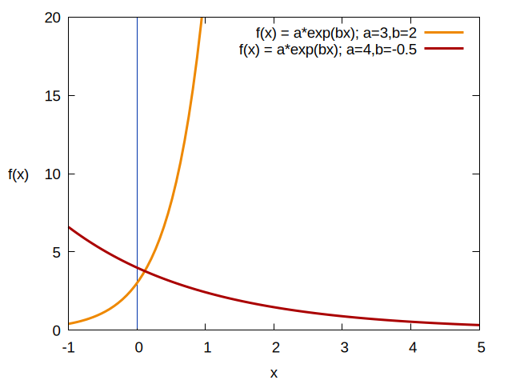{fig-alt="graph" .cycle-diagram}
:::
::: {.column width="33%" .fragment}
Modern plotting:

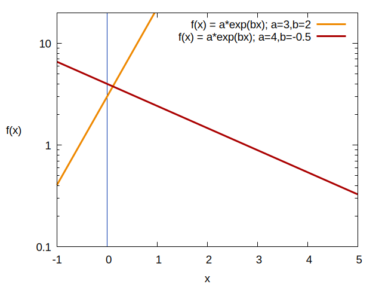{fig-alt="graph" .cycle-diagram}
:::
::: {.column width="33%" .fragment}
Old school:

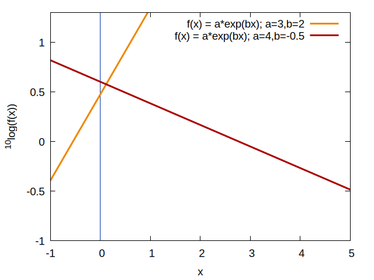{fig-alt="graph" .cycle-diagram}
:::
::::

## Axis transformations: power functions
:::: {.columns }
::: {.column width="50%"}
Linear axes:

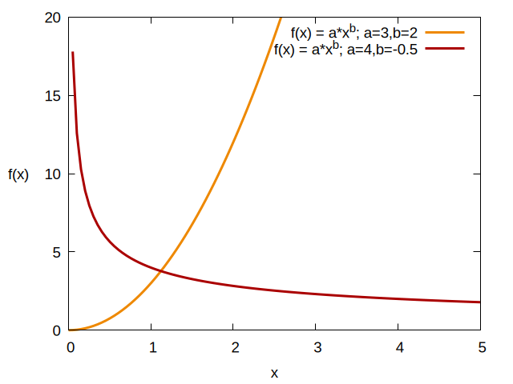{fig-alt="graph" .cycle-diagram}
:::
::: {.column width="50%" .fragment}
Double logirthmic axes:

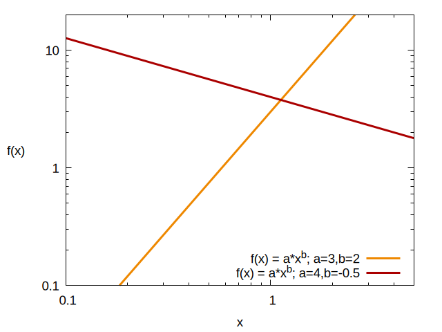{fig-alt="graph" .cycle-diagram}
:::
::::

## Axis transformations: logistic function
$$
\mathrm{logit}(p) = \log(\frac{p}{1-p})
$$

:::: {.columns }
::: {.column width="40%"}
Linear axes:

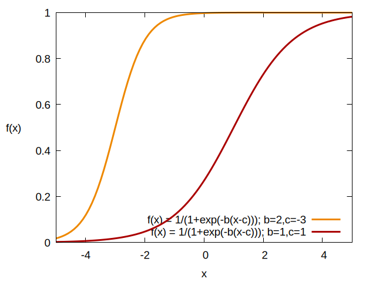{fig-alt="graph" .cycle-diagram}
:::
::: {.column width="40%" .fragment}
logit transform on y-axis

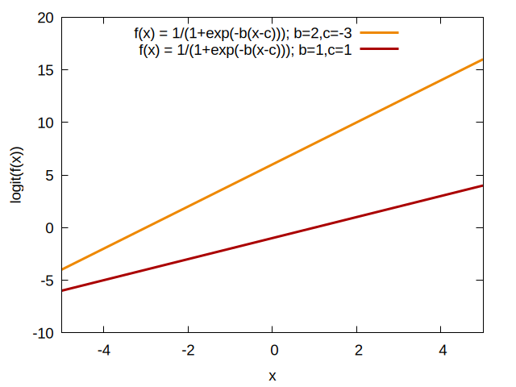{fig-alt="graph" .cycle-diagram}
:::
::::

::: {.activity .fragment}
**1 minute:** Discuss: how to turn $a/(1+exp(-b(x-c)))$ into a straight line?

Can we transform independent of $a,b,c$?
:::

## Transformations: custom transformations
::: {.activity}
**3 minutes:** What axis transformations do you need to turn $f(x) = 1 + \sqrt{x}$ into a straight line?
:::

## Eyeballing
::: {.activity}
**15 minutes:** In groups: find the function that matches the curves that you received on paper. Estimate the parameters. 
:::

##  discussion of eyeballing functions
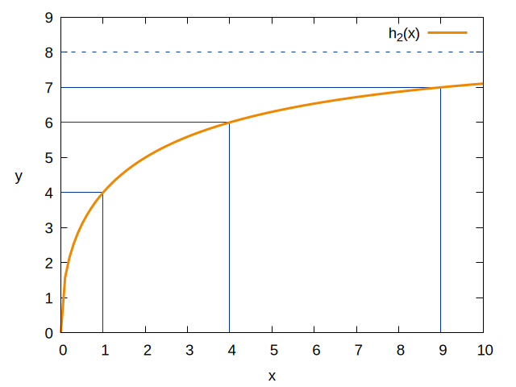{fig-alt="graph" .cycle-diagram}

##  discussion of eyeballing functions
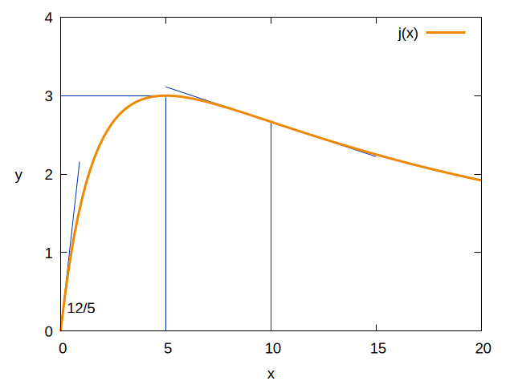{fig-alt="graph" .cycle-diagram}

##  discussion of eyeballing functions
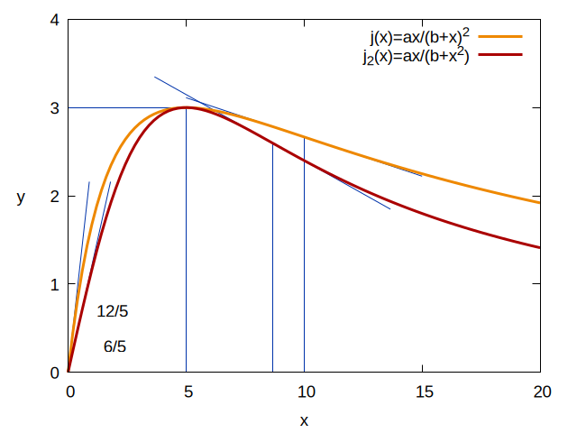{fig-alt="graph" .cycle-diagram}

::: {.takeaway}
Hassell ($j(x)$) and Shepherd ($j_2(x)$) are hard to distinguish in practice.
:::

##  discussion of eyeballing functions
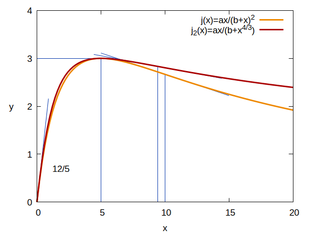{fig-alt="graph" .cycle-diagram}

::: {.takeaway}
Hassell ($j(x)$) and Shepherd ($j_2(x)$) are hard to distinguish in practice.
:::

## wrap-up: what about real data
::: {.takeaway}
Discussion: how useful are axis transformations for real data?
:::

::: {.takeaway .fragment}
Up next: distinguishing different curves using Maximum likelihood estimates.

Different parameterizations of the same curve may be easier/harder to fit!
:::

