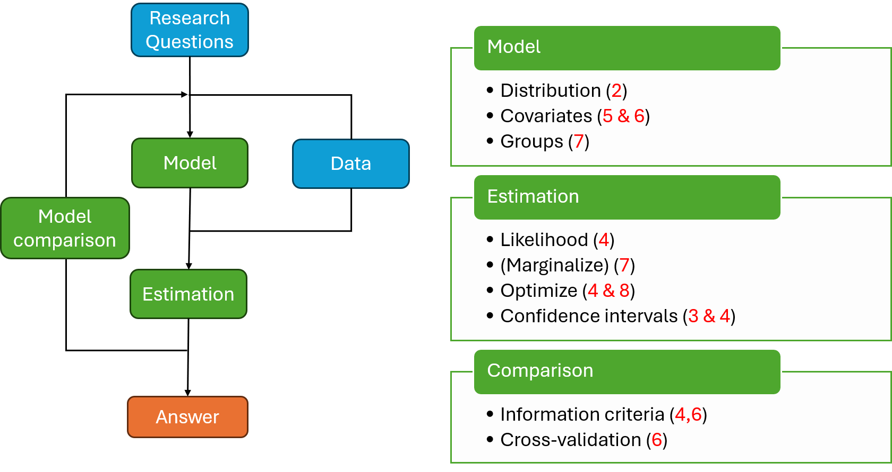
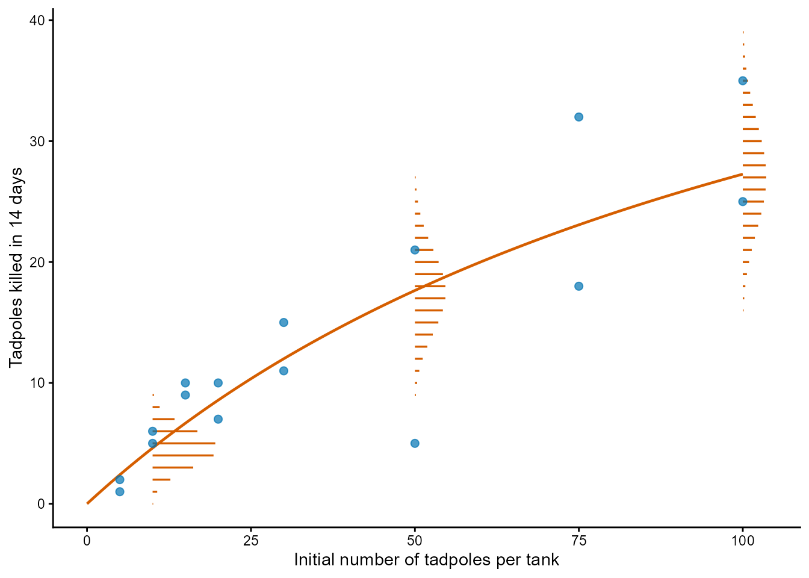
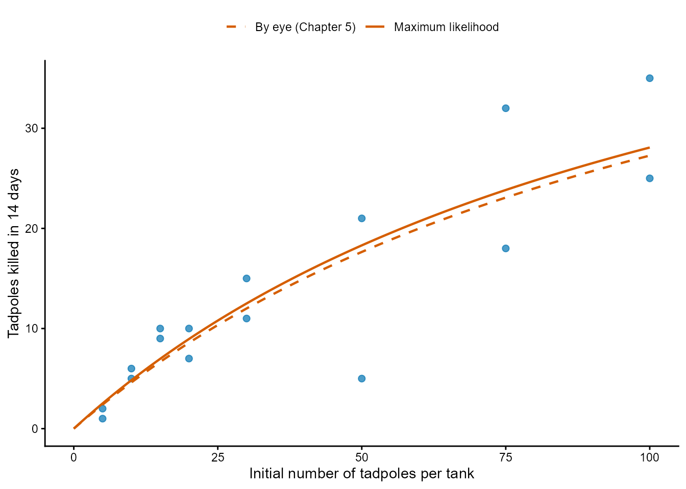
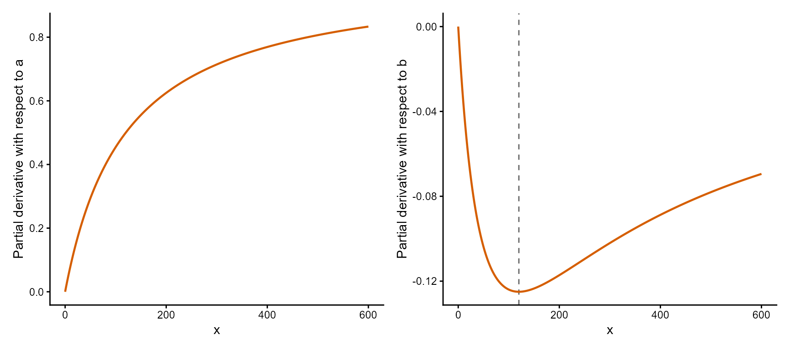
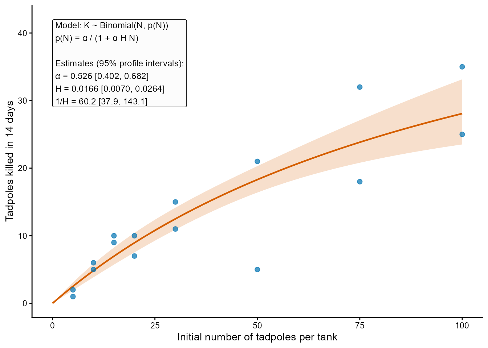
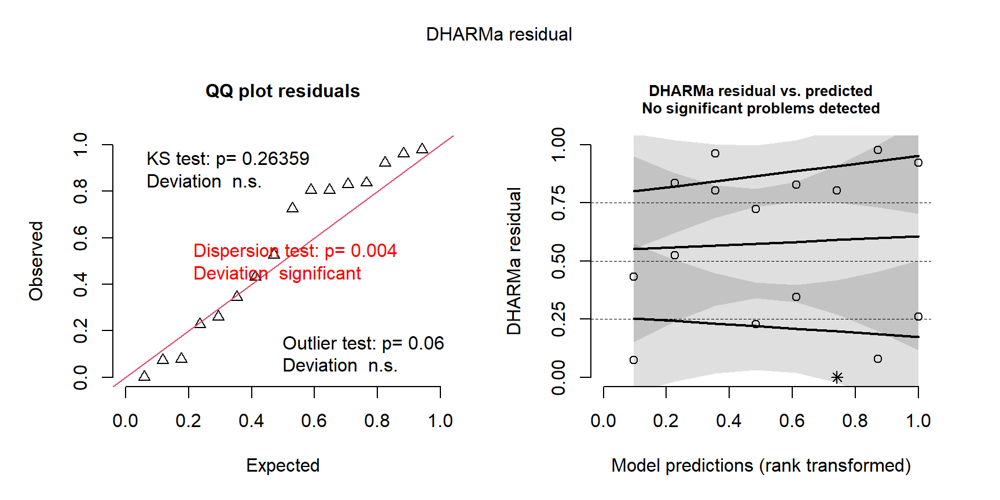

## Ecological Models and Data Analysis {.lecture-title data-timing="60"}

::: {.subtitle}
Chapter 6 · Lecture
:::

::: {.eyebrow}
Fitting Ecological Response Curves
:::

## Overview of the lecture {data-timing="120"}

::: {.incremental}
1. **The model:** how does a predictor enter a distribution?
2. **The fit:** what changes from Chapter 4?
3. **Uncertainty:** how precise are the parameters, and the curve?
4. **Checking:** does the model describe the data?
5. **Revision and comparison:** which model do the data support?
6. **The practical:** what comes next?
:::

## Where we are: the modelling cycle {.diagram-slide data-timing="60"}

{fig-alt="The ecological modelling cycle. Research questions guide the choice of model and data; model and data lead to estimation and to an answer, and model comparison feeds back into the cycle. Three boxes list the tools of the course with their chapters: model (distribution 2, covariates 5 and 6, groups 7), estimation (likelihood 4, marginalise 7, optimise 4 and 8, confidence intervals 3 and 4) and comparison (information criteria 4 and 6, cross-validation 6)." .cycle-diagram}

::: {.caption}
Red numbers: chapters of the course. This lecture goes round the whole cycle for one data
set: covariates (6) in the model box, information criteria and cross-validation (6) in the
comparison box.
:::

## Two pillars: functions and distributions {data-timing="180"}

:::: {.columns}
::: {.column .fragment width="50%"}
### Distributions and likelihood

Chapters 2 to 4: a distribution for the observations, its parameters estimated by maximum
likelihood.
:::
::: {.column .fragment width="50%"}
### Deterministic functions

Chapter 5: curves that describe how an expected response changes with a predictor.
:::
::::

::: {.example .fragment}
Reed frog tadpoles: 16 tanks with 5 to 100 tadpoles each; the number killed by dragonfly
larvae in 14 days.
:::

::: {.takeaway .fragment}
A curve gives a parameter of the distribution of each observation.
:::

## A response curve as a parameter of a distribution {.figure-slide data-timing="240"}

$$
\theta_i=f(x_i;\boldsymbol\beta)
$$

:::: {.columns}
::: {.column width="56%"}
{fig-alt="The number of tadpoles killed in 16 tanks (blue points) against the initial number of tadpoles per tank, from 5 to 100, rising from 1 or 2 killed at 5 tadpoles to 25 and 35 at 100. A vermillion curve rises and bends, reaching about 27 killed at 100 tadpoles. At 10, 50 and 100 tadpoles, horizontal vermillion bars show the Binomial probability of each number killed: a narrow distribution around 5 at 10 tadpoles, and wider, flatter distributions around 18 at 50 and around 27 at 100 tadpoles."}
:::
::: {.column width="44%"}
::: {.incremental}
- **One distribution per observation:** its parameter is the curve at its own $x_i$.
- **Other parameters:** often shared.
- **Independent:** but not identically distributed.
- **The observation model:** a choice, like the curve.
:::

::: {.example .fragment}
$K_i\sim\operatorname{Binomial}\left(N_i,p(N_i)\right)$, with
$p(N)=\alpha/(1+\alpha HN)$
:::
:::
::::

::: {.caption}
Blue: the 16 tanks. Line: expected number killed with the values read by eye in Chapter 5
($\alpha=0.5$, $H=1/60$). Bars: Binomial probabilities at 10, 50 and 100 tadpoles.
:::

## What the curve must return {.roadmap data-timing="240"}

| Distribution | Parameter and its range | A curve with that range |
|---|---|---|
| Normal | mean $\mu$: any value | any curve |
| Poisson, Negative Binomial | mean $\mu$: positive | positive, or `exp()` of a curve |
| Binomial | probability $p$: 0 to 1 | between 0 and 1, or `plogis()` of a curve |

::: {.example .fragment}
The Binomial needs a probability, so the curve gives $p(N)$; the expected number killed,
$N\,p(N)=\alpha N/(1+\alpha HN)$, is the disc equation of Chapter 5. With $0<\alpha<1$ and
$H>0$, $p(N)$ lies between 0 and $\alpha$.
:::

::: {.takeaway .fragment}
The range of the curve is part of the model.
:::

## Practice 1: seedlings and light {data-timing="180"}

::: {.activity}
**3 minutes:** on paper.

The number of tree seedlings in a quadrat is described with a Poisson distribution whose
parameter follows a curve of the light that reaches the soil, $x$ (% of full sunlight).

1. Which parameter does the curve describe, and which values must it return?
2. Could the straight line $a+bx$ be used for every value of $a$ and $b$?
3. Could $ax/(b+x)$ with positive $a$ and $b$, if some quadrats have no light at all?
:::

## The likelihood of a response curve {data-timing="240"}

$$
\ell(\boldsymbol\beta)=\sum_{i=1}^{n}\log\left(P(Y_i=y_i\mid\boldsymbol\beta)\right)
$$

::: {.incremental}
- **Each observation:** its probability, with the parameter given by the curve at its own
  $x_i$.
- **Shared parameters** of the distribution: added to $\boldsymbol\beta$.
- **The same machinery as Chapter 4:** two lists, transformations, `cmb()`, `MakeADFun()`,
  `optim()`.
- **New:** the predictor goes in the list of data; starting values come from a plot.
:::

::: {.example .fragment}
One tank: $\log\left(\binom{N_i}{K_i}\,p(N_i)^{K_i}\left(1-p(N_i)\right)^{N_i-K_i}\right)$,
summed over the 16 tanks.
:::

## The negative log-likelihood in R {data-timing="240"}

:::: {.columns}
::: {.column width="42%"}
::: {.incremental}
- **List of data:** the predictor and the response.
- **Transformations:** `plogis()` for a probability, `exp()` for a positive parameter.
- **The curve:** one value per observation (a vector).
- **Log probabilities:** each with its own trials and probability.
:::
:::
::: {.column width="58%"}

```{r}
#| echo: true
#| eval: false
# Predictor and response in the list of data.
frog_data = list(
  initial = ReedfrogFuncresp$Initial,
  killed = ReedfrogFuncresp$Killed
)

binomial_nll = function(parms, data) {
  getAll(parms, data)
  alpha = plogis(logit_alpha)
  H = exp(log_H)
  # Probability that a tadpole is killed,
  # at the density of each tank.
  p = alpha / (1 + alpha * H * initial)
  -sum(dbinom(x = killed, size = initial,
              prob = p, log = TRUE))
}
```

:::
::::

## Starting values and the fit {data-timing="240"}

:::: {.columns}
::: {.column width="42%"}
::: {.incremental}
- **Starting values:** read by eye from a plot (Chapter 5), on the transformed scale.
- **`MakeADFun()`:** the NLL connected to the data with `cmb()`.
- **`optim()`:** BFGS with `gr`; check `convergence`.
- **Transform back:** the estimates on the original scale.
:::
:::
::: {.column width="58%"}

```{r}
#| echo: true
#| eval: false
# Start from the values read by eye in Chapter 5.
binomial_obj = MakeADFun(
  cmb(binomial_nll, frog_data),
  list(logit_alpha = qlogis(0.5),
       log_H = log(1 / 60)),
  silent = TRUE
)
binomial_fit = optim(
  par = binomial_obj$par, fn = binomial_obj$fn,
  gr = binomial_obj$gr, method = "BFGS"
)
binomial_fit$convergence  # 0

# 0.526 per experiment; 0.0166 experiments
# per tadpole killed.
plogis(binomial_fit$par["logit_alpha"])
exp(binomial_fit$par["log_H"])
```

:::
::::

## Reading the fitted curve {.figure-slide data-timing="180"}

:::: {.columns}
::: {.column width="58%"}
{fig-alt="The 16 tanks as blue points with two vermillion curves of the expected number killed against the initial number of tadpoles per tank: a solid curve fitted by maximum likelihood and a dashed curve with the values read by eye in Chapter 5. The two curves nearly coincide, rising from zero to about 28 killed at 100 tadpoles per tank."}
:::
::: {.column width="42%"}
::: {.incremental}
- **Points:** the observations. **Line:** the expected response under the fitted model.
- **Invariance:** quantities of the curve, such as its asymptote and half-maximum, follow
  from the estimates of its parameters.
- **Convergence** is the first check; residuals come next.
:::

::: {.example .fragment}
Asymptote $1/\hat H$: about 60 tadpoles killed. Half-maximum $1/(\hat\alpha\hat H)$: about
115 tadpoles per tank. By eye: 60 and 120.
:::
:::
::::

::: {.caption}
Solid: maximum likelihood. Dashed: the values read by eye in Chapter 5.
:::

## The gradient and automatic differentiation {data-timing="180"}

::: {.definition}
**Gradient:** the vector of partial derivatives of the NLL with respect to the parameters,
its slope in the direction of each parameter.
:::

::: {.incremental}
- **Automatic differentiation:** RTMB differentiates the code of the NLL, exactly up to
  rounding error, without a formula from us.
- **BFGS:** uses it at every step; correlated parameters make a narrow, tilted valley,
  where an inexact gradient can stop the search early.
- **Also behind** `sdreport()`, `ADREPORT()` and random effects (Chapter 7).
- **Requirement:** functions that RTMB knows; an `if` on a parameter is refused.
:::

::: {.example .fragment}
`binomial_obj$gr()`: $-4.30$ and $3.20$ at the starting values; close to zero at the
estimates.
:::

## Precision and correlation of curve parameters {data-timing="240"}

:::: {.columns}
::: {.column width="46%"}
::: {.incremental}
- **`sdreport()`:** standard errors and covariance matrix, as in Chapter 4.
- **Correlated estimates:** different combinations of parameters give similar curves over
  the range of the data.
- **Parameterisation:** changes the correlation and not the fit.
:::
:::
::: {.column width="54%"}

```{r}
#| echo: true
#| eval: false
binomial_sd = sdreport(binomial_obj)
summary(binomial_sd)
#             Estimate Std. Error
# logit_alpha    0.104      0.285
# log_H         -4.098      0.294

cov2cor(binomial_sd$cov.fixed)  # 0.82
```

:::
::::

::: {.example .fragment}
Correlation 0.82 between $\operatorname{logit}(\hat\alpha)$ and $\log(\hat H)$; 0.98
between $\log(\hat a)$ and $\log(\hat b)$ of the Michaelis–Menten form, because the tanks
determine mainly the initial slope, $a/b=\alpha$.
:::

## Where the data lie {.figure-slide data-timing="240"}

:::: {.columns}
::: {.column width="64%"}
{fig-alt="Two panels for the Michaelis–Menten function with a = 60 and b = 120, for x from 0 to 600. Left: the partial derivative with respect to a rises from 0 at x = 0 towards 1; it is 0.5 at x = 120 and about 0.83 at x = 600. Right: the partial derivative with respect to b is negative; it is zero at x = 0, largest in size, -0.125, at x = 120 (dashed line), and returns slowly towards zero."}

::: {.caption}
Partial derivatives of $ax/(b+x)$ with $a=60$ and $b=120$ (Chapter 5): left, the asymptote
$a$; right, the half-maximum $b$ (dashed line). The tanks lie between 5 and 100.
:::
:::
::: {.column width="36%"}
::: {.incremental}
- **Partial derivative:** how much the curve moves at each $x$ when one parameter changes.
- **Observations inform a parameter** where the curve responds to it.
- **Only the rise observed:** initial slope well determined, asymptote poorly.
:::
:::
::::

::: {.takeaway .fragment}
The design determines what can be estimated.
:::

## Likelihood profile intervals of curve parameters {data-timing="240"}

::: {.incremental}
- **The reference method:** `TMB::tmbprofile()` and `confint()`, as in Chapter 4.
- **Poorly determined parameter:** an asymmetric profile; the data rule out one side more
  strongly than the other.
- **Transform the endpoints:** any monotonic function; a decreasing one swaps them.
:::

```{r}
#| echo: true
#| eval: false
binomial_profile_H = TMB::tmbprofile(binomial_obj, name = "log_H", trace = FALSE)
H_interval = exp(confint(binomial_profile_H))
# Largest number killed, 1 / H: decreasing, so the endpoints swap (37.9 to 143.1).
rev(1 / H_interval)
```

::: {.example .fragment}
$\alpha$: 0.40 to 0.68 per experiment. $1/H$: about 60 tadpoles killed, from 38 to 143
(Wald from the log scale: 34 to 107). The data rule out a low asymptote, not a high one.
:::

## The uncertainty of a fitted curve {data-timing="240"}

::: {.incremental}
- **A point of the curve:** a quantity calculated from all the parameters.
- **`ADREPORT()` of a vector:** a standard error for every element (the delta method; box
  in the chapter).
- **A grid of $x$** in the list of data: the curve at every point of the grid.
- **Wald interval on an unbounded scale** (the logit for a probability), endpoints
  transformed back.
- **Pointwise:** each interval covers the curve at its own $x$.
:::

```{r}
#| echo: true
#| eval: false
# Inside the NLL: the logit of the curve at every density of the grid.
p_grid = alpha / (1 + alpha * H * initial_grid)
logit_p_grid = qlogis(p_grid)
ADREPORT(logit_p_grid)
```

## A confidence band {.figure-slide data-timing="240"}

:::: {.columns}
::: {.column width="58%"}
{fig-alt="The 16 tanks as blue points, the fitted expected number killed as a vermillion curve and its pointwise 95% confidence band as a light vermillion shaded area, narrow at low density and widening to about 24 to 33 killed at 100 tadpoles per tank. Many tanks lie outside the band. An inset gives the model, K ~ Binomial(N, p(N)) with p(N) = α/(1 + αHN), and the estimates with 95% profile intervals: α = 0.526 [0.402, 0.682], H = 0.0166 [0.0070, 0.0264], 1/H = 60.2 [37.9, 143.1]."}
:::
::: {.column width="42%"}
::: {.incremental}
- **Band:** at each $x$, an interval that contains the value of the curve under the data
  generating process in about 95% of hypothetical samples.
- **Not where observations fall:** that is the distribution around the curve, much wider.
- **Beyond the data:** the band widens quickly.
:::

::: {.example .fragment}
At 100 tadpoles: 23.5 to 33.1 killed. The curve is well determined within the data,
the asymptote is not.
:::
:::
::::

::: {.caption}
Shaded: pointwise 95% Wald intervals from the logit scale. Inset: the model and the
likelihood profile intervals.
:::

## Practice 2: handling time of a ladybird {data-timing="180"}

::: {.activity}
**3 minutes:** R as a calculator.

A Holling type II curve is fitted to the number of aphids eaten by ladybird larvae in one
hour, with the handling time $H$ (hours per aphid) optimised on the log scale. The fit
gives $\log(\hat H)=-3.2$, and `sdreport()` gives a standard error of 0.20.

1. Calculate a 95% Wald interval for $H$.
2. From it, calculate an interval for the largest number of aphids eaten per hour, $1/H$.
3. Why are the endpoints swapped in the second interval?
:::

## Simulating from a fitted model {data-timing="180"}

::: {.incremental}
- **A fitted model:** a data generating process, with its parameters at the estimates.
- **`OBS()`** marks the response; **`obj$simulate()`** draws one hypothetical sample.
- **Same design:** the same observations and values of the predictor.
- **Complete observations:** the variation around the curve, not only the curve.
:::

```{r}
#| echo: true
#| eval: false
# In the NLL: killed = OBS(killed). Then 1,000 hypothetical samples of the 16 tanks.
n_sim = 1000
binomial_simulations = matrix(NA, nrow = length(frog_data$killed), ncol = n_sim)
set.seed(seed = 601)
for (j in seq_len(n_sim)) {
  binomial_simulations[, j] = binomial_obj$simulate(binomial_fit$par)$killed
}
```

## Scaled quantile residuals {data-timing="240"}

::: {.definition}
**Scaled quantile residual:** the fraction of the simulated values of an observation that
are smaller than the observed value.
:::

::: {.incremental}
- **If the model describes the data generating process:** approximately uniform between 0
  and 1, whatever the distribution and the predictor.
- **Ties** (discrete response): the residual is drawn at random between "smaller" and
  "smaller or equal".
- **One common scale** for observations with different distributions.
- **`DHARMa::createDHARMa()`:** the simulations, the observations and the expected values.
:::

::: {.example .fragment}
The tank with 5 of 50 tadpoles killed lies below all its 1,000 simulated values: residual 0.
:::

## Reading residual plots {.figure-slide data-timing="240"}

:::: {.columns}
::: {.column width="60%"}
{fig-alt="DHARMa's two residual panels for the Binomial model. Left: quantile–quantile plot of the 16 scaled quantile residuals against a uniform distribution; the lower points lie close to the diagonal and the upper half lies above it. Printed: KS test p = 0.26, dispersion test p = 0.004 in red, outlier test p = 0.06. Right: the residuals against the rank-transformed model predictions, with dashed lines at 0.25, 0.5 and 0.75 and three fitted quantile lines, the upper one well above 0.75; a star at zero marks the tank whose observation lies outside all its simulations."}


::: {.example .fragment}
Dispersion statistic 2.9: overdispersion relative to the Binomial. No clear trend with
density.
:::
:::
::: {.column width="40%"}
::: {.incremental}
- **Left:** against a uniform distribution; many near 0 and 1: too much spread.
- **Right:** against the fitted values; a trend: the curve misses a change.
- **Dispersion statistic:** observed / simulated spread; about 1 under the model.
- **Printed tests:** exploratory; no decisions on p-values.
:::
:::
::::

::: {.takeaway .fragment}
A check shows where a model disagrees with the data, not why.
:::

## Discussion: what does a residual pattern tell us? {data-timing="180"}

::: {.incremental}
1. Residuals mostly below 0.5 at low $x$ and mostly above 0.5 at high $x$.
2. Too many residuals near 0 and 1 at every $x$; dispersion statistic 3.
3. Residuals of neighbouring quadrats along a transect are alike.
4. No pattern at all, with eight observations.
:::

::: {.takeaway}
Curve · Distribution · Independence · Cannot tell
:::

::: {.activity}
**3 minutes:** label each pattern with a neighbour.
:::

## Live demo: the modelling cycle for one model {.demo-slide data-timing="1080"}

::: {.incremental}
1. **The NLL and the fit:** the predictor in the list of data, starting values by eye,
   the gradient, convergence.
2. **Estimates and the curve:** back-transformed and drawn over the data.
3. **Uncertainty of the parameters:** `sdreport()`, the correlation, a likelihood profile.
4. **Uncertainty of the curve:** `ADREPORT()` on a grid, the band.
5. **Checking:** `obj$simulate()` and scaled quantile residuals.
:::

::: {.demo}
**Script:** `demo-cycle.R`, sections 1 to 5 (section 0 during the break): the Binomial model
with the Holling type II curve; no model comparison.
:::

## Revising the observation model {data-timing="240"}

$$
E[K]=Np,
\qquad
\operatorname{Var}(K)=Np(1-p)\,\frac{\kappa+N}{\kappa+1}
$$

::: {.incremental}
- **Beta-Binomial:** the probability varies among sampling units; mean $p$ from the curve,
  precision $\kappa$.
- **Large $\kappa$:** close to a Binomial. The factor grows with the number of trials $N$.
- **The curve is unchanged:** only the observation model is revised.
:::

::: {.example .fragment}
$\hat\alpha\approx0.54$, $\hat H\approx0.018$, $\hat\kappa\approx26$; standard errors 0.38
and 0.46 (Binomial: 0.29 for both); dispersion statistic 0.92.
:::

::: {.takeaway .fragment}
When units vary, the information depends more on the number of units than on the number of
trials.
:::

## Practice 3: fruit set in inflorescences {data-timing="180"}

::: {.activity}
**3 minutes:** on paper.

Each inflorescence of a shrub has 20 flowers, and the mean probability that a flower sets
fruit is 0.4.

1. Calculate the variance of the number of fruits per inflorescence under a Binomial model
   and under a Beta-Binomial model with $\kappa=5$.
2. Which value of $\kappa$ would make the variance of the Beta-Binomial model only 10%
   larger than that of the Binomial model?
:::

## Candidate models {data-timing="180"}

::: {.incremental}
- **Plausible alternatives:** ecological or statistical.
- **The same observations:** the same rows, response and units.
- **Nested:** a special case obtained by fixing a parameter of another model.
:::

::: {.example .fragment}

| Curve | Binomial | Beta-Binomial |
|---|---|---|
| Constant probability, $p(N)=\alpha$ | $K=1$ | $K=2$ |
| Holling type II, $p(N)=\alpha/(1+\alpha HN)$ | $K=2$ | $K=3$ |

$H=0$ gives the constant probability; $\kappa\rightarrow\infty$ gives the Binomial.
:::

## AIC, AICc and BIC {data-timing="300"}

$$
\mathrm{AIC}=2K-2\,\ell(\hat\theta)
\qquad
\mathrm{AICc}=\mathrm{AIC}+\frac{2K(K+1)}{n-K-1}
\qquad
\mathrm{BIC}=K\log(n)-2\,\ell(\hat\theta)
$$

::: {.incremental}
- **AIC:** how well the fitted model would predict new data; AICc for small samples.
- **BIC:** $\log(n)$ per parameter, more than 2 when $n>7$; tends to select the simplest
  candidate that contains the data generating process.
- **$n$:** the number of independent observations, the same for every model.
- **All three:** differences between models fitted to the same observations; they rank,
  and do not show that the best is good.
:::

::: {.example .fragment}
$n=16$ tanks and not 610 tadpoles: under the Beta-Binomial model the tadpoles of a tank share
its probability.
:::

## Leave-one-out cross-validation {data-timing="240"}

::: {.definition}
**Cross-validation:** fit without one part of the data, score the part held out, repeat
until every part has been held out once.
:::

::: {.incremental}
- **Leave-one-out:** each part is one observation; every parameter refitted to the other
  $n-1$.
- **Log score:** the log probability of the held-out observation, summed; larger is better.
- **Any observation model:** no penalty needed; in large samples AIC $\approx-2\times$ score.
- **5-fold or 10-fold** when $n$ fits take too long; blocks for data ordered in time or
  space.
:::

::: {.example .fragment}
16 fits per model, 64 in all; every fit converged.
:::

## Comparing the candidates {.roadmap data-timing="240"}

::: {.example}

| Model | $K$ | Log-lik. | ΔAIC | ΔAICc | ΔBIC | ΔLOO |
|---|---:|---:|---:|---:|---:|---:|
| Constant, Binomial | 1 | −52.22 | 15.70 | 13.99 | 14.16 | −8.17 |
| Holling type II, Binomial | 2 | −46.72 | 6.71 | 5.63 | 5.94 | −4.21 |
| Constant, Beta-Binomial | 2 | −44.73 | 2.72 | 1.64 | 1.95 | 0 |
| Holling type II, Beta-Binomial | 3 | −42.37 | 0 | 0 | 0 | −0.94 |

Every criterion prefers the Beta-Binomial; under it, density dependence remains uncertain.
:::

::: {.caption}
Δ: difference from the best model for each criterion (lowest AIC, AICc and BIC; highest
leave-one-out log score, LOO).
:::

::: {.takeaway .fragment}
Criteria rank the candidates, and can disagree; the ecological interpretation is ours.
:::

## A recipe for a response curve {data-timing="120"}

:::: {.columns}
::: {.column width="50%"}
::: {.incremental}
1. **Choose** the curve and the observation model, with its range.
2. **Write the NLL:** predictor and response in the list of data.
3. **Starting values:** by eye, from a plot.
4. **Fit:** check `convergence`, plot the curve over the data.
5. **Parameters:** `sdreport()`, `TMB::tmbprofile()`.
:::
:::
::: {.column width="50%"}
::: {.incremental}
6. **The curve:** `ADREPORT()` on a grid, the band.
7. **Check:** `OBS()`, `obj$simulate()`, residuals.
8. **Revise** the curve or the observation model.
9. **Compare:** AIC, AICc, BIC, cross-validation.
10. **Interpret** in units, with what remains uncertain.
:::
:::
::::

## The Chapter 6 R practical {data-timing="120"}

::: {.incremental}
- **Virus titre in rabbits** (Exercise 1, worked): a Ricker curve, Normal and Gamma models.
- **Enzyme kinetics** (Exercise 2): Michaelis–Menten, one asymptote per state.
- **Fecundity of fir trees** (Exercise 3): a power law, Poisson and Negative Binomial.
- **Coverage by simulation** (Exercise 4): extra.
:::

::: {.takeaway .fragment}
Exercises 1 to 3 are the core. Try, then check.
:::

## Summary and closing questions {.closing data-timing="180"}

::: {.incremental}
- A response curve gives a parameter of the distribution of each observation, in its range.
- The log-likelihood evaluates each observation at its own $x$; RTMB supplies the exact
  gradient.
- Curve parameters are often correlated; their precision depends on where the data lie.
- `ADREPORT()` on a grid gives a pointwise band, calculated on an unbounded scale.
- Simulated residuals show where a model disagrees, not why.
- Revise the observation model, then compare with AIC, AICc, BIC and cross-validation.
:::

::: {.takeaway .fragment}
Curve · Distribution · Gradient · Band · Residuals · Revision · AIC · BIC · Cross-validation
:::

::: {.activity .fragment}
**Closing questions**

1. Why do data on the rise of a curve say little about its asymptote?
2. What can a residual plot not tell us?
:::
