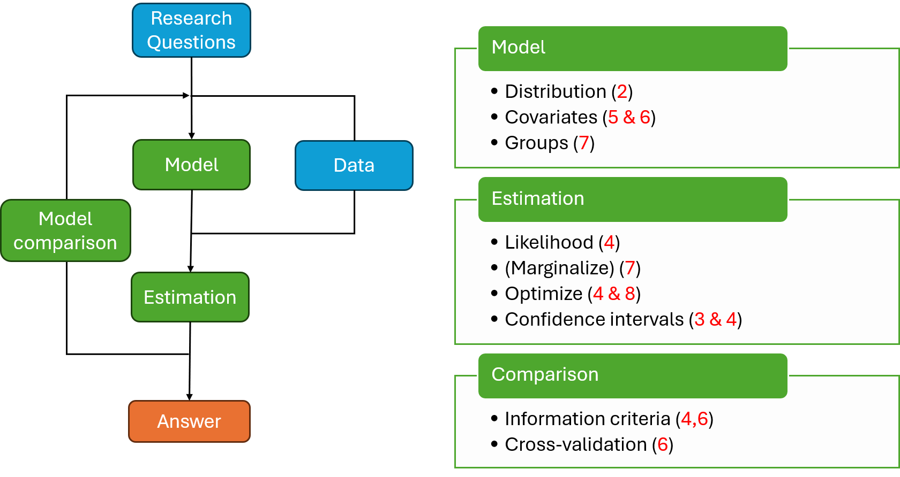
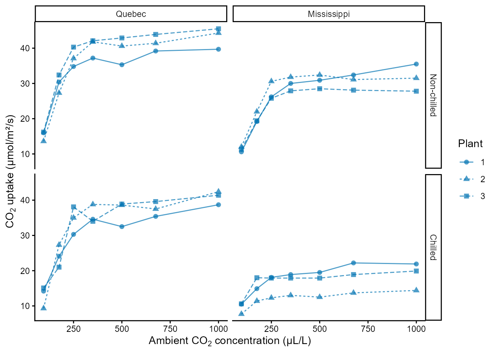
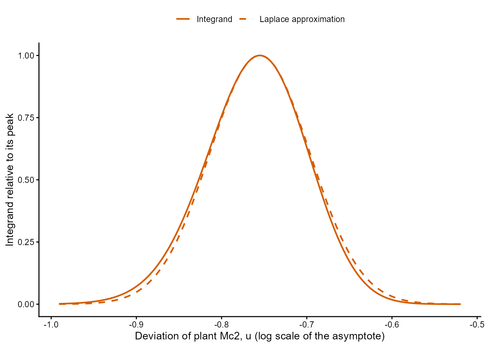
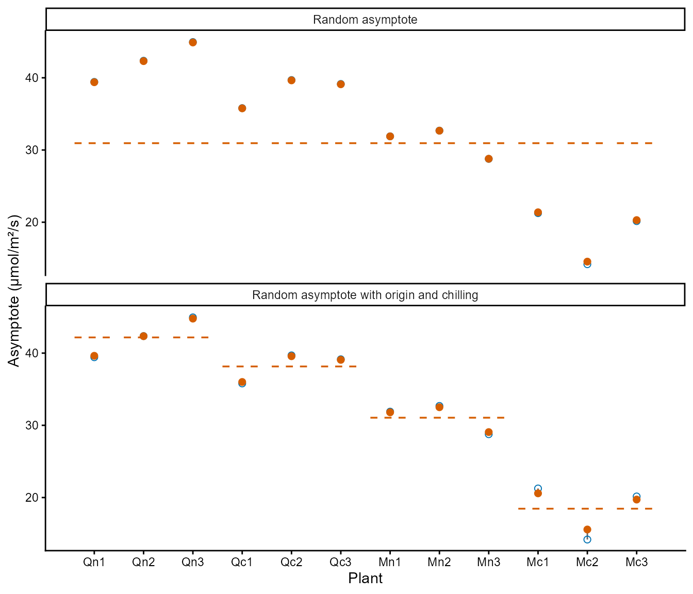
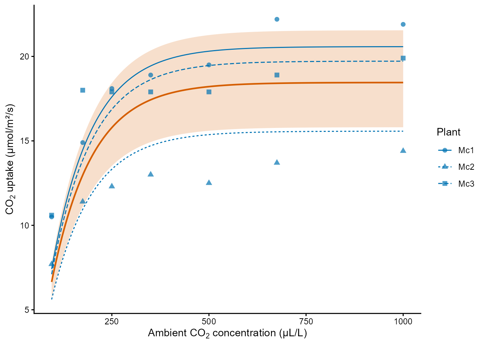
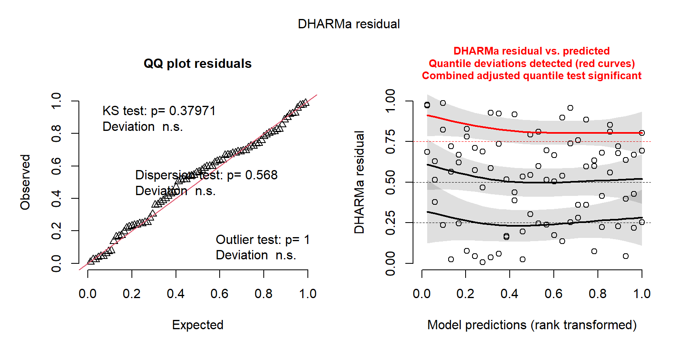

## Ecological Models and Data Analysis {.lecture-title data-timing="60"}

::: {.subtitle}
Chapter 7 · Lecture
:::

::: {.eyebrow}
Grouped Ecological Response Curves
:::

## Overview of the lecture {data-timing="120"}

::: {.incremental}
1. **Groups:** why are grouped observations not independent?
2. **The model:** how does a curve vary among groups?
3. **The fit:** what is a marginal likelihood?
4. **Interpretation:** what do variances, shrinkage and new groups tell us?
5. **Checking and comparison:** does the model describe the groups, and which model do the
   data support?
6. **The practical:** what comes next?
:::

## Where we are: the modelling cycle {.diagram-slide data-timing="60"}

{fig-alt="The ecological modelling cycle. Research questions guide the choice of model and data; model and data lead to estimation and to an answer, and model comparison feeds back into the cycle. Three boxes list the tools of the course with their chapters: model (distribution 2, covariates 5 and 6, groups 7), estimation (likelihood 4, marginalise 7, optimise 4 and 8, confidence intervals 3 and 4) and comparison (information criteria 4 and 6, cross-validation 6)." .cycle-diagram}

::: {.caption}
Red numbers: chapters of the course. This lecture: groups (7) and the marginal likelihood
(7).
:::

## Observations in groups {data-timing="180"}

::: {.definition}
**Group:** observations on the same individual, site, nest or tank, which share its
conditions.
:::

::: {.incremental}
- **Observational unit:** the entity of one observation; several in each group.
- **Shared conditions:** observations of a group resemble each other more.
- **Process variation:** it would remain with perfect measurements.
- **Treated as independent:** standard errors too small, intervals too narrow.
:::

::: {.example .fragment}
Tadpoles sharing a tank (Chapter 4); tanks as $n$ in AICc and BIC (Chapter 6).
:::

::: {.takeaway .fragment}
A grouped model describes the dependence explicitly.
:::

## Response curves measured on the same groups {.figure-slide data-timing="180"}

:::: {.columns}
::: {.column width="62%"}
{fig-alt="CO2 uptake of 12 grass plants against the ambient CO2 concentration, from 95 to 1000 µL/L, in four panels: non-chilled and chilled plants in rows, Quebec and Mississippi in columns. Each plant is a blue line with points. Every curve rises steeply up to about 250 µL/L and then levels off. The non-chilled plants from Quebec level off near 40 µmol/m²/s, the chilled plants from Quebec and the non-chilled plants from Mississippi near 30 to 40, and the chilled plants from Mississippi lowest, near 15 to 22. Within a panel the three plants differ mainly in the level that they reach."}
:::
::: {.column width="38%"}
::: {.incremental}
- **One curve per group:** every group measured at the same values of the predictor.
- **The curve:** $\mu(x)=a\left(1-e^{-b(x-c)}\right)$; asymptote $a$, rate $b$, zero at
  $x=c$.
- **The parameter that varies:** the one in which the groups differ most.
:::

::: {.example .fragment}
12 plants: 2 origins × 2 treatments × 3 plants, 7 concentrations, 84 measurements. The
asymptote varies among plants.
:::
:::
::::

::: {.caption}
Blue: CO₂ uptake (µmol/m²/s) of each plant against the concentration of CO₂ (µL/L). Rows:
treatment. Columns: origin.
:::

## Conditional distributions {data-timing="240"}

::: {.definition}
**Conditional distribution:** the probabilities of the values of $X_1$ among the outcomes in
which $X_2=x_2$.
:::

$$
P(X_1=x_1\mid X_2=x_2)=\frac{P(X_1=x_1,X_2=x_2)}{P(X_2=x_2)}
$$

::: {.incremental}
- **The bar:** "for a given value of", here of another random variable.
- **Joint over marginal:** the given value must have a probability above zero.
- **Independence:** conditional = marginal, for every given value.
:::

::: {.example .fragment}
Two seeds (Chapter 2): $P(X_1=0\mid X_2=0)=0.28/0.70=0.4=P(X_1=0)$: independent.
:::

## Marginal distributions {data-timing="240"}

$$
P(X_1=x_1,X_2=x_2)=P(X_1=x_1\mid X_2=x_2)\,P(X_2=x_2)
$$

$$
f_X(x)=\int_{-\infty}^{\infty}f_{X\mid Y}(x\mid y)\,f_Y(y)\,dy
$$

::: {.incremental}
- **Joint:** conditional × marginal.
- **Marginal:** sum the joint probabilities over the other variable; integrate densities.
- **In plain words:** the conditional distributions averaged, weighted by the given value.
- **A grouped model:** the value of a group first, then the observations for that value.
:::

::: {.example .fragment}
Beta-Binomial (Chapter 6): Binomial for a given probability, Beta among tanks; closed form.
A random effect: Normal on a transformed scale; usually no closed form.
:::

## A model with a random asymptote {data-timing="240"}

$$
u_j\sim\operatorname{Normal}\left(0,\sigma^2_{\mathrm{group}}\right),
\qquad
Y_{ij}\mid u_j\sim\operatorname{Normal}\left(\mu_j(x_{ij}),\sigma^2_{\mathrm{obs}}\right)
$$

$$
\mu_j(x)=a\,e^{u_j}\left(1-e^{-b(x-c)}\right)
$$

::: {.incremental}
- **$Y_{ij}$:** observation $i$ of group $j$; **$u_j$:** its deviation (log asymptote).
- **$a_j=a\,e^{u_j}$:** always positive; deviations multiply ($u_j=0.1$: about 10% higher).
- **For a given $u_j$:** the observations of a group are independent.
- **Marginally:** dependent, because they share $u_j$; different groups are independent.
:::

::: {.example .fragment}
12 plants ($j$), 7 concentrations ($i$), $\sigma^2_{\mathrm{plant}}$; $b$ and $c$ shared by
all plants.
:::

::: {.takeaway .fragment}
Independent for a given group effect, dependent marginally.
:::

## Fixed effects and random effects {data-timing="180"}

::: {.definition}
**Fixed effects:** parameters shared by all groups, including the effects of group-level
predictors.
:::

::: {.definition .fragment}
**Random effects:** the deviations of the groups, described by a distribution.
:::

::: {.incremental}
- **Mixed-effects model:** both kinds; also called a **hierarchical** or **multilevel
  model**, because it describes the data in levels.
- **"Random":** described by a distribution; not allocated at random, and not without cause.
:::

::: {.example .fragment}
$a$, $b$ and $c$ are fixed effects; $u_1,\ldots,u_{12}$ are random effects.
:::

## Practice 1: two seedlings in one quadrat {data-timing="180"}

::: {.activity}
**3 minutes:** on paper.

A quadrat is favourable or unfavourable for seedlings, each with probability 0.5. A seedling
survives with probability 0.8 in a favourable quadrat and 0.2 in an unfavourable one,
independently of the other seedlings. Two seedlings are planted in a quadrat whose quality
was not recorded; $X_1$ and $X_2$ are 1 if a seedling survives.

1. Calculate the joint distribution of $X_1$ and $X_2$, and $P(X_1=1)$.
2. Calculate $P(X_1=1\mid X_2=1)$.
3. Are the two seedlings independent? Are they independent for a given quality?
:::

## Three ways to share information {data-timing="240"}

::: {.incremental}
- **Complete pooling:** one value; assumes that the groups do not differ, so their
  variation goes into the observation variance.
- **No pooling:** an ordinary parameter per group; the measured groups only.
- **Partial pooling:** values from a distribution with an estimated variance; the measured
  groups and groups in general.
- **Its costs:** an assumed distribution (Normal here) and an integral in the likelihood.
:::

::: {.example .fragment}
Measurements around one curve: standard deviation 8.2 µmol/m²/s; around each plant's
curve: 1.9. No pooling: asymptotes 14.2 to 45.0 µmol/m²/s.
:::

::: {.takeaway .fragment}
Each group informs the distribution, and the distribution informs each group.
:::

## Discussion: which pooling answers which question? {data-timing="180"}

Newts are counted five times in each of 20 ponds of a region.

::: {.incremental}
1. Which of these 20 ponds has the most newts?
2. How much does the density of newts vary among the ponds of the region?
3. How many newts should we expect in a pond that was not surveyed?
4. Does the density increase with the area of a pond, and how precisely do we know it?
:::

::: {.takeaway}
Complete pooling · No pooling · Partial pooling
:::

::: {.activity}
**3 minutes:** match each question with a neighbour.
:::

## The marginal likelihood {data-timing="240"}

$$
L_j(\boldsymbol\theta)=\int_{-\infty}^{\infty}
f(\mathbf y_j\mid u,\boldsymbol\theta)\,f(u\mid\sigma_{\mathrm{group}})\,du,
\qquad
L(\boldsymbol\theta)=\prod_{j}L_j(\boldsymbol\theta)
$$

::: {.incremental}
- **Random effects are not observed:** the likelihood is the probability of the
  observations with the effects integrated out.
- **One group:** the likelihood of its observations, averaged over the values of its
  effect, weighted by their density.
- **Independent groups:** a product over groups, a sum of log-likelihoods.
- **Why not estimate each $u_j$?** That is no pooling. One variance replaces them, so the
  number of parameters stays fixed as groups are added.
:::

::: {.example .fragment}
$\boldsymbol\theta$: $a$, $b$, $c$, $\sigma_{\mathrm{plant}}$ and $\sigma_{\mathrm{obs}}$;
12 integrals, one for each plant.
:::

## The Laplace approximation {.figure-slide data-timing="240"}

:::: {.columns}
::: {.column width="54%"}
{fig-alt="The integrand of the marginal likelihood of plant Mc2 against its deviation u, from -1.0 to -0.5, relative to its value at the peak. A solid vermillion curve, the integrand, peaks at 1 at u of about -0.75. A dashed vermillion curve, the Laplace approximation, has the same peak and almost coincides with it; the integrand has a slightly longer tail towards low values of u."}

::: {.caption}
Solid: the integrand of plant Mc2 at the estimates. Dashed: its Laplace approximation.
:::
:::
::: {.column width="46%"}
::: {.incremental}
- **Near the peak:** the log integrand is close to a parabola.
- **Area:** height of the peak × width from the curvature.
- **Accurate:** many, nearly Normal observations per group.
- **Less accurate:** few observations, counts near zero, binary data.
:::

::: {.example .fragment}
Mc2: area 0.3% too small; log-likelihood off by 0.003.
:::
:::
::::

::: {.takeaway .fragment}
RTMB does it for every group, at every evaluation of the NLL.
:::

## Random effects in RTMB {data-timing="240"}

:::: {.columns}
::: {.column width="40%"}
::: {.incremental}
- **Joint NLL:** random effects and observations for given effects.
- **Parameters:** a vector of random effects, starting at zero.
- **Order:** their density before they are used (to simulate).
- **`random = "u"`:** integrates them out; `fn` and `gr` are the marginal NLL and its
  gradient, `par` the other parameters.
:::
:::
::: {.column width="60%"}

```{r}
#| echo: true
#| eval: false
mixed_nll = function(parms, data) {
  getAll(parms, data)
  # The density of the deviations comes first.
  nll = -sum(dnorm(x = u, mean = 0,
                   sd = exp(log_sd_plant), log = TRUE))
  a = exp(log_asym + u)
  mu = a[plant] *
    (1 - exp(-exp(log_rate) * (conc - c0)))
  nll - sum(dnorm(x = uptake, mean = mu,
                  sd = exp(log_sd_obs), log = TRUE))
}
mixed_obj = MakeADFun(
  cmb(mixed_nll, co2_data),
  list(log_asym = log(30), log_rate = log(0.01),
       c0 = 50, log_sd_plant = log(0.1),
       log_sd_obs = log(2), u = rep(0, 12)),
  random = "u", silent = TRUE)
```

:::
::::

## Variance components and predicted effects {data-timing="240"}

::: {.definition}
**Variance components:** $\sigma^2_{\mathrm{group}}$ among groups, $\sigma^2_{\mathrm{obs}}$
around each group's curve.
:::

:::: {.columns}
::: {.column width="50%"}
::: {.incremental}
- **`"fixed"`:** estimates and standard errors of $\boldsymbol\theta$.
- **`"random"`:** predicted group effects (conditional modes): predictions, not
  estimates.
- **Log scale:** a small standard deviation ≈ a coefficient of variation; $u_j=0$ gives
  the median, not the mean.
:::
:::
::: {.column width="50%"}

```{r}
#| echo: true
#| eval: false
mixed_sd = sdreport(mixed_obj)
summary(mixed_sd, select = "fixed")
# sd_plant 0.34 (log scale),
# sd_obs 2.0 µmol/m²/s, a 30.9 µmol/m²/s

summary(mixed_sd, select = "random")
# Quebec positive; Mc1, Mc2, Mc3:
# -0.370, -0.755, -0.422
```

:::
::::

## Group-level predictors {data-timing="240"}

::: {.definition}
**Group-level predictor:** measured on the group, shared by its observations (origin,
treatment, habitat).
:::

::: {.incremental}
- **A fixed effect** on the parameter that varies among groups, on its log scale.
- **On the log scale** the effects add; on the original scale they multiply.
- **Interaction:** the effect of one predictor depends on the level of the other.
:::

::: {.example .fragment}
$\log(a_j)=\log(a)+\beta_{\mathrm{miss}}M_j+\beta_{\mathrm{chill}}C_j+\beta_{\mathrm{int}}M_jC_j+u_j$;
$\hat\sigma_{\mathrm{plant}}$ 0.34 → 0.079. Chilling: × 0.90 (Quebec), × 0.59 (Mississippi).
:::

::: {.takeaway .fragment}
Predictors explain variation among groups; the variance describes what remains.
:::

## Two ways to encode groups {data-timing="180"}

:::: {.columns}
::: {.column .fragment width="50%"}
### One parameter per group

Each combination of predictors has its own typical value.
:::
::: {.column .fragment width="50%"}
### Baseline plus effects

One group is the baseline; the others are differences from it, with an interaction.
:::
::::

::: {.incremental}
- **The same model:** parameters, maximum likelihood and fitted curves.
- **Baseline plus effects:** differences with standard errors and intervals; leave a term
  out for a simpler model.
:::

::: {.example .fragment}
Four typical log asymptotes, or $\log(a)$ and three $\beta$: NLL 192.086 in both forms.
:::

::: {.takeaway .fragment}
Choose the form whose parameters answer the question.
:::

## Shrinkage {.figure-slide data-timing="240"}

:::: {.columns}
::: {.column width="52%"}
{fig-alt="Asymptote of each of the 12 plants without pooling (open blue circles) and predicted by a mixed model (filled vermillion circles), in two panels. Top, the random asymptote only: the two points nearly coincide for every plant, and the dashed line of the median asymptote lies at about 31 µmol/m²/s. Bottom, with the effects of origin and chilling: dashed lines mark the typical asymptote of each origin and treatment, at about 42, 38, 31 and 18 µmol/m²/s; the predicted asymptotes move towards these lines, most visibly for Mc2, from about 14 to about 16."}

::: {.caption}
Open: no pooling. Filled: predicted. Dashed: median (top) or typical asymptote (bottom).
:::
:::
::: {.column width="48%"}
::: {.definition}
**Shrinkage:** predicted effects pulled towards the typical value of groups with the same
predictors.
:::

::: {.incremental}
- **Stronger** with few or noisy observations and a small variance among groups.
- **Regularisation:** each group less sensitive to noise.
- **Part of the model:** it follows from the distribution of group effects.
:::

::: {.example .fragment}
Mc2: 14.2 → 14.5 µmol/m²/s without predictors; → 15.6 with them (typical 18.5).
:::
:::
::::

## Practice 2: wing length of chicks in nests {data-timing="180"}

::: {.activity}
**3 minutes:** R as a calculator.

Wing length of chicks of the same age, with a random effect for each nest:
$\sigma^2_{\mathrm{nest}}=4$ mm² and $\sigma^2_{\mathrm{obs}}=4$ mm². In nest A two chicks
were measured, in nest B eight; in both, the mean is 3 mm above the common mean. The
predicted deviation of a nest is its observed deviation times
$w=n\sigma^2_{\mathrm{nest}}/(n\sigma^2_{\mathrm{nest}}+\sigma^2_{\mathrm{obs}})$.

1. Which nest is pulled more towards the common mean, and why?
2. Calculate both predicted deviations.
3. Calculate them again for $\sigma^2_{\mathrm{nest}}=1$ mm².
:::

## Live demo: from pooling to partial pooling {.demo-slide data-timing="1080"}

::: {.incremental}
1. **Complete pooling:** one curve, and the spread of the observations around it.
2. **No pooling:** one asymptote for each group.
3. **Partial pooling:** `random = "u"`, the variance components and the predicted group
   effects.
4. **Group-level predictors:** the variance among groups falls; shrinkage.
5. **Observed and new groups:** the curves of measured groups and the range of new ones.
:::

::: {.demo}
**Script:** `demo-pooling.R`, sections 1 to 5 (section 0 during the break): the CO₂ uptake
of 12 plants; no model comparison.
:::

## Uncertainty of variance components and REML {data-timing="240"}

::: {.incremental}
- **A variance among groups** is informed by the groups, not the observations; use the
  likelihood profile of its log standard deviation.
- **Maximum likelihood** underestimates variances when fixed effects are estimated from the
  same data (the $n-1$ of Chapter 3).
- **REML:** the fixed effects are integrated out as well; add them to `random`.
- **Cautions:** approximate for non-linear or non-Normal models; compare models with their
  maximum likelihood fits.
:::

::: {.example .fragment}
$\hat\sigma_{\mathrm{plant}}=0.079$, profile interval 0.045 to 0.139 (variance 0.0020 to
0.019): 84 measurements, but 12 plants. REML: 0.105.
:::

::: {.takeaway .fragment}
To estimate a variance among groups more precisely, observe more groups.
:::

## Curves for observed and new groups {.figure-slide data-timing="240"}

:::: {.columns}
::: {.column width="58%"}
{fig-alt="CO2 uptake of the three chilled plants from Mississippi (blue points with a different symbol for each plant) against the CO2 concentration, with the curve of each plant from its predicted deviation (blue lines), the typical curve of this origin and treatment (thick vermillion line, levelling off at about 18.5 µmol/m²/s) and a light vermillion band from about 15.8 to 21.5 µmol/m²/s at high concentrations for 95% of new plants. The curves of Mc1 and Mc3 lie above the typical curve; the curve of Mc2 lies just below the band and above the measurements of Mc2."}
:::
::: {.column width="42%"}
::: {.incremental}
- **Observed group:** its predicted effect, shrunk towards the typical curve.
- **Typical curve:** $u_j=0$; the median group, not the mean.
- **New group:** a new draw of $u$; 95% within
  $a_{\mathrm{typ}}e^{\pm1.96\,\sigma_{\mathrm{group}}}$.
- **At the estimates:** the range leaves out their uncertainty.
:::

::: {.example .fragment}
Chilled Mississippi plants: typical 18.5, new plants 15.8 to 21.5 µmol/m²/s.
:::
:::
::::

::: {.takeaway .fragment}
Measured groups: their own curves. Groups in general: typical curve and range.
:::

## Practice 3: sapling growth in forest stands {data-timing="180"}

::: {.activity}
**3 minutes:** R as a calculator.

The typical growth rate of the saplings of stand $j$ is $r\,e^{u_j}$, with
$u_j\sim\operatorname{Normal}(0,\sigma^2_{\mathrm{stand}})$, $r=20$ cm/year and
$\sigma_{\mathrm{stand}}=0.4$.

1. Between which values lie the typical growth rates of 95% of new stands?
2. A surveyed stand has a predicted effect of 0.5. What is its typical growth rate? Which
   answer would you use to plan a planting in a stand that was not surveyed?
3. Is the mean growth rate over stands 20 cm/year? Check it by simulating many stands.
:::

## Checking a grouped model {.figure-slide data-timing="240"}

:::: {.columns}
::: {.column width="60%"}
{fig-alt="DHARMa's two residual panels for the 84 measurements under the model with a random asymptote and the effects of origin and chilling. Left: quantile–quantile plot of the scaled quantile residuals against a uniform distribution; the points follow the diagonal. Printed: KS test p = 0.38, dispersion test p = 0.57, outlier test p = 1. Right: the residuals against the rank-transformed typical curve, with dashed lines at 0.25, 0.5 and 0.75 and three fitted quantile lines; the upper one is drawn in red and lies above 0.75 everywhere, most at low typical values, and a red title reports quantile deviations."}
:::
::: {.column width="40%"}
::: {.incremental}
- **Unconditional simulation:** `obj$simulate()` draws new group effects, then new
  observations.
- **Observation residuals:** share their group's effect; a pattern may come from a few
  groups.
- **Group residuals:** `DHARMa::recalculateResiduals()` with `group`.
:::

::: {.example .fragment}
Dispersion 0.80. Mc2: group residual 0.010, not unusual among 12 plants.
:::
:::
::::

::: {.takeaway .fragment}
Each level can hide a problem at the other: check both.
:::

## AIC for grouped models {data-timing="240"}

$$
\mathrm{AIC}=2K-2\,\ell(\hat{\boldsymbol\theta})
$$

::: {.incremental}
- **$\ell(\hat{\boldsymbol\theta})$:** the maximum marginal log-likelihood.
- **$K$:** the fixed effects and the variance parameters, not the random effects; the
  length of `par`.
- **Boundary:** a model without random effects has $\sigma_{\mathrm{group}}=0$, at the
  edge of the range, so AIC is then an approximate guide.
- **No AICc or BIC:** the number of independent observations lies somewhere between the
  number of groups and the number of observations.
:::

::: {.example .fragment}
Random asymptote: $K=5$, not 17; the 12 deviations cost one parameter,
$\sigma_{\mathrm{plant}}$. And $n$: 84 measurements or 12 plants?
:::

## Leave-one-group-out cross-validation {data-timing="240"}

::: {.definition}
**Leave-one-group-out:** hold out one whole group, refit every parameter to the other
groups, and score the held-out group by its marginal log-likelihood.
:::

::: {.incremental}
- **Whole groups:** a held-out observation of a fitted group is easier to predict than a
  new group.
- **Marginal log-likelihood:** all observations of the group together, its effect
  integrated out.
- **`map` in `MakeADFun()`:** fixes the parameters at the estimates; `fn` then returns the
  marginal NLL of the held-out group.
- **Fixed starting values;** count the fits that did not converge.
:::

::: {.example .fragment}
5 candidates × 12 plants: 60 fits, all converged.
:::

## Comparing the candidates {.roadmap data-timing="180"}

::: {.example}

| Model | $K$ | ΔAIC | ΔLOO |
|---|---:|---:|---:|
| Complete pooling | 4 | 200.34 | −96.97 |
| Complete pooling, origin × chilling | 7 | 19.15 | −22.19 |
| Random asymptote | 5 | 25.04 | −3.03 |
| Random asymptote, origin + chilling | 7 | 8.64 | −0.33 |
| Random asymptote, origin × chilling | 8 | 0 | 0 |

:::

::: {.caption}
Δ: difference from the best model (lowest AIC; highest leave-one-plant-out log score, LOO).
×: with the interaction; +: without.
:::

::: {.takeaway .fragment}
The criteria rank; the ecology interprets. No pooling predicts the same groups: left out.
:::

## A recipe for a grouped response curve {data-timing="120"}

:::: {.columns}
::: {.column width="50%"}
::: {.incremental}
1. **Groups:** the observational unit, the groups, the level of each predictor.
2. **Model:** curve, observation model, and the parameter that varies, on a log or logit
   scale.
3. **Joint NLL:** the density of the random effects first.
4. **Fit:** `MakeADFun()` with `random`, `optim()`, `convergence`.
5. **Variances and effects:** `sdreport()`, `TMB::tmbprofile()`; REML if the variances are
   the question.
:::
:::
::: {.column width="50%"}
::: {.incremental}
6. **Curves:** observed groups, the typical curve, new groups.
7. **Check:** `OBS()`, `obj$simulate()`, residuals of observations and groups.
8. **Compare:** maximum likelihood fits, AIC, leave-one-group-out.
9. **Interpret** in units, with what the number of groups leaves uncertain.
:::
:::
::::

## The Chapter 7 R practical {data-timing="120"}

::: {.incremental}
- **Growth of loblolly pines** (Exercise 1, worked): a random asymptote for each tree.
- **Survival of tadpoles in tanks** (Exercise 2): Binomial with a random effect for each
  tank, against the Beta-Binomial.
- **Begging calls at owl nests** (Exercise 3): Negative Binomial with a random effect for
  each nest.
- **Salamanders at mined and unmined sites** (Exercise 4): Poisson with a random effect for
  each site, and the same model with a formula.
- **Maximum likelihood and REML by simulation** (Exercise 5): extra.
:::

::: {.takeaway .fragment}
Exercises 1 to 4 are the core. Try, then check.
:::

## Summary and closing questions {.closing data-timing="180"}

::: {.incremental}
- Grouped observations are independent for a given group effect, dependent marginally.
- Partial pooling describes the measured groups and groups in general.
- The marginal likelihood integrates the random effects out; RTMB uses the Laplace
  approximation with `random`.
- Predictors explain variation among groups; predicted effects shrink towards the typical
  value.
- A variance among groups is informed by the number of groups; REML reduces its bias.
- Check both levels; compare with AIC and leave-one-group-out.
:::

::: {.takeaway .fragment}
Groups · Conditional · Marginal · Pooling · Laplace · Variance · Shrinkage · REML · New groups
:::

::: {.activity .fragment}
**Closing questions**

1. Why does measuring each group more often not make the variance among groups much more
   precise?
2. Which curve would you use for a group that was not measured, and why?
:::
