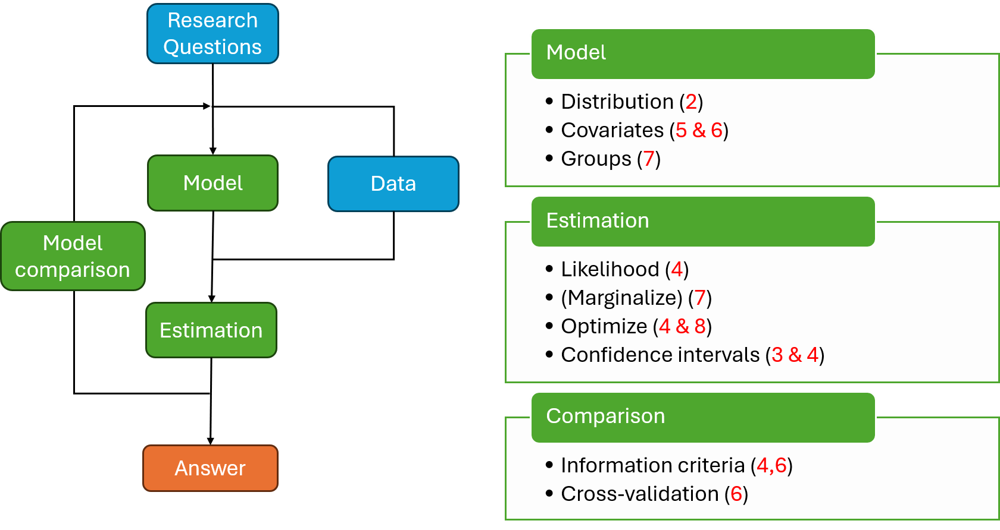
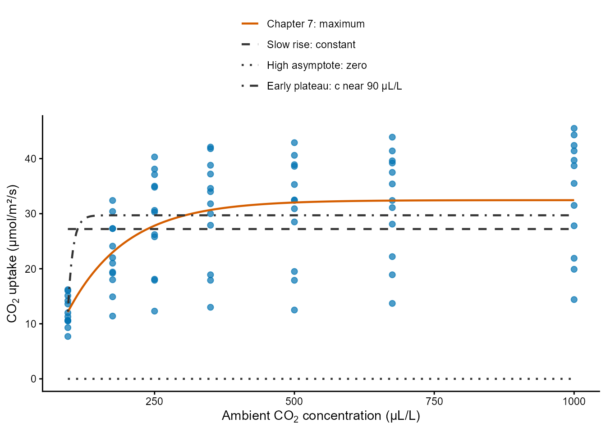
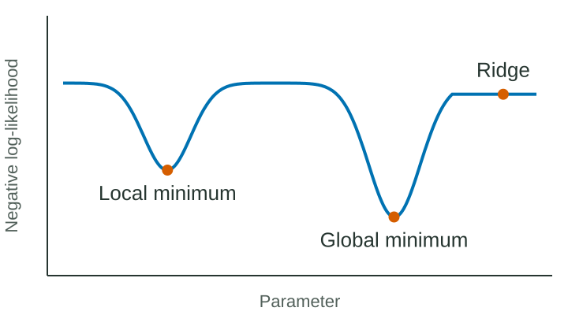
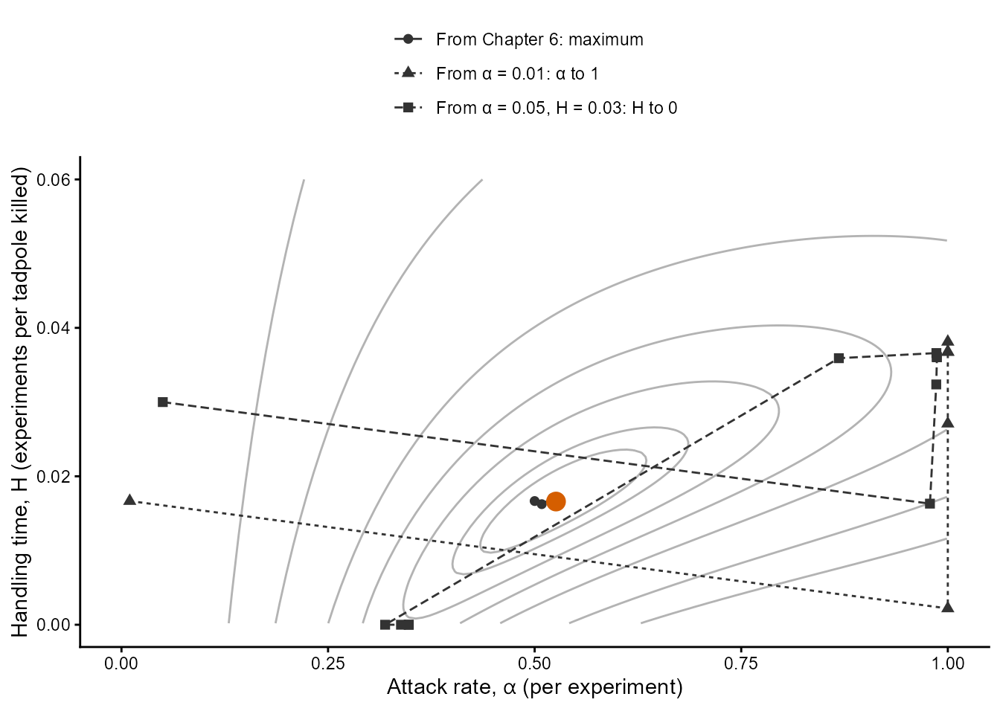
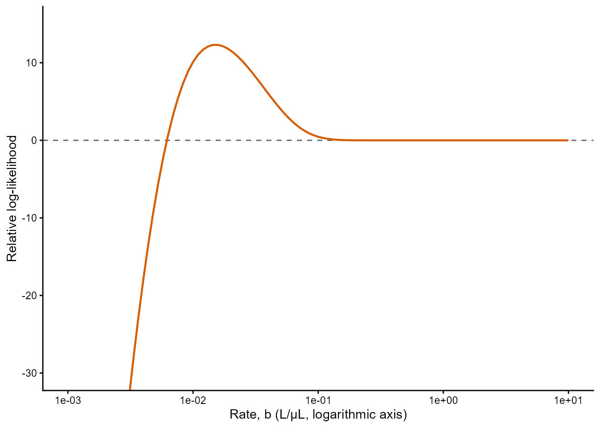

## Ecological Models and Data Analysis {.lecture-title data-timing="60"}

::: {.subtitle}
Chapter 8 · Lecture
:::

::: {.eyebrow}
Numerical Optimisation
:::

## Overview of the lecture {data-timing="120"}

::: {.incremental}
1. **The problem:** why can a fit stop in the wrong place?
2. **Diagnosis:** how do we know whether it did?
3. **Starting values:** what if the start matters?
4. **Identifiability and boundaries:** what if the data cannot decide?
5. **Scaling and parameterisation:** what makes a surface hard to search?
6. **Other optimisers and global search:** what if BFGS keeps failing?
7. **The practical:** what comes next?
:::

## Where we are: the modelling cycle {.diagram-slide data-timing="60"}

{fig-alt="The ecological modelling cycle. Research questions guide the choice of model and data; model and data lead to estimation and to an answer, and model comparison feeds back into the cycle. Three boxes list the tools of the course with their chapters: model (distribution 2, covariates 5 and 6, groups 7), estimation (likelihood 4, marginalise 7, optimise 4 and 8, confidence intervals 3 and 4) and comparison (information criteria 4 and 6, cross-validation 6)." .cycle-diagram}

::: {.caption}
Red numbers: chapters of the course. This lecture looks inside the estimation step: optimise
(4 and 8).
:::

## What an optimiser does {data-timing="180"}

::: {.definition}
**Optimiser:** a search for the parameter values $\boldsymbol\theta$ that minimise the
negative log-likelihood $-\ell(\boldsymbol\theta)$, starting from given values.
:::

::: {.incremental}
- **Local information only:** at each point it evaluates, the value of the NLL and its
  gradient; never the whole surface.
- **Step by step:** it moves from the starting values and stops by a rule.
- **It returns:** the estimates, the minimum of the NLL and a convergence code.
:::

::: {.example .fragment}
```{r}
#| echo: true
#| eval: false
fit = optim(par = obj$par, fn = obj$fn, gr = obj$gr, method = "BFGS")
```
:::

::: {.takeaway .fragment}
The maximum likelihood estimate is the global minimum of the NLL.
:::

## A fit that stops in the wrong place {.figure-slide data-timing="240"}

:::: {.columns}
::: {.column width="62%"}
{fig-alt="CO2 uptake of 12 plants against the concentration of CO2, from 95 to 1000 µL/L, as blue points that rise steeply and level off near 30 to 40 µmol/m²/s. Four curves: a solid vermillion curve through the data that rises and levels off (the maximum), a dashed grey horizontal line near 27 (constant curve), a dotted grey line at zero, and a dot-dashed grey curve that is nearly flat above 95 µL/L. A legend on top names the four fits."}
:::
::: {.column width="38%"}
::: {.incremental}
- **Convergence code 0:** the stopping rule was met.
- **The same model, other starts:** other end points.
- **Not every end point is the maximum.**
:::

::: {.example .fragment}
Complete-pooling CO₂ model, four starts: one maximum, a constant curve, a curve at zero and
a curve with $c$ just below 95 µL/L.
:::
:::
::::

::: {.caption}
Blue: measurements. Curves: end of the fit from Chapter 7's starting values (solid) and from
three other plausible starts, all with code 0.
:::

::: {.takeaway .fragment}
A code of zero is not the maximum.
:::

## Local minima, saddle points and ridges {.figure-slide data-timing="180"}

:::: {.columns}
::: {.column width="52%"}
{fig-alt="Schematic of the negative log-likelihood against one parameter, a blue curve without numerical scales. It has a shallower dip on the left marked local minimum, a deeper dip on the right marked global minimum, and a flat stretch at the far right marked ridge."}
:::
::: {.column width="48%"}
::: {.incremental}
- **Local minimum:** lower than all nearby points.
- **Global minimum:** lowest of all: the maximum likelihood estimate.
- **Saddle point:** gradient zero, but the NLL falls in some direction.
- **Ridge:** a direction along which the NLL hardly changes.
:::
:::
::::

::: {.example .fragment}
CO₂ stops: a ridge (rate towards infinity), an asymptote at zero, and a stop near $c=90$
µL/L with a negative curvature.
:::

## How a gradient method searches {.figure-slide data-timing="240"}

:::: {.columns}
::: {.column width="60%"}
{fig-alt="Contour plot of the relative log-likelihood of the reed frog model against the attack rate alpha, from 0 to 1, and the handling time H, from 0 to 0.06. The contours are ellipses tilted upwards around a vermillion circle at alpha 0.53 and H 0.017. Three dashed or dotted grey paths with points: one from alpha 0.5 and H 0.017 ends at the circle; one from alpha 0.01 ends at alpha 1 on the right edge; one from alpha 0.05 and H 0.03 ends at H 0 on the bottom edge."}
:::
::: {.column width="40%"}
::: {.incremental}
- **Downhill:** along the negative gradient, with a line search for the step.
- **Newton's method:** uses the curvature too; fast near a minimum.
- **BFGS:** builds the curvature from successive gradients; needs only `fn` and `gr`.
- **Consequence:** it ends where the slope leads.
:::
:::
::::

::: {.caption}
Reed frogs (Chapter 6): contours of the relative log-likelihood. Points: where BFGS evaluated
the gradient. Circle: the maximum.
:::

## Exact and approximate gradients {data-timing="180"}

::: {.incremental}
- **Finite difference:** the change in the NLL between two nearby values of a parameter,
  divided by their distance.
- **Without `gr`:** `optim()` uses two extra evaluations of the NLL per parameter, for every
  gradient.
- **The step:** too large, a poor slope; too small, rounding error.
- **RTMB:** an exact gradient up to rounding, at the cost of a few evaluations.
:::

::: {.example .fragment}
CO₂ fit from Chapter 7's start: 296.2565 without `gr`, 296.2557 with it; 339 calls to `fn`
against 104.
:::

::: {.takeaway .fragment}
The exact gradient helps; it does not cure a wrong stop.
:::

## Stopping rules and convergence codes {data-timing="180"}

::: {.definition}
**Stopping rule:** the condition that ends a search. BFGS in `optim()` stops when a step lowers
the NLL by less than `reltol` × (|NLL| + `reltol`), and then a step along the gradient does
not either.
:::

::: {.incremental}
- **Code 0:** the rule was met; the gradient is never tested.
- **Code 1:** the limit `maxit` of iterations was reached.
- **Relative:** the tolerance scales with the size of the NLL.
:::

::: {.example .fragment}
CO₂ NLL near 300: a step must lower it by more than about $4.4\times10^{-6}$. Adelie body
masses in grams (practical): a stop after one step.
:::

::: {.takeaway .fragment}
Code 0: the search stopped making progress.
:::

## Diagnosing a fit {.figure-slide data-timing="240"}

:::: {.columns}
::: {.column width="52%"}
::: {.incremental}
1. **Estimates:** sensible values in their units?
2. **Gradient:** close to zero? Also small on a ridge.
3. **`sdreport()`:** is `pdHess` `TRUE`? Standard errors?
4. **A refit:** from the solution and from other starts.
5. **A slice:** along a suspicious parameter.
:::

::: {.example .fragment}
Constant-curve stop: gradient $5\times10^{-6}$, but `pdHess` is `FALSE` and the standard
errors are `NaN`.
:::
:::
::: {.column width="48%"}
{fig-alt="Relative log-likelihood of the complete-pooling CO2 model against the rate, from 0.001 to 10 L/µL on a logarithmic axis. A vermillion curve rises steeply from low values at the left to about 12 near 0.015, falls slightly, and is flat at zero for rates above about 0.2. A dashed horizontal line marks zero."}
:::
::::

::: {.caption}
Slice along the rate through the end of the fit from the slow rise: flat on the plateau where
the fit stopped.
:::

## Practice 1: three fits of a parasitoid {data-timing="180"}

::: {.activity}
**3 minutes:** with a neighbour.

Three BFGS fits of $ax/(b+x)$ with a Poisson model, from three starts:

| Fit | Code | NLL | $a$ | $b$ | `pdHess` | Largest gradient |
|---|---:|---:|---:|---:|---|---:|
| A | 0 | 154.82 | 41.3 | 18.6 | `TRUE` | 0.0004 |
| B | 1 | 154.85 | 39.8 | 17.4 | `TRUE` | 0.21 |
| C | 0 | 171.40 | $6.2\times10^{8}$ | $2.9\times10^{8}$ | `FALSE` | 0.000003 |

Which fits found the maximum? What would you check next?
:::

## Discussion: has this fit found the maximum? {data-timing="240"}

Three fits of a model with a rate and an asymptote, all with code 0:

::: {.incremental}
1. NLL 296.3; gradient 0.003; `pdHess` `TRUE`; sensible estimates.
2. NLL 318.7; gradient $5\times10^{-6}$; `pdHess` `FALSE`; rate $5\times10^{11}$.
3. NLL 302.3; gradient 0.02; `pdHess` `FALSE`; one negative curvature.
:::

::: {.takeaway}
Estimates · Gradient · Hessian · Refit · Slice
:::

::: {.activity}
**4 minutes:** which fit would you report, and which check decides each case?
:::


## The Hessian at the end of a search {data-timing="180"}

::: {.definition}
**Hessian:** the matrix $\mathbf H(\boldsymbol\theta)$ of second derivatives of the NLL: its
curvature in every direction.
:::

::: {.incremental}
- **Positive definite:** every curvature positive; a minimum, and standard errors exist.
- **A zero curvature:** a flat direction (a ridge); no inverse, standard errors `NaN`.
- **A negative curvature:** the NLL falls in some direction; not a minimum.
:::

::: {.example .fragment}
Stop with $c$ at 90.3 µL/L: gradient small, a refit stays, but one curvature is negative
(location and rate together). A slice along $c$ alone shows a minimum.
:::

::: {.takeaway .fragment}
The Hessian looks in every direction at once; a slice looks along one.
:::

## Multiple starting values {data-timing="240"}

::: {.incremental}
1. **A box:** plausible values of each parameter, in units, on the optimised scale.
2. **Random starts:** draw within the box and fit from each.
3. **Keep the lowest NLL;** count how many fits reach it and compare their estimates.
4. **Restart BFGS** from the best fit and diagnose it.
:::

::: {.example .fragment}
50 starts, CO₂ model: 17 at 296.3, 17 at 318.7, 14 at 402.8, 1 at the iteration limit, 1
far away.
:::

::: {.takeaway .fragment}
Agreement of many starts is evidence, not proof, of the global minimum.
:::

## Starting values in a model with random effects {data-timing="180"}

::: {.incremental}
- **The same failures:** ridges and early plateaus remain in the fixed effects.
- **A joint NLL:** the random effects are integrated out inside every evaluation.
- **Inner optimisation:** Newton's method for the random effects, with exact second
  derivatives from RTMB.
- **Slower fits:** multiple starts cost more.
:::

::: {.example .fragment}
CO₂ with a random asymptote: 207.61 from Chapter 7's start; 307.72 (rate to infinity) and
261.17 ($c$ at 91.6 µL/L) from poor starts, both code 0.
:::

## Structural and practical non-identifiability {data-timing="240"}

::: {.definition}
**Identifiable:** different values of the parameter give different distributions of the
data, so the likelihood can tell them apart.
:::

::: {.incremental}
- **Structural:** the model contains parameters only in a combination; the NLL is exactly flat
  along a ridge.
- **Practical:** the model could tell them apart, but the data cannot: no observations where the
  curve responds.
- **Symptoms:** estimates that depend on the start, huge standard errors, correlations near
  $\pm1$, a flat likelihood profile.
- **Remedies:** remove or fix a parameter, change the design, or report it as not determined.
:::

::: {.example .fragment}
Common asymptote plus a deviation per plant: 13 parameters for 12 asymptotes. Only 250
µL/L and above: $c$ stays at its start, standard error 579 µL/L.
:::

## Estimates at a boundary {data-timing="240"}

::: {.incremental}
- **A boundary:** the edge of the allowed range (probability 0 or 1, a variance of zero).
- **On the optimised scale** (log, logit) the edge lies at $\pm\infty$: the search walks towards
  it and stops where the slope is tiny.
- **Report it** as "at the boundary", or change the model.
- **Bounds:** `L-BFGS-B` and `nlminb()` accept them; the course keeps transformations.
:::

::: {.example .fragment}
Reed frogs: from two other starts, $\alpha\to1$ (NLL 59.77) and $H\to0$ (52.22), code 0,
against 46.72 at the maximum.
:::

::: {.takeaway .fragment}
A parameter running to $\pm\infty$ is a result, not a number.
:::

## Practice 2: identifiability of seed predation {data-timing="180"}

::: {.activity}
**3 minutes:** on paper. See the callout in the chapter.

Rodents are offered trays with 5 to 40 seeds. Two models for the expected number removed:
$\lambda=a\,p\,x$, and $\lambda=ax/(b+x)$ with $b$ near 500 seeds per tray.

For each model: which parameters can the data determine, which symptoms would a fit show, and
what would you change?
:::

## Scaling {data-timing="180"}

::: {.definition}
**Scaling:** parameters of very different magnitudes make one step size wrong for some of them.
:::

::: {.incremental}
- **Transformations:** the logarithm puts a rate of 0.01 and an asymptote of 30 on comparable
  scales.
- **Units of the data:** a change of units changes the size of the NLL and of the
  parameters.
- **`parscale`:** tells `optim()` the typical size of each parameter; the course prefers
  transformations.
:::

::: {.example .fragment}
CO₂ with the rate on its original scale: a stop at 318.68 (code 0); with `parscale`, or with
the log rate, 296.26.
:::

## Parameterisation {data-timing="180"}

::: {.definition}
**Parameterisation:** the same model written with other parameters has a surface of another
shape, round or a narrow tilted valley, and estimates with other correlations.
:::

::: {.incremental}
- **A narrow tilted valley** is harder to search.
- **Correlation of the estimates** shows the tilt.
- **Write distributions with their mean** where possible.
:::

::: {.example .fragment}
Owls: $\mu,k$ gives a correlation of about 0, $k,p$ of 0.71, and BFGS reaches the same NLL
from both. Adelie masses, Gamma (practical): 0.996, and BFGS stops after one step.
:::

## Practice 3: scaling a growth curve {data-timing="180"}

::: {.activity}
**3 minutes:** R as a calculator. See the callout in the chapter.

Fish length (mm) against age $x$ in days: $a\left(1-e^{-b(x-c)}\right)$, with starting values
$a=600$ mm, $b=0.0005$/day, $c=-100$ days and a standard deviation of 20 mm.

1. Calculate the starting values on the optimised scale.
2. Which parameter is poorly scaled, and which change of units helps?
:::


## Live demo: diagnosing a failed fit {.demo-slide data-timing="1080"}

::: {.incremental}
1. **A poor start:** code 0, the estimates and the curve.
2. **Diagnosis:** the gradient, `sdreport()` and a slice.
3. **Multiple random starts:** the table of where the fits ended.
4. **Refine and confirm:** BFGS from the best, `pdHess`, a likelihood profile.
5. **The fitted curve** over the data.
:::

::: {.demo}
**Script:** `demo-diagnosis.R`, sections 1 to 5 (section 0 during the break): the CO₂ uptake
of 12 plants; no comparison of optimisers.
:::

## Other local optimisers {data-timing="240"}

::: {.incremental}
- **`nlminb()`:** the PORT routines; uses `fn` and `gr`; controls its steps with a trust
  region; glmmTMB's default.
- **Nelder–Mead:** no gradient; a simplex of $p+1$ points reflected, expanded and contracted;
  many evaluations and a less precise stop.
- **Same object:** every optimiser takes `obj$fn` and `obj$gr` of the same `MakeADFun()`.
:::

::: {.example .fragment}
50 starts, CO₂ model, in this example: 17 fits of BFGS, 42 of `nlminb()` and 12 of Nelder–Mead
end within 0.01 of the minimum.
:::

## One parameter: a search within an interval {data-timing="120"}

::: {.incremental}
- **`optimize()`:** golden-section search and parabolic interpolation within an interval.
- **No gradient, no start;** only the interval, on the optimised scale.
- **Why not Nelder–Mead:** it is unreliable in one dimension.
:::

::: {.example .fragment}
Fir seedlings: $\log(\lambda)$ in $(-3,3)$ gives 2.14 seedlings per quadrat, the sample mean.
:::

## Comparing optimisers fairly {data-timing="180"}

::: {.incremental}
- **The same NLL** and the same starting values.
- **The final NLL,** not only the estimates.
- **Evaluations** counted for `fn` and `gr`.
- **One example** is not a ranking.
:::

::: {.takeaway .fragment}
Compare what each optimiser reaches, not how it is described.
:::

## Global search: differential evolution {data-timing="300"}

::: {.incremental}
- **Population:** parameter vectors drawn at random within a box.
- **Mutation:** a scaled difference of two members added to a third.
- **Crossover:** mix the mutant with the current member.
- **Selection:** keep the challenger only if its NLL is lower.
- **Cost:** a box, thousands of evaluations and a seed; it proves nothing.
:::

::: {.example .fragment}
`DEoptim::DEoptim()` on the CO₂ NLL: population 40, 200 generations, 8,040 evaluations.
:::

## Global search, then local refinement {data-timing="300"}

::: {.incremental}
- **Global:** finds the region of the minimum without starting values.
- **Local:** BFGS from the best member is precise near the minimum.
- **Then diagnose:** `sdreport()`, as for every fit.
- **With random effects:** expensive; multiple starts are usually cheaper.
:::

::: {.example .fragment}
```{r}
#| echo: true
#| eval: false
de = DEoptim::DEoptim(fn = obj$fn, lower = lo, upper = hi, control = ctrl)
fit = optim(par = de$optim$bestmem, fn = obj$fn, gr = obj$gr, method = "BFGS")
```
:::

::: {.takeaway .fragment}
Global search, then BFGS, then diagnosis.
:::

## Discussion: which remedy for which symptom? {data-timing="240"}

::: {.incremental}
1. A parameter of 10⁻²⁵⁰ on the original scale, standard errors `NaN`.
2. Different NLLs from different starts, all with code 0.
3. A rate of 0.003 and an asymptote of 3,000, and an early stop.
4. A standard error of 579 for a parameter measured in tens.
5. BFGS keeps stopping at wrong places after every remedy so far.
:::

::: {.takeaway}
Boundary or ridge · Multiple starts · Scaling · Identifiability · Another optimiser
:::

::: {.activity}
**4 minutes:** match each symptom with a remedy.
:::

## A recipe for a difficult fit {data-timing="180"}

:::: {.columns}
::: {.column width="50%"}
::: {.incremental}
1. **NLL:** an ordinary number and gradient at the start.
2. **Fit:** BFGS with the gradient of RTMB.
3. **Diagnose:** estimates, gradient, Hessian, refit, slice.
4. **Multiple starts** if in doubt.
:::
:::
::: {.column width="50%"}
::: {.incremental}
5. **Ridge or boundary:** identifiable? Change or report.
6. **Rescale or reparameterise.**
7. **Another optimiser,** then global search and BFGS.
8. **Report** the starts and the failures.
:::
:::
::::

## The Chapter 8 R practical {data-timing="120"}

::: {.incremental}
- **Growth of loblolly pines** (Exercise 1, worked): a fit that stops at a curve of zero.
- **Body mass of Adelie penguins** (Exercise 2): a Gamma fit that stops after one step.
- **A variance among sites at zero** (Exercise 3): REML fits of a simulation.
:::

::: {.takeaway .fragment}
Symptom · Diagnosis · Remedy · Confirmation. Try, then check.
:::

## Summary and closing questions {.closing data-timing="300"}

::: {.incremental}
- An optimiser searches locally and ends where the slope leads.
- Code 0 says that the stopping rule was met, not that the maximum was found.
- Diagnose: estimates, gradient, `sdreport()`, a refit and a slice.
- Multiple starts show which minima a model has; agreement is evidence, not proof.
- Non-identifiable parameters and boundaries are reported, not fitted away.
- Scaling and parameterisation shape the search; `nlminb()`, Nelder–Mead and differential
  evolution are the next tools.
:::

::: {.takeaway .fragment}
Local · Code 0 · Diagnose · Starts · Identifiable · Boundary · Scale · Global then local
:::

::: {.activity .fragment}
**Closing questions**

1. What would you report about a fit for which 3 of 40 random starts reach the lowest NLL?
2. Which check of a fit would you never skip, and why?
:::
